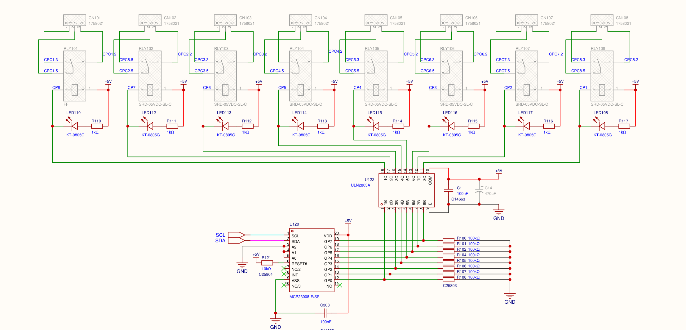
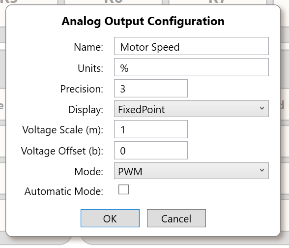

# Actuators and Loads

> **Engineering application guide, review required.** A SigCore command is a control instruction, not confirmation that the attached machine moved. This chapter distinguishes the relay **contact circuit**, analog **signal output**, and the independently powered **load**. Verify ratings, field wiring and protective circuits for the actual installation. The examples are interface patterns, **not** certified designs.

## 1. Choose the correct output

Rev B has **eight SPDT relay outputs (R1–R8)** and **four analog outputs (AO1–AO4)**. A relay can switch an independent field circuit within its *verified load-dependent* rating. An AO supplies a **0–5 V or PWM control signal**, not substantial actuator power.

| Controlled equipment | Appropriate interface pattern | Required external function |
|---|---|---|
| Pilot lamp or suitably rated discrete load | Relay contacts | External load supply, proper circuit protection and verified contact rating |
| Pump/motor contactor enable | Relay contacts into compatible contactor/control circuit | Contactor power stage, overload protection, independent shutdown and feedback |
| Solenoid or inductive valve | Relay contact into a **rated** external driver/circuit | Coil supply and suppression suited to DC/AC and relay/contact protection |
| Variable-frequency drive speed command | AO voltage **only if** drive accepts 0–5 V; otherwise conditioner | Drive's own power and motor protection; compatible signal common |
| PWM-capable heater/LED driver | AO PWM into a compatible control input | External semiconductor/power stage, separate power supply and load-specific protection |
| Proportional valve accepting 4–20 mA | Not directly from a nominal 0–5 V AO | Qualified voltage-to-current transmitter/driver |
| 12 V heater or motor | **Never drive directly from AO** | Appropriately rated external power supply and switching/amplification stage |

Do not infer a relay contact rating for high inrush, capacitive, inductive or DC loads from an AC resistive headline rating. The product reference cites **120 VAC / 10 A** for relay contacts but does not establish every utilization category, DC breaking capacity, temperature derating or field-terminal approval. Obtain the as-built rated specification before selecting a real load.

## 2. Relay contact logic is not relay command logic

The actual contact transfer is:

| Relay **coil** condition | COM–NO | COM–NC |
|---|---|---|
| Released / de-energized | Open | Closed |
| Energized | Closed | Open |

The hardware driver receives a polarity-mapped command. The Core exposes a **logical** ON/OFF value, and `invertedLogic` changes how that value maps to coil drive. Therefore a reported logical ON does not universally mean that COM and NO are closed. Always verify the active physical mapping for the deployed release and wiring. An **inversion-change bug** has been identified in the supplied snapshot: modifying `invertedLogic` may not immediately reapply the current output to hardware. The user has separately prioritized fixing it; do not assert the deployed version contains that fix without verification.



*Figure 1. Actual Rev B relay-driver circuit excerpt. Identify COM/NO/NC by the device's labeled field terminals, not by interpreting schematic sheet coordinates as a user pinout.*

A relay switch does not supply the load's electricity. The **load supply, wiring, fusing, return and protection are part of the external circuit**. Choose NO versus NC according to what happens when the coil is released, and consider what happens when **the entire controller loses power**, not only when software sends OFF.

The configurable `failSafeState` field is present, but the reviewed Core snapshot has **not** demonstrated code applying it in a fault path. A configured value is not an independently validated emergency-state guarantee. A software command or API `accepted:true` response does not sense coil current, mechanical contact position or load current.

## 3. Relay-actuated device with independent feedback

A general supervisory pattern:

```text
SigCore relay contact -> rated external control circuit -> actuator
                                                        |
                                                        v
Separate limit/auxiliary contact or sensor -> DI / AI -> Core/operator
```

For example, when using a relay to command a contactor, wire the appropriate **auxiliary contact** into a suitably conditioned DI if actual engagement must be distinguished from a successful command. Compare requested and observed states with an explicit settling timeout. A mismatch is evidence of a fault to investigate, not proof of which component has failed.

**Do not claim** that SigCore provides contact welding detection, arc suppression, motor overload protection, E-Stop or a safety-rated feedback loop unless independently verified for the installation. The external controller/safety circuit must place hazardous equipment into its defined safe condition even if SigCore crashes, reboots, loses network access or has a stuck output.

## 4. Analog output mode and scaling

Rev B's MCP4728 DAC produces a software-commanded voltage path; a PCA9685 produces PWM. Per-channel analog switching selects the path. The Core clips the electrical command to **0–5 V** in voltage mode and **0–100% duty** in PWM mode. These are *software conversion bounds*, not a measured terminal tolerance, output-current capability or drive-current specification.



*Figure 2. Configure voltage versus PWM and scaling for the signal expected by the receiving equipment.*

**Scaling is unresolved in the supplied snapshot.** The customer Control Panel Reference expresses `displayed = m × physical_voltage + b` while `A_OUT.SetAnalogValue` implements `physical = m × requested_value + b`. For any application with non-default `m`/`b`, confirm the command-to-voltage relation experimentally before connecting the actuator; the two conventions can create dramatically different outputs. `voltM=0` also requires source review because inverse readback divides by that value.

**Configuration changes are not harmless.** `A_OUT.SetConfig`/`SetMode` in the reviewed source can reset a channel's output to **zero**. Do not save an AO's name, mode or calibration during an active process without accounting for the electrical transition. Automatic PID operation may subsequently re-command that channel. The Core also does not universally reject direct AO writes while `auto` is set, so output ownership must be coordinated.

## 5. PWM load interface example

**Conceptual setup only:** AO1 configured as PWM -> compatible transistor/isolated gate-driver input -> separate **12 V** supply and heater. The transistor/power stage must be specified for the heater's current, temperature, switching frequency, and failure mode. The AO signal **must not** be wired directly across the heater. A temperature transmitter may return a conditioned AI value for PID supervision.

Before connecting: establish signal ground/driver isolation, control input thresholds, gate resistance/bias and default-off behavior. The receiving driver must be verified to interpret the SigCore PWM frequency and duty correctly; no specific universal operating PWM frequency or voltage tolerance is guaranteed by the example. PWM average voltage on a meter does not establish duty-cycle waveform fidelity.

For a heater, use an **independent overtemperature limit/cutout** and an appropriate power disconnect. For inductive loads, choose suppression based on the particular actuator; do not recommend a universal flyback diode across AC or mains circuits. For valves/motors, verify mechanical end stops, back-EMF/inrush, safe restart and fail-to-state requirements.

## 6. Manual control versus Core PID

A typical closed-loop architecture is **AI measurement -> PID -> AO control signal -> external power stage/actuator**. The source exposes four PID controllers and selectable AI/AO routes. `isEnabled` and `autoMode` are separate settings; both affect whether PID computation commands an output. The source does not demonstrate exclusive protection against **two active PIDs sharing one AO**, nor does it implement a universal block against manual/API writing of an automatically controlled AO.

Establish **one owner per writable output**. Test it manually against a safe dummy load before enabling PID. Configure realistic limits in *both the control algorithm and the external device*. Treat configured output limits as software controls, not functional safety guarantees. See [PID Control](../Core-Software/PID-Control.md) and [Control Applications](Control-Applications.md).

## 7. Commissioning and fault checks

1. **Draw the electrical boundary.** Record which supply actually powers the load and which SigCore terminal delivers only a signal or dry contact.
2. **Verify safe electrical defaults.** With process load isolated, check relay COM/NO/NC continuity and AO level/waveform at startup, power loss, Core restart and a commanded state change.
3. **Exercise every intended state.** Measure at the receiving device using a qualified instrument, including both inversion settings if applicable.
4. **Inspect the actuator's feedback independently.** Do not use a software command echo as proof the load is active.
5. **Test communication and sensor faults.** Determine what happens to the actuator if Core, WebBridge, the network, the Pi or the external field supply stops.
6. **Maintain a channel ownership record.** Identify whether the operator, PID, script or supervisory system is authorized to write each channel and how control is handed off.

## 8. Source evidence and review gates

Published source: `project/sources/documentation/hardware-reference.html` (*Switch a device with a relay*, *Send an analog output*), `control-panel-reference.html` (*Relay outputs*, *Analog outputs*). Implementation: `libs/SigCoreCommon/RELAY_OUT.cs`, `A_OUT.cs`, `Mcp4728Driver.cs`, `PCA9685.cs`, `PID_LOOP.cs`, `HardwareManager.cs`, `Payloads/RelayConfigPayload.cs`, `Payloads/AOutConfigPayload.cs` and `WebBridge/Endpoints/RelayEndpoints.cs`, `AnalogOutputEndpoints.cs`. Hardware: Rev B schematic sheet 2 and [Relay Outputs](../Hardware/Relay-Outputs.md), [Analog Outputs](../Hardware/Analog-Outputs.md).

**Before customer approval:** confirm actual field-contact/load ratings, allowable AO output current/impedance, PWM frequency constraints, polarity fix status, `failSafeState` behavior, AO scaling convention and zero-on-config behavior. The application examples are illustrative integrations, not deployment-specific wiring or safety approval.
