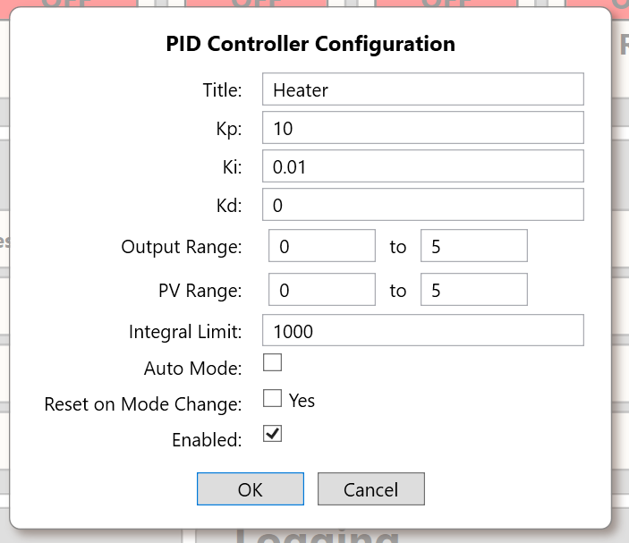

# Control Applications

> **Engineering application guide, not a safety design.** SigCore UC can participate in measurement, feedback and supervisory control, but a configured channel, command or PID loop does not establish the safety of the connected process. Determine independent protective functions and failure responses before commissioning. The user retains responsibility for validated process-specific logic and hardware interlocks.

## 1. Control responsibilities and boundaries

The Rev B hardware provides **four AI**, **eight DI**, **four AO**, **eight relays**, and **four software PID** controllers. Control resides in **Core**, not in the web browser: WebBridge and the Windows Control Panel act as clients. The website and applications may supervise Core by reading values and changing setpoints/configurations, but browser refresh intervals must not be mistaken for the inner-loop execution rate.

| Layer | Role | Not provided by that role alone |
|---|---|---|
| AI / DI | Observe physical sensor signals and logical statuses | Certified process validity, independent safety confirmation |
| PID in Core | Calculate automatic AO command from selected AI process variable | Safety-rated limiting, unique AO arbitration, guaranteed fault-safe output |
| AO / relay | Generate analog/PWM control signal or switch external contacts | Power amplification for arbitrary loads; contact/actuator feedback |
| WebBridge / Control Panel | Operator view, configuration and supervisory commands | Deterministic real-time interlock or process-state machine guarantee |
| External instrumentation/interlocks | Independent limits, stops, overload/overtemperature protection | Must be selected and validated for the process |

**An operator UI displayed state is not independent physical feedback.** Use separate field sensors when actual load operation or mechanism position matters. See [Actuators and Loads](Actuators-and-Loads.md) and [Operating Modes and Safety](../Core-Software/Operating-Modes-and-Safety.md).

## 2. Closed-loop PID design

A typical one-loop design is:

```text
Process -> compatible measurement transmitter -> AI (PV) -> Core PID
                    ^                             |
                    |                             v
                    +----- physical actuator <- external driver <- AO
```

PID1–PID4 have configurable `pvSource` and `outputDestination` (both **0–3**). `isEnabled` and `autoMode` are separate controls; enabling the loop alone does not guarantee the destination AO is in automatic mode. The configured AO can operate in voltage or PWM mode and applies its **own** scaling to the PID's engineering-unit output.

### Preparation sequence

1. **Define the physical process:** PV units, measurement span, maximum safe temperature/pressure/travel, actuator fail-to-state and allowable response time.
2. **Condition and calibrate AI:** check transmitter at multiple known stimuli. Confirm the latest range/current conversion implementation against installed software.
3. **Verify AO signal and power-stage response in manual mode** at a safe test setup, including actuator direction. Do not enable a PID until the sign of process feedback is understood.
4. **Allocate one output owner.** The reviewed source does not prevent two PIDs from commanding the same AO; manual/API writes are not universally blocked when AO auto is enabled.
5. **Set meaningful output bounds**, PV context, setpoint and tolerance; do not claim configured software bounds are a safety cutoff. Carefully reconcile the unresolved AO scaling convention for any non-default coefficients.
6. **Use conservative gains and observe behavior** before increasing controller authority. Record output, PV, error, P/I/D terms, saturation and the actual process response.
7. **Validate mode transfers and faults** with independent means of stopping the actuator. The supplied `resetOnModeChange` setting is stored, but its promised effect was not verified; bumpless transfer cannot be assumed.



*Figure 1. The supplied Control Panel exposes PID settings; the displayed numbers are not recommended tuning for a particular plant.*

### Software algorithm characteristics

The reviewed PID implementation calculates error `SP − PV`, proportional action `Kp × error`, derivative **on error** and an integrated term using elapsed `dt`. It conditionally limits integration and clamps output if valid bounds are configured. **Setpoint steps can cause derivative kick**; computed saturation is not proof that a physical actuator has reached a limit. The code attempts to clamp PV, but the runtime setter is a no-op in the supplied source, so **effective PV clipping is not demonstrated**. See [PID Control](../Core-Software/PID-Control.md) for exact mathematics and monitor fields.

## 3. Sequence / discrete control

A relay may command a contactor or valve interface while DIs report limit switches, pressure-switch states and other permits. The supplied Core exposes individual I/O and PID resources, but it does **not** establish a general-purpose user-programmable safety PLC/ladder system or an out-of-the-box equipment sequencing engine. An external supervisor or application-specific program may implement a **state machine**.

A conceptual state pattern for a valve command:

| Application state | Required observations | Action / timeout behavior |
|---|---|---|
| `Idle` | System available; independent protections intact | Hold external circuit in the defined safe state |
| `RequestOpen` | Valid operator/supervisor request and qualified permissives | Command relay with intended polarity; start application timeout |
| `WaitingForFeedback` | Separate limit/position DI must change appropriately | If timeout expires, flag fault and apply *validated* stop procedure |
| `OpenConfirmed` | Continuous qualified position feedback | Allow only actions appropriate to known open valve |
| `Fault` | Contradiction, missing permit, stale status or actuator timeout | Stop/limit according to external engineered safety design |

This is an **example of external application logic**, not a claim that Core implements those named states. Feedback cannot be inferred from `RelayChanged`; that event reports Core logical command state. A network command cannot be used as the sole emergency stop.

## 4. Command ownership and multi-client coordination

The Windows Control Panel, browser and custom `.NET`/Python applications may all address the **same hardware**. A successful transport write does not create a lock on the output. Without a verified release-specific ownership/arbitration mechanism, multiple writers can issue contradictory commands or a PID can overwrite manual AO commands.

Implement an explicit application policy: which actor owns an AO/relay at each stage, permitted supervisory adjustments, how to transfer ownership, and what to do when that actor disappears. Record commands and observable state separately. Read back Core state after configuration and use an **external sensor** if physical confirmation is necessary.

If the controlling network link fails, distinguish the state of **Core running on device**, **WebBridge connection**, **operator browser**, **external controller** and **field actuator**. A website outage does not by itself stop Core's PID computation; a Core/Pi fault can have very different effects. Identify and test all relevant failure modes rather than assuming they collapse to a single safe state.

## 5. Supervisory setpoint control

The supported WebBridge/PHP route for an operator-approved setpoint write is:

```text
POST /api/control.php?operation=pid&channel=0&action=setpoint
Content-Type: application/json

{"value":10.0}
```

This is **not** a universally safe setpoint. `channel=0` means PID1, and the units come from the *configured process*. The bridge's response `accepted:true, confirmed:false` indicates accepted transmission, not proof that the new setpoint was applied, the control loop is healthy or the process reached target. Read back PID state and validate the physical response separately. Use the API only on an approved network with appropriate authorization and limits.

The native `SigCoreSystem` methods include `SetPIDSPAsync`, `SetPIDAutoAsync`, `ResetPIDAsync`, `GetPIDCurValAsync`, and configuration access. For command syntax and transport caveats see [HTTP API and WebBridge](../Programming/HTTP-API-and-WebBridge.md) and [.NET API](../Programming/DotNet-API.md).

## 6. Fault-response design checklist

- **Sensor low/high/out of range:** Is the analog signal physically valid, or merely clipped/calibrated? Is there a separate hardwired high-limit sensor?
- **Stale reading:** When Core disconnects or acquisition stalls, does the supervisor mark the reading invalid rather than reuse the last display value?
- **Lost network:** Which logic still executes locally, and which functions depend on the browser or remote computer?
- **Power loss / restart:** What do relay contacts and external drivers do before software completes boot?
- **AO mode/config change:** The reviewed `A_OUT` code can reset the output to zero; does the plant tolerate that?
- **Incorrect inversion:** Is actual relay coil/contact behavior independently verified after changes? The snapshot's inversion-change issue remains a tracked bug until verified fixed.
- **Multiple PID/write authority:** Can two controllers select the same AO or an operator write while automatic control is running?
- **Safety cutoff:** Can the process be stopped by appropriately rated hardware independent of the Pi, Core, network and database?

## 7. Engineering evidence and publication gates

Source: `libs/SigCoreCommon/PID_LOOP.cs`, `PidLoopModel.cs`, `A_OUT.cs`, `RELAY_OUT.cs`, `HardwareManager.cs`, `SigCoreSystem.cs`; `WebBridge/Endpoints/PIDEndpoints.cs`, `AnalogOutputEndpoints.cs`, `RelayEndpoints.cs`; `control-panel-reference.html`. Cross-references: [PID Control](../Core-Software/PID-Control.md), [Calibration and Scaling](../Core-Software/Calibration-and-Scaling.md), [Processes and Lifecycle](../Core-Software/Processes-and-Lifecycle.md), [Worked Designs](Worked-Designs.md).

**Review prior to customer release:** PID routing bounds and arbitration; PV clamp; mode transitions; output scaling/reset; relay inversion and fail-safe behavior; any claimed industrial safety limits or actuator-specific response times. Do not describe an example sequence as a shipped SigCore programming feature.
