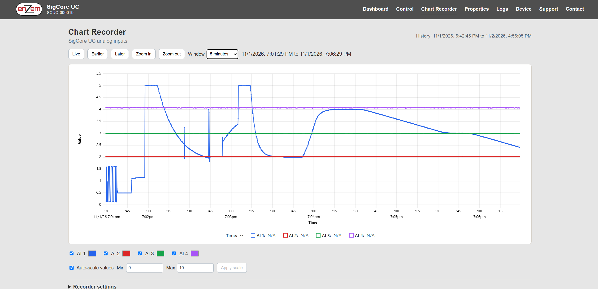

# Data Acquisition and Monitoring

> **Engineering draft.** A SigCore UC measurement can be a raw ADC conversion, a processed Core reading, a cached client value, a resampled Chart Recorder point or an SQL snapshot. These are **not equivalent observations**. Preserve their provenance, update time, units and retention when reporting or exporting data.

## 1. Measurement and monitoring paths

Four AI channels and eight DI channels can be observed through several paths. Relays, analog outputs and PID statuses are additional **software/control-state observations**, not independent sensors of physical contact position or actual load power.

| Question | Suitable data path | Main limitation |
|---|---|---|
| "What does Core currently report?" | `.NET` `SigCoreSystem` calls or subscriptions | Acquisition freshness depends on Core scan and connectivity |
| "What is the device website displaying?" | `/api/state.php` through PHP/WebBridge | Cached state can be stale after Core disconnect |
| "Is Core reachable and reporting status now?" | `/api/status.php` (fresh Core request) | Does not prove each field sensor or actuator is healthy |
| "Show the recent analog trend" | Chart Recorder, `/api/chart-history.php` | WebBridge RAM only; display resampling, not lossless raw samples |
| "Retain measurements for longer analysis" | Configured external MySQL logger | Requires enabled/configured logger and verified schema/deployment |
| "Explain warnings and process failures" | Application/event logs and status | Diagnostic events are not uniformly time-synchronized raw data |

The source snapshot implements a MySQL logger within Core; later project work describes a **separate logger process**. Confirm which architecture is deployed before describing logger ownership or service restart procedures.

## 2. Effective acquisition rate and bandwidth

The ADS1115 services AI1–AI4 sequentially through external TMUX1209 multiplexers. In the reviewed source, global nominal ADC settings are **Low 8 SPS**, **Medium 32 SPS**, **High 475 SPS**. Each channel change incurs conversion waits and a discarded result; configured averaging adds more conversions. Consequently:

- `475 SPS` means a **configured converter rate**, **not** 475 fresh measurements per second for each AI.
- The old source performs a sequential per-channel scan, and a later moving-buffer averaging change is known to be under active development. The installed release must be examined before prescribing precise scan-rate arithmetic.
- DI inputs have their own polling/debounce path; their transition times are not equivalent to the analog sampling cadence.
- PID uses its own approximate cadence (reviewed loop requests 100 ms delay), distinct from the measurement loop and logging timer.
- Browser refresh and chart recording **do not make the ADC sample faster**.

For a fast-changing sensor, establish the *actual effective per-channel* interval using timestamps and a known varying input on the deployed version. Do not reconstruct high-frequency waveform content from a 1-second chart. If detecting transient pulses or peaks is essential, evaluate whether dedicated acquisition/counter hardware is needed.

## 3. A reading's identity and timestamps

Recommended measurement record schema **for external exports**, not a claim of an existing built-in SigCore schema:

| Field | Meaning |
|---|---|
| `device_serial`, `hardware_revision`, `software_version` | Provenance for the particular instrument and implementation |
| `channel` / `channel_index` | Human `AI1`–`AI4` and machine `0..3` mapping |
| `received_at_utc` | When the *external client* observed data; not necessarily ADC conversion time |
| `source_time_utc` | Use only when the supplying API/logger actually provides a source timestamp |
| `value`, `units` | Calibrated engineering-unit reading and explicitly recorded units |
| `measurement_mode`, `calibration_revision` | Processing context if known |
| `quality`, `connection_state` | Client-provided validity and stale-data policy |
| `sampling_or_resampling` | Raw-ish Core reading, SQL snapshot, interpolated chart point, etc. |

The bridge cache and client receive time cannot recover an absent hardware ADC timestamp. A network disconnect can leave a plausible-looking but obsolete number on a screen. Always propagate **stale/unknown** rather than silently reusing old values for control decisions.

## 4. Chart Recorder: volatile trend, not permanent log



*Figure 1. Screenshot from the supplied source archive. The plotted curves are example device readings, not guaranteed channel accuracy or a permanent data record.*

The recorder lives in **WebBridge memory**, periodically capturing the latest four cached AI values with **1-second default interval**. Its buffer persists neither across WebBridge restart nor the loss of the process. Recorder display settings are persisted separately in WebBridge JSON and do not turn historical samples into permanent storage. Changes to recording interval or maximum memory can clear accumulated history.

The browser history endpoint is:

```text
GET http://DEVICE-ADDRESS/api/chart-history.php?start=UNIX_MS&length=DURATION_MS&samples=N
```

- `start` and `length` are **Unix milliseconds** and **duration milliseconds** respectively, not ISO strings or seconds.
- `samples` is the number of requested output points; the reviewed endpoint validates **1..10000**.
- `data` contains **five parallel arrays**: times as **Unix seconds**, then AI1, AI2, AI3 and AI4 values.
- A raw reading that falls inside a requested output bucket may be represented by its **last** recorded value; when bracketing samples exist with no in-bucket sample, output is linearly interpolated; absent bounds become JSON **`null`**.
- Equal-spaced returned data are therefore **display-resampled data**, not one-to-one ADC conversion records.

Example: a two-minute window with `samples=121` represents about one output point per second. This does not establish one actual physical conversion per second, nor prevent multiple raw recorder values from being collapsed into one returned bucket.

The chart's **Go Live** command positions now at 90% of the visible window. It advances a fixed window in 10% steps only when a new reading passes the right edge; this is a **display viewport policy**, not a change in sampling rate or retention.

## 5. SQL snapshots and event logs

The reviewed `MYSQL_LOGGER` stores a configured periodic snapshot of AI, AO, DI, relay and PID state through MySQL tables `config_current` and `data_log`. It is a different stream from the four-channel Chart Recorder. The implementation contains a hard-coded database credential issue in the supplied snapshot; **never include credentials or unredacted settings in a customer example or KB response**. Confirm the actual logger deployment, storage schema, retention and credential handling with the release owner.

A periodically written snapshot is not a continuous oscilloscope trace. Report the **configured logger interval**, distinguish recorded zero from missing values, and test the case where the database becomes unavailable. Application/event logs explain program activity and errors; they must not be represented as full-time measurement histories.

## 6. A read-only monitoring example

The on-device PHP API exposes a cached state object. The following is **illustrative read-only Python** using only the standard library; it assumes a device website accessible on an approved network. It does not depend on a nonexistent SigCore-specific Python package.

```python
import json
from datetime import datetime, timezone
from urllib.request import urlopen

url = "http://DEVICE-ADDRESS/api/state.php"
with urlopen(url, timeout=5) as response:
    state = json.load(response)

observed_at = datetime.now(timezone.utc).isoformat()
connected = bool(state.get("connection", {}).get("connected"))
if not connected:
    raise RuntimeError("Core is disconnected; cached measurements may be stale")

print("Client observation time UTC:", observed_at)
for index, value in enumerate(state.get("analogInputs", [])):
    print(f"AI{index + 1}: {value}")
```

Do **not** assume `observed_at` is an ADC sample timestamp, or that an AI returned in engineering units can be compared numerically to its terminal voltage without checking calibration. See [HTTP API and WebBridge](../Programming/HTTP-API-and-WebBridge.md), [Python Integration](../Programming/Python-Integration.md) and [Logging and History](../Core-Software/Logging-and-History.md).

## 7. Monitoring design and data quality

1. Decide what is being measured, required response time, acceptable age, units and data-retention period.
2. Verify sensor electrical interface and independent known points before collecting operating data.
3. Determine whether **cached live display**, **volatile chart**, or **durable SQL snapshots** answers the actual question.
4. Measure actual per-channel update interval on the deployed unit with a known change signal; do not infer it from nominal ADC SPS.
5. Define data-quality states including `fresh`, `stale`, `missing`, `out-of-range` and `unverified`; these are **external application concepts** unless explicitly supported by an API.
6. Re-fetch a complete state after any disconnect/reconnect. Never silently bridge a data gap by repeating the old reading as though it were sampled continuously.
7. Label chart interpolation or sample reduction in analytical exports; preserve device/software and calibration provenance.
8. For external logging, handle time synchronization, database downtime, clock changes, and safe credential storage explicitly.

## 8. Source traceability and review

Sources: `libs/SigCoreCommon/A_IN.cs`, `HardwareManager.cs`, `MYSQL_LOGGER.cs`, `SigCoreSystem.cs`; `WebBridge/ChartRecorder.cs`, `CoreState.cs`, `Endpoints/ChartEndpoints.cs`, `Endpoints/StatusEndpoints.cs`; `UpdaterFiles/www/api/chart-history.php` and `state.php`. Additional detail: [Measurement and Control Timing](../Core-Software/Measurement-and-Control-Timing.md), [Logging and History](../Core-Software/Logging-and-History.md), [Device Website](../User-Interfaces/Device-Website.md).

**Engineering review:** source-versus-deployed analog sampling implementation; whether runtime logger is separate or Core-owned; actual database retention/timestamps; measurement validity/staleness signals; chart limits and signal-loss behavior. Do not publish unsupported accuracy, guaranteed sample rates or persistent chart-history claims.
