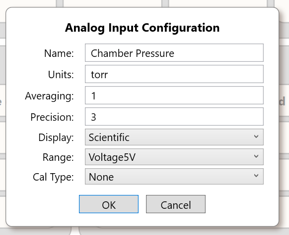
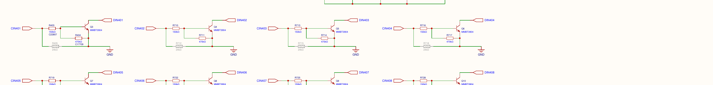
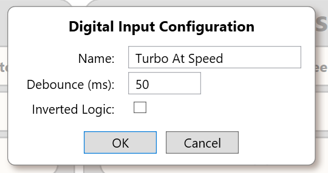

# Sensors and Signal Conditioning

> **Engineering application guide, review required.** This chapter explains how to **select and condition** sensors for the SigCore UC Rev B interfaces. It is not a terminal-by-terminal wiring certification. Electrical maximums, terminal assignments, grounding, surge protection, and sensor-specific installation must be verified against the as-shipped unit and the sensor manufacturer's instructions. Do not treat internal software range labels as permission to exceed the published field-input ranges.

## 1. Select the signal interface first

SigCore UC has **four analog inputs (AI1–AI4)** and **eight digital inputs (DI1–DI8)**. Match the **electrical output of the sensor**, not simply its measurement quantity, to the corresponding interface. An analog sensor measures a continuous variable; a digital sensor or switch reports a state. A thermocouple, RTD, strain gauge, quadrature encoder or dry contact does **not** inherently produce the required SigCore input signal.

| Sensor output at its terminals | Applicable SigCore input | Required qualification |
|---|---|---|
| Conditioned **0–5 V** measurement output | AI configured for published voltage range | Supply compatible reference/ground; confirm voltage does not exceed approved limits |
| Conditioned **0–500 mV** measurement output | AI, low-level voltage category | Verify the actual supported range selection and resolution on the deployed release |
| **4–20 mA** transmitter | AI with published current-input function | Provide external loop supply as required; verify loop topology and selected mode against actual hardware |
| **0–10 V** process signal | **Not directly** supported by the cited Rev B field-wiring guidance | Add a suitably rated external attenuator or isolated signal conditioner, then verify output range |
| On/off sensor with known positive voltage relative to common | DI | Published OFF ≤1 V, ON ≥2 V; 1–2 V is unspecified; maximum input voltage still requires confirmation |
| Dry contact only | DI **with external excitation/interface** | Contact opening/closure alone does not generate the required logic voltage |
| Thermocouple, RTD or bridge sensor raw leads | No direct temperature/bridge input claimed | Use compatible transmitter or conditioning module to 0–5 V or 4–20 mA |
| NPN/PNP/open-collector proximity switch | DI only after output topology is checked | Provide proper supply/bias/return; verify active level and input limits |
| High-frequency pulses or encoder | Not established as supported pulse counter | DI debounce/polling is designed for logical states; no verified hardware counting/timestamp accuracy |

The published analog classes are **0–5 V, 0–500 mV, and 4–20 mA**. Internal `A_IN.Range` contains `Voltage10V`, but the Rev B Control Panel repurposes that value for the **2.500 V reference**; it must not be used to justify direct 10 V wiring. See [Analog Inputs](../Hardware/Analog-Inputs.md) and [Digital Inputs](../Hardware/Digital-Inputs.md).



*Figure 1. Analog-input configuration in the supplied Control Panel; values shown are not guaranteed electrical ratings.*

## 2. Analog measurement chain and channel identity

For an ordinary field sensor the conceptual chain is:

```text
Physical quantity -> sensor/transmitter -> compatible voltage/current signal
 -> AI terminal and return -> Rev B conditioning/multiplexer -> ADS1115
 -> Core raw measurement -> selected calibration -> engineering-unit reading
 -> .NET API, Control Panel, or WebBridge/device website
```

The hardware uses per-channel **TMUX1209** selection and one shared **ADS1115** converter. The Core scans channels sequentially. Sampling settings, mux settling, ADC conversion waits, configured averaging, I²C activity and OS scheduling determine effective per-channel update rate. The selected ADS1115 samples-per-second setting is **not** the four-channel measurement throughput. See [Measurement and Control Timing](../Core-Software/Measurement-and-Control-Timing.md).

Use **AI1–AI4** as human channel names. In APIs these are **zero-based indices 0–3**. Source code compensates for a nonsequential internal ADC mux wiring order; external integrations should retain the published logical index, not try to reorder inputs.

## 3. Example: 0–5 V pressure transmitter

**Illustrative design assumption:** the transmitter produces 0 V at 0 psi and 5 V at 100 psi, with a known common reference, and has been independently verified to stay within its specified output range.

For a linear interpretation:

```text
Pressure_psi = (100 psi / 5 V) × measured_voltage_V
             = 20 × measured_voltage_V
```

| Sensor output | Expected physical pressure |
|---:|---:|
| 0.00 V | 0 psi |
| 1.25 V | 25 psi |
| 2.50 V | 50 psi |
| 3.75 V | 75 psi |
| 5.00 V | 100 psi |

Configure an AI for the appropriate **voltage** input, label it e.g. `Chamber Pressure`, and set units `psi`. If the calibration method is the source's `mXplusB`, the illustrative slope/intercept would be `m=20`, `b=0` **only if the calibration input `x` is expressed in volts** in the installed release. Confirm this with two independent test points before trusting the displayed reading; an unexpected raw-unit transformation or range-mode choice changes the required coefficients. `precision` controls formatting, not measurement accuracy.

## 4. Example: 4–20 mA transmitter

**Illustrative sensor mapping:** 4 mA represents 0 kPa, and 20 mA represents 400 kPa. The physical sensor relation is:

```text
P_kPa = (I_mA − 4) × (400 / 16)
      = (I_mA − 4) × 25
```

| Transmitter current | Physical pressure |
|---:|---:|
| 4 mA | 0 kPa |
| 8 mA | 100 kPa |
| 12 mA | 200 kPa |
| 16 mA | 300 kPa |
| 20 mA | 400 kPa |

**Do not copy those coefficients directly into AI calibration until the deployed current-mode raw units have been established.** The supplied implementation's current-route conversion, 200-ohm shunt circuitry, ADC-voltage representation and customer-reference `Current20mA` / `Current4To20mA` names are not fully reconciled. Determine what the actual raw/calibrated Core value represents at a known **4 mA** and **20 mA**, then derive calibration from those observations. The external transmitter normally needs its own correctly specified loop supply; no SigCore-provided loop excitation has been established.

A missing/broken 4–20 mA loop may produce a low or zero reading, but SigCore should **not** be described as having a certified 3.6 mA fault-detection function without release-specific evidence. If a failed sensor can produce unsafe control, add application-level validity checking and an independently safe response.

## 5. Digital input from switch or proximity sensor

The published DI recognition bands are **≤1 V = OFF** and **≥2 V = ON** relative to the approved input reference. The interval from 1 V to 2 V has no guaranteed interpretation in the cited reference. The transistors and input-conditioning circuit **share the controller ground**; they are **not galvanically isolated**, despite an `isolated` label in the source schematic. Do not bond a floating/high-energy field circuit directly without a compatible interface.



*Figure 2. Actual Rev B circuit excerpt showing input conditioning; it is **not** a field terminal pinout or isolation certificate.*

A dry contact can be used only when a suitable externally supplied logic level, bias and common are provided. For an open-collector proximity sensor, determine whether its output **sinks** or **sources** current and whether a pull-up/pull-down or isolating interface is needed. Inversion in the DI configuration changes the **reported logical state**, not the voltage present on a field terminal.

Debounce suppresses short state changes and also adds a delay to valid transitions. The reviewed source uses a default of **50 ms**; actual permitted settings and the latest validation should be verified on the installed release. Neither DI debounce nor input polling provides a guaranteed high-speed pulse counter. For safety switches, a general-purpose DI indication must not be assumed to replace a hardwired safety-rated circuit.



*Figure 3. Input inversion and debounce are software interpretation settings.*

## 6. Calibration, filtering and faults

1. **Check the physical signal with an instrument** before modifying coefficients. Confirm supply, signal common, wiring and end points against the sensor's specification.
2. **Select a valid input mode** for the actual electrical signal. A software enum or calibration cannot increase a physical channel's safe voltage/current rating.
3. **Calibrate with independently known points.** Linear (`m`, `b`), multipoint piecewise or polynomial processing may be appropriate; use the algorithm and coefficient order documented in [Calibration and Scaling](../Core-Software/Calibration-and-Scaling.md). The product's recently revised averaging implementation is version-sensitive; do not rely on the old scan-loop description without checking the installed version.
4. **Set units and presentation precision** only after physical scaling is verified. A reading with many digits is not evidence of corresponding sensor accuracy.
5. **Define invalid-input behavior:** disconnected wire, out-of-range source, implausible jump, missing updates, converter fault or frozen cached data. Use independent feedback/protective circuits where bad measurements could cause harm.
6. **Record commissioning points** with channel, raw signal, configured calibration, observed reported value, units, physical stimulus and installed software version.

Do not use the WebBridge cached `analogInputs` values as proof of new ADC conversions. A browser can continue to show the last sampled value during a Core disconnect. Verify `connection.connected` and, when necessary, obtain fresh Core status or an independent measurement.

## 7. Source references and verification gates

Primary customer-facing references in the supplied evidence: `project/sources/documentation/hardware-reference.html` (*Read an on/off signal* and *Measure an analog signal*) and `control-panel-reference.html` (*Digital inputs* and *Analog inputs*). Implementation evidence: `libs/SigCoreCommon/A_IN.cs`, `Ads1115Driver.cs`, `A_DOUT.cs`, `D_IN.cs`, `Payloads/AInConfigPayload.cs`, `Payloads/DInConfigPayload.cs`, and `HardwareManager.cs` under `project/sources/SigCore-Software-Source/`; Rev B schematic sheet 3. See also [Analog Inputs](../Hardware/Analog-Inputs.md), [Digital Inputs](../Hardware/Digital-Inputs.md) and [Hardware Overview](../Hardware/Hardware-Overview.md).

**Review before customer approval:** maximum field-input ratings; exact current/raw-unit interpretation; actual 0–500 mV mode mapping; terminal-level returns and sensor wiring; release-specific averaging/validation behavior; DI input limits and the unintended schematic isolation wording. Any example numerical conversion above is a **sensor calibration illustration**, not a measured SigCore electrical accuracy specification.
