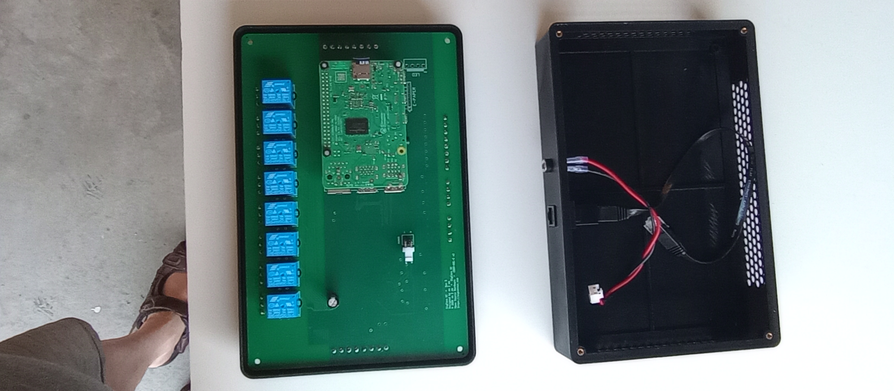
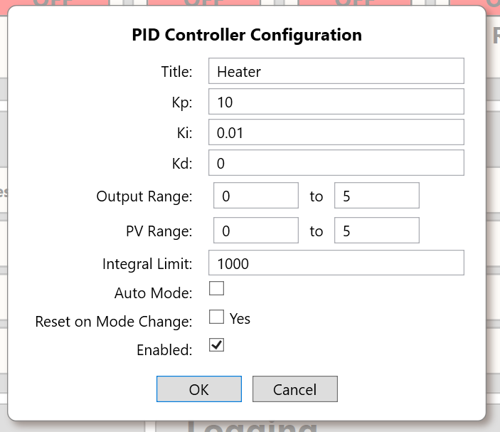
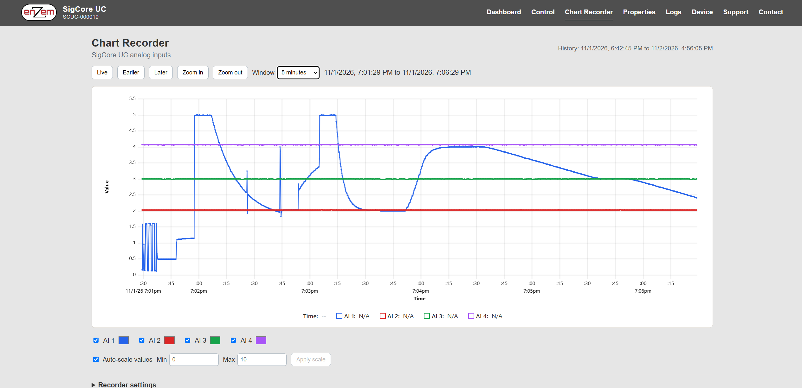

# Worked Designs

> **Illustrative engineering designs, not approved wiring diagrams or application programs.** These worked examples identify Signal/Control paths and verification steps using the Rev B resources. Any actual build requires final connector pinouts, permitted electrical ratings, as-shipped version verification, load protection and a process-specific safety review. **Never use the provided examples to operate hazardous equipment without independent interlocks.** Numerical examples are design assumptions, not measurements of a SigCore unit.

## 1. How to read these designs

The channel counts used below are **4 analog inputs, 4 analog outputs, 8 digital inputs, 8 SPDT relays, 4 PID controllers**. Human names `AI1`, `AO1`, `DI1`, `R1`, `PID1` map to **zero-based API index 0**. *Sensor reading* refers to a configured Core measurement; *AO value* is a commanded software value; *relay state* is a logical state; *external feedback* requires a separate sensor.

Every example has four distinct parts: **field interface**, **software configuration**, **expected observations**, and **fault/protection checks**. The named components/terms in the examples represent external engineering selections and are not included by SigCore.



*Figure 1. Controller assembly photograph. Connector locations must be taken from the labeled device and current hardware reference, not inferred from this photograph.*

## 2. Design A: Bench-scale AO-to-AI functional check

**Objective:** verify the *relationship* between an AO command and a measured AI value, with **no powered actuator**. This is a low-energy commissioning test using independently checked signals, not a certification of accuracy.

### A.1 Conceptual path

```text
API/Control Panel -> AO1 in voltage mode -> approved signal connection -> AI1
                          |                                         |
                          +-> independent voltmeter at test point <-+
```

Do not wire the AO signal into a current-loop-only path, into a power terminal, or into another voltage **source**. Confirm compatible input and output ranges, common signal reference, actual terminal labels and output loading before making a loopback connection. An external voltmeter is needed to detect a disagreement between Core's reported value and the real terminal voltage.

### A.2 Configuration

| Resource | Example setting | Reason |
|---|---|---|
| AO1 | **Voltage mode**; `auto=false`; **identity scaling** (`voltM=1`, `voltB=0`) | Avoid unresolved non-default AO scaling convention during initial measurement |
| AI1 | Published 0–5 V mode; initial no-offset/no-gain correction | Observe physical voltage without an arbitrary calibration transformation |
| PID1 | Disabled | Prevent an automatic command from overwriting the manual AO test |
| R1–R8 | No external loads | Avoid incidental relay activity |

### A.3 Test and expected outcome

With external circuit verified safe, command **0.5 V**, **2.0 V**, and **4.5 V** in sequence. At each point record (a) requested AO value, (b) AO reported state, (c) meter terminal voltage and (d) AI1 reported reading. Expect the AI trend to follow the commanded voltage **qualitatively**; the actual error must be measured. Do not assume `0.5`, `2.0`, and `4.5` will appear identically to three decimal places. Use a slow sequence so mux/ADC acquisition and the client display settle; no hard real-time settling guarantee is documented.

If the observed AO terminal voltage disagrees with the request, check mode, actual signal ground, load, supply variation and scaling. If the meter reads correctly but AI does not, check AI selection, raw units, current/voltage path and calibration. Do not alter many settings simultaneously. A software AO configuration save in the reviewed Core source can reset the physical output to **zero**; anticipate it while the loopback is attached.

### A.4 Sign-off evidence

The bench record should contain serial, hardware/software version, channel configuration, each commanded point, DMM reading, AI value, observation time, and any error. It is **not** an accuracy specification without calibrated instrumentation and an acceptance tolerance.

## 3. Design B: Temperature feedback with external heater driver

**Objective:** regulate a modest heater using a conditioned temperature measurement and PID1 while retaining a **separate physical overtemperature stop**.

### B.1 Signal chain

```text
Thermocouple/RTD -> external transmitter -> compatible AI1 signal
                                                |
                                                v
                                             Core PID1
                                                |
                                                v
                                  AO1 PWM or 0–5 V signal
                                                |
                                                v
                              compatible external power controller
                                                |
                                      independently powered heater
                                                |
                       separate thermostat / high-limit cutoff
```

A bare thermocouple or RTD is not a direct SigCore field input. Choose a suitable transmitter producing a **verified** 0–5 V or 4–20 mA interface. The transmitter and field supplies require separate electrical validation. A **12 V heater**, for example, must be driven from an appropriate separate power supply and rated switching stage; AO1 must not be connected directly to the heater. If the external controller expects a 4–20 mA *command*, a voltage-to-current conditioner is required because AO1 is voltage/PWM, not a published current source.

### B.2 Example configuration

| Resource | Example assignment | Validation |
|---|---|---|
| AI1 | `Heater Temperature`, engineering unit `°C` | Independently verify the transmitter and its numeric mapping at two or more points |
| PID1 PV | `pvSource=0` | Ensure it reads **AI1**, not a different process variable |
| PID1 output | `outputDestination=0` | Ensure it commands **AO1** and no other enabled PID shares AO1 |
| AO1 | PWM **only if** driver accepts PWM; otherwise voltage mode into a compatible driver | Verify signal frequency, polarity and safe manual response |
| PID1 setpoint | Application-selected value within the process's validated safe envelope | Do not substitute a demonstration number for a safe operating temperature |
| External cutoff | Independent thermostat/high limit interrupts heater energy | Test protection without depending on SigCore code or networking |

### B.3 Commissioning sequence

1. Verify the independent cutoff **with the heater power path separate from SigCore**; establish manual ability to remove energy.
2. Apply a known temperature or transmitter simulator and prove AI1 reads in the correct engineering units. Check plausible sensor-failure behavior.
3. In manual mode with the heater power stage controlled and process safe, verify AO1's 0%, intermediate and maximum permissible command responses using the receiving driver or a dummy input.
4. Configure PID1 route, conservative output range and appropriate action. Test **feedback sign**: if more heater command makes PV climb, the PID must reduce positive command when PV exceeds SP.
5. Enable the intended `isEnabled` and `autoMode` conditions, and monitor **SP, PV, calculated output, error and saturation**. Increase authority only after stable lower-energy tests; the stored default gains are not a recommended tuning.
6. Test sensor disconnect, reboot, Core loss and external supply loss. Define action for every case; in the supplied source, neither PID fault handling nor AO scaling constitutes a safety-rated cutout.



*Figure 2. PID properties allow route/gain/output configuration, but cannot replace external protective hardware.*

### B.4 Important implementation limitations

The reviewed source attempts PV clamping through a no-op runtime setter. It also does not demonstrate effective `resetOnModeChange` behavior or unique PID-to-AO ownership. Direct AO writes may still be accepted during automatic operation. Calibrate the AO with default scaling first because the documented and implemented scaling directions conflict. All are **review items**, not accepted process behavior for a field deployment. See [PID Control](../Core-Software/PID-Control.md).

## 4. Design C: Supervised valve-and-pump sequence

**Objective:** illustrate a basic *external supervisory state machine* for valve/pump equipment using relay commands and independent DI feedback. This is **not a shipped vacuum-control application** and is not a complete industrial safety system.

### C.1 Hypothetical point list

| Point | Conceptual purpose | What it actually proves |
|---|---|---|
| R1 | Command external pump contactor/control circuit | A logical relay command, not confirmed motor running |
| R2 | Command a valve-compatible external driver | A commanded control-circuit state, not valve position |
| DI1 | Pump auxiliary contact | Observed conditioned digital feedback, if correctly wired |
| DI2 | Valve-open limit switch | Conditioned open-position indication, not proof of leak-tight seal |
| DI3 | Valve-closed limit switch | Conditioned closed-position indication, if installed and functional |
| AI1 | Conditioned pressure transmitter | Calibrated process pressure, not proof of hardware protection |

Rev B relays are **SPDT dry contacts**. They do not provide the pump or solenoid's power. DI conditioning shares SigCore ground and is **not galvanically isolated**. Externally powered and electrically incompatible control circuits require suitable interposing modules and independent protection. Do not read an unconditioned high-voltage auxiliary circuit directly into a DI.

### C.2 External application state machine

| State | Entry requirements | Actions and confirmation |
|---|---|---|
| `Idle` | Independent E-Stop/protective system healthy | Hold outputs at externally validated states; log initial DI feedback |
| `StartRequested` | Operator request and qualified permits | Command pump circuit via R1 and start timeout |
| `PumpStarting` | Await **DI1** auxiliary confirmation | If missing/contradictory after timeout, enter fault state |
| `ValveOpening` | Pump confirmed and pressure preconditions valid | Command R2 and await **DI2** open confirmation, checking DI3 consistency |
| `Operating` | Requested permits and feedback remain valid | Read calibrated AI1 pressure and react per validated state machine |
| `StopRequested` | Controlled stop request | Sequence actuator commands and observe independent feedback |
| `Fault` | Missing sensor, timeout, contradictory feedback or loss of permitted conditions | Trigger the **separately engineered** safe stop and alert operator |

These are **suggested names and requirements for an external program**. SigCore Core does not become a sequencing PLC simply because it has DI/relay channels. Relay inversion, startup behavior and the unverified application of `failSafeState` must be tested on the actual release. During a power outage, contact NC/NO behavior follows mechanical de-energization, regardless of software settings.

### C.3 Acceptance evidence

Verify each physical relay/contact mapping, each independently stimulated DI, intended debounce, contradictory feedback detection, timeouts, restart recovery and the hardwired emergency stop. Do not equate the UI's `RelayChanged` event with contact sensing. Where pressure control or vacuum hazards exist, use professionally designed relief, limit and shutdown functions independent of the application program.

## 5. Design D: Long-term sensor monitoring without actuation

**Objective:** observe a 0–5 V environmental or process sensor on AI1 and show a recent trend while separately retaining long-term measurements.

1. **Field setup:** Install a compatible, externally powered and independently calibrated 0–5 V sensor on AI1. Label it and record units, calibration/version and sample identification.
2. **Live view:** Read `AI1` using the Windows Control Panel, native `.NET` API, or the device website's `/api/state.php`. With HTTP, check `connection.connected`; the value can remain cached when Core is lost.
3. **Recent trend:** Use the device Chart Recorder. It records WebBridge's latest four AI values at **1-second default interval**; its history is **volatile** and is cleared when that process restarts. A history request returns evenly spaced, reduced/interpolated values, not raw ADC conversions.
4. **Historical storage:** Enable and validate the configured MySQL logger if persistent snapshots are required. Confirm logger deployment, database schema, cadence and outage behavior. The reviewed source includes a credential-handling defect, so never publish a database password in this document or logs.
5. **Analysis:** Preserve channel, unit, calibration, device serial, software release, client observation timestamp and whether points came from SQL snapshots or chart resampling.



*Figure 3. A real source screenshot of the Chart Recorder user interface. Its visual curves are not evidence of a fixed ADC conversion or logging rate.*

## 6. General engineering acceptance matrix

Use a matrix for each installed design instead of declaring success from one green status screen:

| Test class | Example verification | What **must not** be inferred |
|---|---|---|
| Electrical compatibility | Field signal and return measured within approved input class | Internal enum range implies safe terminal maximum |
| Software calibration | Multiple known sensor values agree within a **selected** tolerance | Numerical display precision proves accuracy |
| Commands | Configured AO/relay logical state can be sent and read | Command transport success proves physical actuation |
| Physical response | Independent meter/DI/limit sensor confirms actual load action | Core value is independent feedback |
| Timing | Actual update and timeout measured on deployed release | Nominal ADS1115 SPS is full-system per-channel throughput |
| Faults | Power, disconnect, sensor, actuator and reboot failure cases tested | `failSafeState` property alone provides certified safe fallback |
| Records | History persistence and timestamp provenance verified | Chart Recorder RAM history survives process restart |
| Revision | Device serial, Rev and active release recorded | Unversioned development snapshot equals deployed firmware |

## 7. Supporting sources and review requirements

These designs depend on [Sensors and Signal Conditioning](Sensors-and-Signal-Conditioning.md), [Actuators and Loads](Actuators-and-Loads.md), [Data Acquisition and Monitoring](Data-Acquisition-and-Monitoring.md), [Control Applications](Control-Applications.md), [External System Integration](External-System-Integration.md), and the dedicated [Hardware](../Hardware/Hardware-Overview.md) / [Programming](../Programming/Integration-Patterns.md) sections.

Implementation evidence: `libs/SigCoreCommon/{A_IN,A_OUT,D_IN,RELAY_OUT,PID_LOOP,HardwareManager,SigCoreSystem}.cs` (under the supplied repository's source tree), `WebBridge/ChartRecorder.cs`, `WebBridge/Endpoints/{ChartEndpoints,PIDEndpoints,AnalogOutputEndpoints,RelayEndpoints}.cs`, Rev B schematics and the current public-reference snapshots in `project/sources/documentation/`.

**Publication gates:** source snapshot applicability; as-built terminal/power ratings; analog-input mode/current units; AO scaling/reset, relay polarity and fail-safe behavior; PID fault/owner semantics; and externally validated safety design. This chapter deliberately gives **no universal gain values, high-energy relay wiring instructions, hazardous process setpoints or automatic safety guarantees**.
