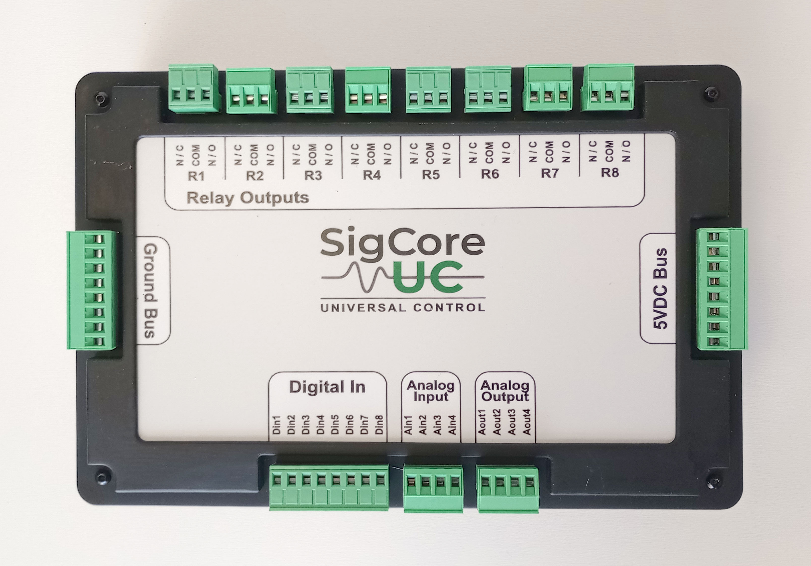

# Product Overview

> **Engineering source draft.** Describe the product as documented for Rev B, not as an extrapolation from a planned roadmap. No guarantee of a particular software feature in an installed unit follows merely from a class or source file existing in a development snapshot.

## 1. What SigCore UC is

**SigCore UC is a network-connected universal controller** built around a Raspberry Pi 4 Model B and a dedicated Rev B I/O board. It combines discrete switching, digital-state monitoring, analog measurement, analog/PWM control, software PID loops, local user interfaces, a programmatic controller interface, and update/recovery machinery. It is designed to bridge field hardware and applications, rather than act as a general-purpose laboratory ADC or PLC with certified safety features.

The controller operates as a self-contained device: it runs Core and hosts a device website. A Windows Control Panel and supported external applications are *clients* rather than required execution hosts for every measurement or control operation. The public product website and its Support references are separate from the local device website.



*Figure 1. Supplied controller photograph. See [Connectors and Pinouts](../Hardware/Connectors-and-Pinouts.md) for the limits of interpreting terminal order from the supplied evidence.*

## 2. Capabilities, quantities and meaning

| Resource | Quantity | Function | Principal details |
|---|---:|---|---|
| Relay outputs | **8** (`R1`–`R8`) | Dry-contact circuit switching with `COM`, `NO`, `NC` | Contact rating in published Rev B reference: **120 VAC / 10 A**; load classification/derating not established in snapshot |
| Digital inputs | **8** (`DI1`–`DI8`) | Read two-state field signals | Published thresholds: OFF at or below 1 V, ON at or above 2 V; no claimed galvanic isolation |
| Analog inputs | **4** (`AI1`–`AI4`) | Read voltage/current-loop signals | Published ranges: 0–5 V, 0–500 mV and 4–20 mA; verify current conversion implementation |
| Analog outputs | **4** (`AO1`–`AO4`) | Output selected DAC-derived voltage or PWM | Published output types: 0–5 V and PWM; do not infer source-current capacity |
| PID loops | **4 software loops** in reviewed Core | Feedback control using configured input/output assignments | A PID loop is *not* an additional external connector |
| Network functions | Device website, desktop client and programmable interfaces | Monitoring, configuration and control | Control protocol on TCP **7020**; on-device website via HTTP and local PHP-to-WebBridge proxy |

**Count:** 24 external I/O channels (8 + 8 + 4 + 4). Do not count relay contact positions as separate relay channels or count the internal analog switches/ADCs as customer-addressable channels. Refer to [Hardware Overview](../Hardware/Hardware-Overview.md).

## 3. Three ways to work with the controller

1. **On-device website:** Connect using the unit's network address. The on-device browser interface presents dashboard/status, control, configuration, chart recording and operational pages where present in the installed release. The site uses Apache/PHP and local WebBridge; the browser itself does not directly open the internal I²C bus or Core hardware objects. See [Device Website](../User-Interfaces/Device-Website.md).
2. **Windows Control Panel:** Discover or connect to the controller, examine state, configure channels, tune PIDs and manage supported properties. A client PC supplies an operator interface; device Core remains the hardware owner. See [Control Panel](../User-Interfaces/Control-Panel.md).
3. **External software:** Use the documented native .NET client/protocol, or suitable device website HTTP paths for an integration. Python may use accessible HTTP routes; the supplied snapshot does not establish an independently supported Python Core-protocol SDK. See [Programming](../Programming/Integration-Patterns.md).

### Local control versus cloud services

Core operates locally on the controller. The supplied source does not require an OpenAI service, hosted chatbot, or cloud inference engine to run physical I/O. The **AI Knowledge Base** is a separate documentation package intended for customers to supply to their chosen AI service; it is not embedded control logic and gives the AI no automatic right to manipulate field outputs.

## 4. System boundaries and engineering constraints

```text
Field sensors/contacts --> Rev B I/O conditioning --> Core --> network clients
Field loads/actuators <-- relay contacts / signal outputs <-- Core commands/PID
                                            |
                               on-device website via WebBridge
                               Windows Control Panel / external API
```

- **Software-reported state is not independent electrical feedback.** A relay state message does not measure actual contact position. An AO value does not measure terminal voltage or downstream actuator response.
- **Analog signal outputs are control signals, not arbitrary load power supplies.** Use external driver circuitry suitable for heaters, motors, solenoids and other power loads.
- **Digital inputs share a ground reference.** A schematic label describing them as "isolated" does not establish galvanic isolation.
- **A setting is not proof of an implemented safety mechanism.** In the reviewed source, a stored relay fail-safe value does not establish enforcement on Core failure; safety-critical equipment needs independently designed protections.
- **A successful request is not confirmation of physical action.** The WebBridge command paths may acknowledge acceptance without confirming the result.
- **Hardware ratings are revision- and application-dependent.** No authoritative enclosure ingress rating, analog-output current capacity, universal digital-input maximum, or certification evidence was provided with this snapshot.

## 5. Representative applications (not certified designs)

- **Process monitoring:** Read four conditioned analog sensor channels; use the website or external client to view live status. Chart Recorder has RAM-only history, distinct from separately persisted SQL measurement logging where configured.
- **Temperature control:** Use an appropriate transmitter into AI, Core PID for control, and an external power driver receiving AO/PWM; independent overtemperature protection remains an application responsibility.
- **Sequence and machine integration:** Read digital permissives and actuate external contactor/valve drivers through relays, with external interlocks and actual feedback where safety requires them.
- **Bench test and HIL:** Use external scripts or .NET integration to observe inputs and command test outputs; respect input limits and actuator ownership.

Worked engineering configurations, their assumptions and tests are in [Worked Designs](../Applied-Engineering/Worked-Designs.md). These are application examples, not documented certifications or ready-to-install wiring drawings.

## 6. Source/release hierarchy and known caveats

| Evidence | What it establishes | What it does not establish |
|---|---|---|
| Published `hardware-reference.html` | Advertised Rev B I/O counts, categories, basic ratings and website workflows | Complete installation/electrical limits or behavior of every source branch |
| Published `control-panel-reference.html`, `api-reference.html` | Human-facing names, controls, API descriptions | Independent proof of physical signal behavior |
| `SCH_Schematic1_2026-08-15.pdf`, Gerbers, overlay | Designed circuit and board outline | Every as-built option, approved wiring torque or production test outcome |
| Supplied Core, WebBridge, Launcher/Updater source | Mechanisms that *exist in the reviewed snapshot* | Exact identity of installed release 2.0.27 or later, unless built/deployment evidence supplied |

**Current questions:** Analog-output scaling direction and config-save zeroing, relay inversion reapplication and fail-safe behavior, installation ratings and deployment logger topology remain subject to review against the *current* build; see [Known Limitations](../Reference/Known-Limitations.md). Do not present draft source findings as proven defects in all field units.

## 7. Related material

- [System Architecture](System-Architecture.md), [Software Architecture](Software-Architecture.md), [Revisions and Feature Availability](Revisions-and-Feature-Availability.md)
- [Electrical Specifications](../Reference/Electrical-Specifications.md) (planned consolidated reference)
- [Installation and Commissioning](../Operations/Installation-and-Commissioning.md), [Troubleshooting](../Operations/Troubleshooting.md)

**Primary evidence:** `project/sources/documentation/hardware-reference.html`, `control-panel-reference.html`, `api-reference.html`; `project/sources/hardware/SCH_Schematic1_2026-08-15.pdf`; `project/sources/SigCore-Software-Source/`.
