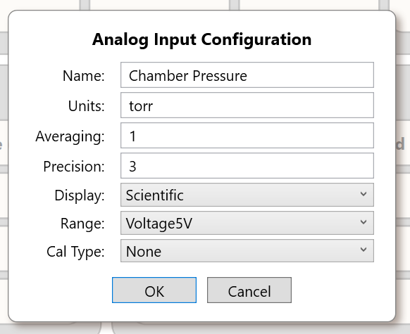
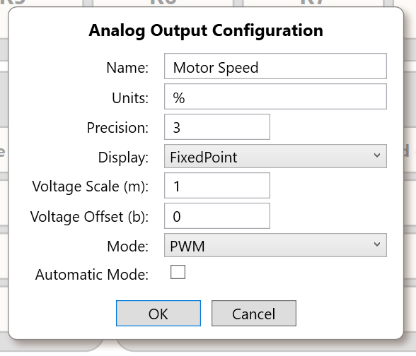

# Calibration and Scaling

> **Engineering draft.** Distinguish the analog **input measurement/calibration** pipeline from the analog **output command/scaling** pipeline. The published Control Panel Reference and the supplied AO Core implementation disagree about the AO scaling direction. Until reconciled by engineering review, an AI must state the discrepancy rather than choosing an undocumented product behavior.

## 1. Analog input processing order

In the supplied Rev B Core source, the path is:

`physical signal → selected input-conditioning path → external TMUX → ADS1115 gain/conversion → raw voltage → channel averaging → calibration → engineering/display value`.

The measurement range determines signal conditioning and ADC gain. Input names, user units, display format and display precision are metadata; they do not change the underlying ADC conversion or electrical measurement range. Calibration maps the raw measured result to an engineering quantity. For wiring, permissible input forms and I²C hardware see [Analog Inputs](../Hardware/Analog-Inputs.md).

*Actual Analog Input Properties screenshot; labels and shown settings are examples. Calibration entry interfaces and validation must be checked against the specific release.*

## 2. Analog input calibration algorithms

`A_IN.CalType` selects one of five implementations:

| Type | Numeric enum | Implementation on raw reading `x` |
|---|---:|---|
| None | 0 | `y = x` |
| `mXplusB` | 1 | `y = m × x + b` |
| `MultiPoint` | 2 | Piecewise linear interpolation within table and linear **extrapolation** along first/last segment beyond its endpoints |
| `Polynomial` | 3 | `y = Σ(c[i] × x^i)` for coefficients in increasing power order |
| `Log10` | 4 | `y = 10^(m × x + b)` |

### 2.1 Linear calibration

To map measured values `(x1, y1)` and `(x2, y2)` with `x2 != x1`:

\[m = (y_2-y_1)/(x_2-x_1),\quad b = y_1-m x_1\]

Enter `m` and `b` so Core computes `m × raw + b`. This is a **mathematical derivation**, not an instruction to connect an unverified voltage/current source directly. If the measurement is noisy or uncertain, the calibration result reflects that uncertainty.

### 2.2 Multipoint calibration

The source expects a matching ordered list of input and adjusted points. For an `x` between adjacent points `(x0, y0)` and `(x1, y1)`, Core computes

\[y = y_0 + (x-x_0)(y_1-y_0)/(x_1-x_0).\]

The selected first or last segment is extended without clamping **outside** the table. This addresses the earlier endpoint pegging problem. With fewer than two points or unequal array lengths, the implementation returns `x`. If adjacent selected input values are equal, the implementation also returns `x` instead of dividing by zero. These fallbacks can silently bypass desired calibration: input points must be distinct and appropriately ordered. The Core function does **not** itself sort user points; the editor must supply a valid order.

`PiecewisePairsString` serializes entries as `input:adjusted` pairs separated by commas; invalid pairs may be silently ignored during parsing. Do not treat malformed point strings as a validated table.

### 2.3 Polynomial calibration

Core evaluates coefficients `c0, c1, ...` as `c0 + c1*x + c2*x² + ...`; their order is **ascending powers**. The polynomial-coefficient text parser converts an invalid coefficient token to `0`, which can create an incorrect curve without a hard parsing error. The source has no fixed fourth-order limit in this evaluation loop, but the maximum degree accepted by a particular UI version must be checked independently.

### 2.4 Logarithmic transformation

The `Log10` label refers to the exponential mapping `10^(m × raw + b)`, **not** computing `log10(raw)`. This matters when explaining sensor transformations or reverse engineering a displayed value. The output can grow rapidly outside the calibration range; no output-domain clamp is shown in `ApplyCalibration`.

## 3. Analog output scaling is a different operation

`A_OUT.SetAnalogValue(channel, engineeringValue)` in the supplied Core source computes:

- **Voltage mode:** `voltage = engineeringValue × voltM + voltB`, then clamps to **0–5 V** and sends a DAC code.
- **PWM mode:** `duty = engineeringValue × voltM + voltB`, then clamps to **0–100%** and commands the PWM driver.
- `GetAnalogValue()` reports the derived engineering value `(storedHardwareValue − voltB)/voltM`.

The published Control Panel Reference has described the scale in the opposite direction (`Display = m × V + b`) and its inverse for voltage output. **This is a documented discrepancy.** The above is a statement about the reviewed Core code, not an approved end-user rule. Setting `voltM = 0` would also create a division-by-zero problem in `GetAnalogValue()`; validate zero-slope behavior before use. The `currentValue` array is internal software's last commanded hardware value, not a measured analog-output voltage.

*Actual Analog Output Properties screenshot. Scaling semantics require engineering reconciliation before customer publication.*

**Configuration hazard:** `A_OUT.SetConfig()` invokes `SetMode()`, which resets the channel to **zero** in both modes, regardless of whether the user changed the mode or only its display/scale properties. See [Operating Modes and Safety](Operating-Modes-and-Safety.md).

## 4. UI formatting is not signal accuracy

Fixed/scientific display format, unit label, and decimal precision change how a value is presented. They do not imply improved ADC accuracy, resolution, voltage-reference stability, or an additional calibration cycle. A conversion that displays six decimal places is not necessarily accurate to one micro-unit. Preserve the actual sensor and hardware limits when interpreting calibrated data.

## 5. Suggested calibration workflow

1. Identify the exact device hardware revision, input channel and approved input mode/range before connecting a calibrator.
2. Choose a traceable input stimulus compatible with that mode and the electrical limits in the hardware reference.
3. Collect raw indicated values and known reference points across the required operating range. Use stable conditions and units.
4. Select linear, multipoint, polynomial, or exponential transform to match the sensor's validated relationship.
5. Save the channel calibration. Core stops/restarts the analog sampling loop for an AI configuration change.
6. Verify at independent check points **not** used to compute coefficients, including near endpoints. Record tolerances, uncertainty and temperature conditions.
7. Test out-of-range behavior: multipoint extrapolates, polynomial and exponential functions may diverge. Do not extrapolate beyond a sensor's physical working range merely because software can calculate a value.

This is **engineering procedure guidance**; do not substitute it for an instrument-specific calibration certificate or assume the KB itself verifies hardware accuracy.

## 6. Source evidence and engineering review

- `libs/SigCoreCommon/A_IN.cs`: `CalType`, `ApplyCalibration`, `Interpolate`, `EvaluatePolynomial`, point string parsers.
- `libs/SigCoreCommon/A_OUT.cs`: scaling conversion/clamp, `GetAnalogValue`, `SetMode`.
- `libs/SigCoreCommon/Payloads/AInConfigPayload.cs`, `AOutConfigPayload.cs`.
- `project/sources/documentation/control-panel-reference.html`: published AI/AO behavior; screenshots in `Images/Control-Panel`.

**Open:** approve AO scaling direction, zero-slope validation, malformed calibration point behavior, full polynomial UI support, input-range nomenclature/current-unit handling, and hardware-metrology evidence by revision.
