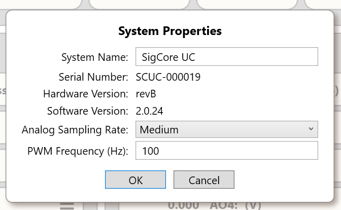

# Data Model and Configuration

> **Engineering draft, not an approved product contract.** This chapter describes persisted configuration, transient Core state, and WebBridge state in the supplied source snapshot. For individual field semantics use the linked subsystem chapters. Do not assume the included source snapshot is identical to the most recently deployed Rev B release.

## 1. Three kinds of information

| Kind | Owner | Typical contents | Lifetime |
|---|---|---|---|
| **Device configuration** | Core, `HardwareManager.Config` | Global/system, network, eight relays, four AIs, four AOs, eight DIs, four PID controllers, logger | File-backed: `/opt/sigcore/properties.json` |
| **Operating state** | Core and per-client subscriptions | Sampled AI/DI values; commanded relay and AO values; PID SP, PV, output, mode, deviation | Process-memory values; not automatically a historical record |
| **Website state and recorder configuration** | WebBridge | Cached Core notifications, current chart settings, circular recorder history | Cache/history in WebBridge RAM; chart settings separately saved to `/opt/sigcore/webbridge-chart.json` on Linux |

**Important:** A configured value, a commanded output state, and a measurement of physical output are different things. For example, relay state readback reflects software logical state, not an independent contact-position sensor. See [Relay Outputs](../Hardware/Relay-Outputs.md).

## 2. Persistent configuration file structure

`HardwareManager.BuildConfigPayload()` writes this top-level JSON object:

| Property | Shape | Source of data |
|---|---|---|
| `global` | object | System properties and acquisition/PWM settings |
| `network` | object | Network settings payload |
| `relays` | array of 8 | Channel names, startup/default state, fail-safe selection, inverted logic |
| `analogInputs` | array of 4 | Input range, name/units, averaging, calibration, display format/precision |
| `analogOutputs` | array of 4 | Voltage/PWM selection, scaling, name/units, auto flag, display format |
| `digitalInputs` | array of 8 | Name, debounce milliseconds, inverted flag |
| `pids` | array of 4 | PID configuration, routing, gains and limits |
| `logger` | object | SQL logger configuration and status properties |

Illustrative **structure only**, not a valid importable or complete configuration:

```json
{
  "global": {}, "network": {}, "relays": [],
  "analogInputs": [], "analogOutputs": [], "digitalInputs": [],
  "pids": [], "logger": {}
}
```

Channel numbers in JSON payloads and .NET API are generally **zero-based** (`channel: 0` means the first device channel). The UI and field labels are typically one-based (`AI1`, `AO1`, `DI1`, `Relay 1`). The `GetSnapshot()` dictionary also uses zero-based labels such as `AI0`, `AO0`, `DI0`, `RELAY0`, `PID0_SP`, etc.; don't confuse those database keys with UI labels.

### 2.1 File load precedence and migration

1. At Core initialization, attempt to read `/opt/sigcore/properties.json`.
2. If the file exists and passes structure validation, load it. If it exists **but is invalid**, generate and persist defaults; the loader does **not** fall back to FRAM in that branch.
3. When the file does not exist, attempt to read a legacy configuration from FRAM if the hardware and data are available.
4. If FRAM data are structurally valid, load them and save a new JSON file. Otherwise create defaults and save them.

`IsValid()` checks the presence of `global`, `network`, and `logger` objects and the expected counts for five channel arrays. **It is primarily a structural check**, not comprehensive validation of every field's value, units, or bounds. Runtime payload decoding and individual setters have their own uneven validation. Do not assume a file passing `IsValid()` is electrically safe or semantically correct.

### 2.2 File writes

`Config.Save()` serializes indented JSON to `properties.json.tmp`, then replaces `properties.json` using `File.Move(..., overwrite: true)`. The application creates the directory if necessary and surfaces failures. A file replacement is not proof that every existing in-memory component immediately adopted new settings: use the dedicated configuration command and its documented restart/reinitialization semantics.

## 3. Configuration write paths

| Configuration operation | Core behavior in reviewed code | Consequence |
|---|---|---|
| Analog input | Stop analog loop; apply payload; save; restart in `finally` | Acquisition interruption; mux configuration reapplied |
| Digital input | Stop DI loop; apply payload; save; restart in `finally` | DI polling interruption |
| PID config | Stop PID loop; update PID object; save; restart in `finally` | PID timing and state can be affected |
| AO config | Apply new AO config; save | `A_OUT.SetMode()` resets physical output to zero even if change was just a property |
| Relay config | Apply payload; save | In supplied snapshot, changing inversion does **not** immediately reapply physical output; known bug under active correction |
| Global config | Update sampling/PWM settings; restart analog sampling; set PWM frequency; save | Settings may alter acquisition and PWM waveforms |
| Logger config | Change enabled state / loop behavior; save | Database logging is a separate operation from chart recording |

See [Operating Modes and Safety](Operating-Modes-and-Safety.md) before modifying outputs connected to energized equipment.

## 4. Global configuration semantics

`SystemConfigPayload` includes `systemName`, `systemSerialNumber`, `hardwareVersion`, `softwareVersion`, `useLastKnownValues`, `analogSamplingRate`, `pwm_frequency`, `isPIDOpen`, and `systemPassword` as public model properties. However, `ToFramPayload()` (used for the saved `global` JSON object) only serializes `systemName`, `systemSerialNumber`, `useLastKnownValues`, `analogSamplingRate`, and `pwm_frequency`. Software/hardware version reporting is also sourced at runtime from the active release's `config.json`.

**Do not claim that every property shown in the global model survives a restart via `properties.json`.** In particular, `UseLastKnownValuesAtStartup` is stored, but its effect on restoring live outputs is **not demonstrated** by the sampled startup path; this is an unresolved product behavior, not a guarantee. The `isPIDOpen` and `systemPassword` properties should likewise not be assumed persisted in the serialized `global` object as currently constructed.



*Actual Control Panel System Properties screenshot. Values shown are examples, not universal product defaults.*

## 5. Backup and restore through WebBridge

`GET /api/config-backup` returns current `properties.json` sections **except** `global` and `network`. The suggested download filename may contain the device serial number; that filename does not mean serial/network identity is included in the backup body. The returned sections can include logger configuration. **Treat backups as sensitive** because logger properties include connection details and potentially a password.

`POST /api/config-restore` accepts up to **1 MiB** of JSON; requires exactly the device's expected non-global/non-network sections; checks type, array count, channel identity and top-level object-field names; atomically replaces the configuration file; then queues a restart of `sigcorelauncher.service` after the response. This checks structure, not all per-field operational ranges. `accepted: true` is not proof that restart, reinitialization, or output operation succeeded. Restoring configuration can change I/O behavior; disconnect or secure loads before use.

## 6. Configuration vs. runtime notifications

Core event subscriptions report current values and relevant changed fields; WebBridge holds a **cached representation** of this state in memory. A successful HTTP status response does not necessarily demonstrate current Core connectivity. A `GetSnapshot()` creates numerical values for AI, AO, DI, relay, and PID fields for SQL logging; it is **not** a complete backup or user-facing state contract. Runtime PID `SP`, `PV`, tolerance, ramp, and `auto` updates are separate from persisted PID gains/routing and may not be saved by `SetPIDCurVal()`.

## 7. Source evidence and verification

- `libs/SigCoreCommon/HardwareManager.cs`: `Initialize`, `BuildConfigPayload`, `Config.Load/Save/IsValid`, `Set*Config`, `GetSnapshot`, `FactoryReset`.
- `libs/SigCoreCommon/Payloads/{SystemConfigPayload,AInConfigPayload,AOutConfigPayload,DInConfigPayload,RelayConfigPayload,PidConfigPayload,LoggerConfigPayload}.cs`.
- `WebBridge/CoreState.cs`, `WebBridge/ChartRecorder.cs`, `WebBridge/Endpoints/BackupRestoreEndpoints.cs`.

**Open checks:** identify exact release commit; validate current live-value persistence policy; audit backup for credential exposure; confirm which `global` fields intentionally persist; test rollback when configuration save fails after a component has already changed; review per-field input validation.
