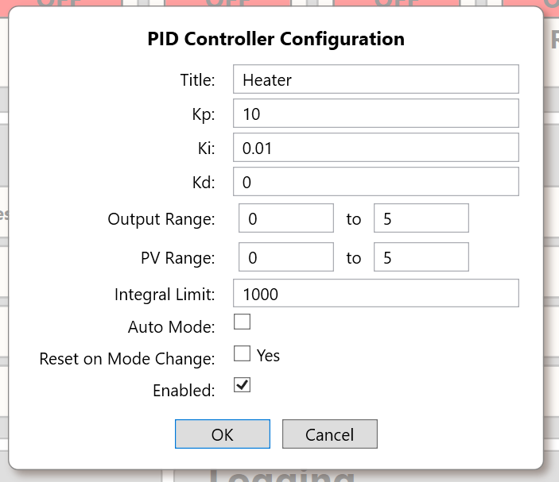

# Operating Modes and Safety

> **Safety-critical engineering draft.** The terms below are the specific software controls verified in the supplied Rev B Core source. They do **not** constitute a certified functional-safety system, a protective interlock, or a guarantee about behavior during loss of power, software crash or watchdog events.

## 1. Separate mode dimensions

SigCore UC has multiple independently configured behaviors, not a single universal "mode" switch:

| Dimension | Setting / state | Practical meaning |
|---|---|---|
| AO signal generation | `A_OUT.OutputMode.Voltage` or `PWM` | Four output channels select DAC-derived voltage or PWM duty generation; switching path resets output to zero in reviewed code |
| AO manual/automatic | AO `IsAuto` / payload `auto` | Indicates whether an output is under automatic control; the PID computation checks the same flag through `PID_LOOP.ConfigRuntime.Auto` |
| PID enable | `isEnabled` | Disabled PID is skipped by `PID_LOOP.ComputeAll()` even when its AO automatic flag is true |
| Relay logical state/polarity | Commanded ON/OFF, `invertedLogic` | Logical state maps to the actual relay driver polarity; does not measure physical contact position |
| DI logical polarity | `inverted` | Interpretation of a conditioned digital input; unrelated to relay polarity |

The Gavula vacuum-control modes sometimes called **Manual with Safety**, **Automatic**, and **Full Override** are application-level concepts. They must **not** be presented as built-in, verified product-wide modes of Rev B Core merely because a particular integration uses those terms.

## 2. Analog output control and mode transitions

- `HardwareManager.SetAOutAuto(channel, enabled)` changes the output's automatic flag and notifies subscribed clients. `GetAOutAuto()` reads that flag. It is not a separate central operating-mode controller.
- `PID_LOOP.ConfigRuntime.Auto` reads and writes the corresponding AO automatic flag, while `PidLoopModel.Compute()` returns without writing when the loop is disabled, not automatic, or given nonpositive elapsed time.
- When enabled and automatic, the PID output property invokes `HardwareManager.SetAOutValue(OutputDestination, value)`. This maps an engineering value to voltage or PWM via the AO scale and clamp. See [PID Control](PID-Control.md) and [Analog Outputs](../Hardware/Analog-Outputs.md).
- The reviewed `HardwareManager.SetAOutValue` **does not reject a direct AO command simply because the output is automatic**. Consequently a manual command may temporarily change an automatically controlled output and then be overwritten by a subsequent PID cycle. The UI may impose additional behavior; Core's setter does not establish exclusive manual/automatic command arbitration.
- Changing an AO configuration calls `A_OUT.SetMode()`, which writes **0 V or 0%** as appropriate. Even a display-only configuration edit can cause an output interruption in this source snapshot. Treat this as an operational hazard when an actuator is connected.
- `resetOnModeChange` exists in the PID configuration model, but no implementation of the corresponding integral reset on an auto/manual transition was established in the reviewed Core sources. Do not promise bumpless transfer.

*PID configuration contains gain, mode, enable, routing-related settings and limits. Screenshot settings are illustrative.*

## 3. Relay control, polarity and fault behavior

The relay has at least three distinct concepts: **logical commanded state**, **coil drive polarity**, and **contact wiring (COM, NO, NC)**. Changing inverted logic may change which electrical drive level corresponds to logical ON without changing the logical state value exposed by Core. `failSafeState` is configurable, but the reviewed `RELAY_OUT` implementation did not show a fault path that commands it. Do not describe it as verified crash or power-loss protection.

**Known bug (fix tracked separately):** `HardwareManager.SetRelayConfig()` updates the inversion setting and saves configuration without reapplying the current logical relay state to the physical output. The intended correction must preserve the logical state and immediately write the newly calculated drive polarity. This chapter describes the supplied snapshot, **not** the post-fix product. Refer to [Relay Outputs](../Hardware/Relay-Outputs.md) for contact and driver details.

On loss of controller power, a relay coil cannot remain energized solely through Core software. The resulting COM/NO/NC connectivity depends on physical relay contacts and wiring, not the stored fail-safe configuration. A system requiring an emergency stop, safety interlock, or defined de-energized state must be engineered with suitable independent protection.

## 4. Inputs are observations, not interlocks by themselves

Digital-input inversion and debounce affect what Core reports, but source-level DI sampling is **not** proof of a safety-rated response time. Analog input measurement and calibration can produce a process value for PID. A sensor value used by an application for supervisory logic is not equivalent to an independent safety chain. Sampling and application loop timing are described in [Measurement and Control Timing](Measurement-and-Control-Timing.md).

## 5. Startup, configuration, and process failure

- Core loads saved configuration, initializes relays, AIs, AOs, DIs and PIDs, then starts sampling tasks and client listener.
- AO mode initialization writes a zero baseline; the actual relay initialization path applies its own configured defaults. A stored `useLastKnownValues` flag has not been shown to restore live outputs from persistent measurements.
- `SigCoreLauncher` terminates children with a process-tree kill during stop/release transition. It does **not** negotiate a documented controlled I/O shutdown with Core.
- A `GOOD` release state is based on process survival, not field-device proof. A reported relay state likewise is not contact feedback.

See [Processes and Lifecycle](Processes-and-Lifecycle.md) for restart/termination details.

## 6. Recommended answer and commissioning behavior

An AI using this KB should ask *which mode dimension* the user means when ambiguous: voltage/PWM, AO auto/manual, PID enable, or relay inversion. For questions involving external power or moving/heating equipment, identify the exact output, actuator type, and required safe state before describing wiring. Never imply that changing `failSafeState` alone creates functional safety. Configuration changes can alter output states immediately, interrupt outputs, or restart a loop.

## 7. Source evidence and unresolved behavior

- `libs/SigCoreCommon/A_OUT.cs`: `SetAnalogValue`, `SetIsAuto`, `SetMode`, `SetConfig`.
- `libs/SigCoreCommon/PidLoopModel.cs`: computation enable/automatic gate and integrator behavior.
- `libs/SigCoreCommon/PID_LOOP.cs`: output routing and automatic flag delegation.
- `libs/SigCoreCommon/HardwareManager.cs`: `SetAOutValue`, `SetAOutAuto`, `SetRelayConfig`, hardware initialization.
- `libs/SigCoreCommon/RELAY_OUT.cs`; `SigCoreLauncher/Launcher.cs`.

**Engineering review:** verify inverter fix in newest release, output arbitration rules, actual fail-safe implementation, startup restoration semantics, safe mode-change effects, and any documented external interlock behavior before approving customer-facing safety statements.
