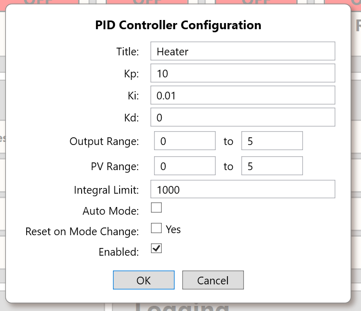

# PID Control

> **Engineering draft.** This describes the algorithm and routing in the supplied Core source; commissioning, tuning and machine safety remain application engineering responsibilities. The Control Panel's screenshot is illustrative, not a live-device measurement.

## 1. Controller resources and routing

SigCore UC implements **four PID controllers**, indexed `0..3` internally and displayed as PID1–PID4. Each PID has an `isEnabled` configuration flag, an `autoMode` flag, a selected analog input (`pvSource`) and a selected analog output (`outputDestination`). The defaults set input/output destinations corresponding to the PID's index, but the routing is configurable.

The PID's **PV** getter obtains the current calibrated reading from `HardwareManager.GetAnalogIn(PvSource)`. Its **Output** setter routes the calculated engineering value to `HardwareManager.SetAOutValue(OutputDestination, value)`; the AO channel then applies its own voltage/PWM scaling. The runtime **Auto** flag delegates to the destination AO's `IsAuto` property. Therefore multiple PIDs configured to the **same destination AO** can interact: no unique-output-ownership enforcement is shown in the reviewed `PID_LOOP` code.



*Actual Control Panel PID Properties dialog; title and numeric fields are example values.*

## 2. Configuration model

| Property / payload name | Interpretation |
|---|---|
| `title` | Display name for the loop |
| `isEnabled` | Whether `ComputeAll()` attempts to evaluate the loop |
| `autoMode` | Routed AO automatic flag; separate from `isEnabled` |
| `kp`, `ki`, `kd` | Proportional, integral and derivative coefficients |
| `pvSource` | Zero-based AI input channel, expected `0..3` |
| `outputDestination` | Zero-based AO output channel, expected `0..3` |
| `outputMin`, `outputMax` | Output clamp bounds when min is strictly less than max |
| `pvMin`, `pvMax` | Configured PV bounds; see implementation qualification below |
| `integralLimit` | Symmetric bound on internal integral accumulator |
| `resetOnModeChange` | Stored flag; its mode-transition effect is not shown in the reviewed algorithm |

The default payload class provides `Kp=10`, `Ki=0.01`, `Kd=0`, output/PV ranges **0–5**, integral limit **1000**, auto true, enabled false. Factory reset explicitly sets PIDs disabled and auto false and resets internal loop state. The screenshot does **not** prove those values are appropriate tuning parameters for any actual process.

## 3. PID mathematical operation

At each enabled automatic computation, `PidLoopModel.Compute(dt)` uses elapsed time in seconds, current setpoint `SP`, and process value `PV`:

```text
error    = SP − PV
P        = Kp × error
D        = Kd × (error − previousError) / dt
I        = Ki × integral
command  = clamp(P + I + D, outputMin, outputMax) when limits valid
```

The controller uses **derivative of error**, not derivative solely of measured PV; a sudden setpoint change can therefore produce derivative kick. It accumulates the integral with `integral += error × dt` unless the *estimated* output is already above the upper limit and error would increase it, or below the lower limit and error would decrease it. It clamps the stored raw integral symmetrically to `[-integralLimit, +integralLimit]`. These are software anti-windup measures, not guarantees against oscillation or overshoot.

If `enabled` is false, `auto` is false, or `dt <= 0`, `Compute` returns without updating the output. Each enabled loop is attempted independently so a fault in one can be logged without preventing other loops from being considered; a summarized exception can be propagated to the caller after processing.

### 3.1 PV limit qualification

The algorithm checks `pvMin < pvMax`, then assigns `curVals.PV = Clamp(curVals.PV, pvMin, pvMax)`. However, in the runtime implementation, `PID_LOOP.ConfigRuntime.PV` has a **no-op setter** and reads directly from an AI. Thus the attempted clamp does **not** actually replace the runtime PV readout in the supplied implementation. Do not claim effective PV clamping until engineering verifies a fix or the actual release behavior.

### 3.2 Runtime status fields

The model exposes `SP`, `PV`, `Output`, `Auto`, `Tol` (tolerance), `Dev`, and a monitor with `error`, `pTerm`, `iTerm`, `dTerm`, `integralRaw`, `atUpperLimit`, `atLowerLimit`, and `saturated`. `Dev` is computed as `abs(error)/Tol` only if `Tol > 0`, otherwise zero; it is a **normalized error ratio**, not an engineering-unit measurement. `saturated` indicates whether a valid configured output clamp altered the raw calculated output. Saturation status and at-limit flags have slightly different definitions and should not be treated as interchangeable.

## 4. Setpoint ramps

The in-memory PID model accepts runtime `ramp`, `rampTime` and `rampTarget` fields. When ramping is active and `rampTime > 0`, it captures the current SP as the starting value, progresses linearly using accumulated elapsed `dt`, and writes the target SP at completion. This modifies the runtime setpoint. The reviewed persisted `PidConfigPayload` **does not** include ramp fields; do not assume ramps survive restart or are included in the PID configuration file.

## 5. Manual/automatic and reset behavior

- Automatic output control is not the same as enabling the PID: **both** enabled and automatic are required for computation to command an AO.
- Direct AO set commands are not rejected by Core merely because that AO is automatic. Such commands may be overwritten during a subsequent PID cycle.
- `PID_LOOP.Reset()` clears integral, previous error and ramp elapsed time, but does not physically zero an AO as part of the reset method shown.
- `resetOnModeChange` is exposed and serialized, yet no call implementing reset on auto/manual transition is seen. `ResetIntegralToOutput()` exists in the model but no use of it was established in the reviewed snapshot. **Bumpless transfer is not verified.**
- A new PID configuration stops the PID sampling task, changes the config, saves it, then restarts the task. The elapsed-time stopwatch and integrator state do not automatically have the same lifecycle as the task.

## 6. Commissioning and troubleshooting

1. Establish the sensor's correct calibrated engineering units and AO actuator interpretation. Note that AO scaling direction is under engineering review; see [Calibration and Scaling](Calibration-and-Scaling.md).
2. Confirm `pvSource` and `outputDestination` route to the intended hardware channels. Verify no second enabled PID is driving the same AO unless intentional and validated.
3. Verify actuator safe limits physically. PID software clamps are not substitutes for independent thermal, pressure, travel or current limits.
4. With a safe test setup, use manual AO commands to verify output response and polarity; then set conservative PID gains.
5. Enable automatic behavior and monitor SP, PV, terms, saturation and output over time. If PV rises when output should reduce error, check process action/polarity and scaling rather than blindly increasing gains.
6. Test recovery from sensor loss, process disconnect, restart, and manual/automatic transitions under controlled conditions. Do not assume the loop goes to a safe output on fault without a validated application-level safety design.

## 7. Source evidence and unresolved questions

- `libs/SigCoreCommon/PidLoopModel.cs`: `Compute`, `Reset`, `ResetIntegralToOutput`, monitor fields.
- `libs/SigCoreCommon/PID_LOOP.cs`: routing, `ComputeAll`, configuration and runtime value packing.
- `libs/SigCoreCommon/Payloads/PidConfigPayload.cs`; `HardwareManager.cs` sampling and setters.
- `ControlPanel/Dialogs/PidConfigDlgVM.cs`, `project/sources/documentation/images/pid-properties.png`.

**Review:** PV clamp no-op; output destination exclusivity; bounds/indices and gain validation; actual auto/manual transition implementation; first-tick `dt` and restart effects; safety on Core/AI failures.
