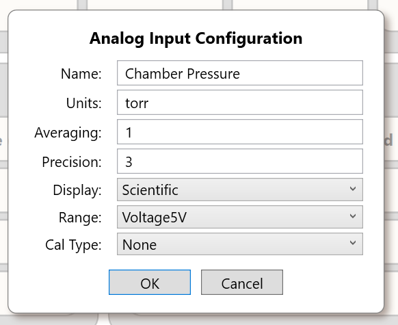

# Analog Inputs

> **Evidence-based development draft, not yet customer-approved.** Four input channels and the main signal-processing chain are supported by the supplied source. The exact relationship between some documented current modes, implementation enum values and returned electrical units needs engineering verification before this chapter is published as authoritative instructions. Do not use unresolved range names to justify wiring that exceeds published input limits.

## 1. Purpose, channels and evidence classification

SigCore UC Rev B has **four independently configured analog inputs**, physically labeled `Ain1` through `Ain4` on the supplied top overlay. Software generally labels them `AI1`–`AI4`. The .NET API indexes them **0–3**, so `AI1` is index `0`.

Knowledge categories used here:

- **Documented capability:** stated in the current product-site customer references supplied in `Project/Sources/documentation/`.
- **Implemented behavior:** directly traceable to code in the supplied `SigCore-Software-Source` snapshot.
- **Schematic fact:** component/wire relationship visible in the supplied Rev B schematic, sheet 3 (analog section).
- **Calculated engineering result:** arithmetic using stated assumptions; not a measurement of a built SigCore device.
- **Not characterized / unresolved:** no controlled end-to-end measurements, or source/documentation mismatch that requires confirmation.

The product Hardware Reference advertises **0–5 V, 0–500 mV, and 4–20 mA** analog inputs. Its wiring instructions also explicitly warn that a **0–10 V sensor needs external conditioning** and that one must not connect 10 V directly simply by choosing a setting. These public specifications take precedence over any temptation to treat an internal enum name as an additional certified range. A discrepancy with the Control Panel Reference and implementation range identifiers is recorded in section 10.

## 2. Physical and software signal path

The Rev B analog circuit uses **four TMUX1209** analog multiplexers, **one ADS1115** analog-to-digital converter, and **REF3025** circuitry generating a nominal 2.500 V reference route. `A_DOUT`, backed by the MCP23017 at I2C address `0x22`, controls external TMUX selection and enable bits. `A_IN` uses an ADS1115 at **I2C bus 1, address `0x48`**. These identifications are supported by schematic sheet 3 and `A_IN.cs`, `A_DOUT.cs`, `Ads1115Driver.cs`.

```text
AinN field signal / circuit reference
 -> Rev B connector protection and per-channel TMUX1209
 -> ADS1115 analog input (a channel of the single ADC)
 -> I2C read into A_IN._samples[N]
 -> channel calibration -> CurrentReading(N)
 -> Core request/subscription -> Control Panel / API / WebBridge
```

The schematic includes **200-ohm shunt resistors** in the current-input conditioning area (e.g. `R698`, `R700`, `R702`, `R704`). It also shows per-channel resistors/capacitors and protective elements on the ADC-connected signals. **A nominal external 2.500 V reference route is not the same thing as proof of a 2.500 V ADC conversion full-scale or guaranteed system accuracy.** The ADS1115 driver's conversion uses its configured full-scale setting.

In the code the ADC channel map is intentionally nonsequential for channels 3 and 4: the `InputMultiplexer` enumeration maps `AIN2 = 0x07` and `AIN3 = 0x06`. Comments attribute this to reverse wiring on the board. Do not "correct" this in client-side channel numbering; it is already compensated for by the driver.

## 3. Supported customer signal classes versus internal modes

**Product Hardware Reference, as supplied:**

| Customer-documented input type | Published description | Engineering qualification |
|---|---|---|
| Voltage | 0–5 V | Use a sensor within the stated interface limits; share an appropriate signal reference |
| Low-level voltage | 0–500 mV | Published category; exact software range selection/ADC PGA mapping needs confirmation |
| Current loop | 4–20 mA | Use an external loop supply where required; SigCore loop power is not assumed |
| 0–10 V source | Not directly supported by the published Rev B wiring instructions | Use rated conditioning before the controller input |

**Implementation range enum in `A_IN.Range` (values are internal, not a customer electrical specification):**

| Enum name | Integer | `ApplyMux` address selection | ADS1115 PGA selection in `ApplyInputRange` |
|---|---:|---|---|
| `Voltage256mV` | 0 | voltage path | ±0.256 V (`Gain16x`) |
| `Voltage1024mV` | 1 | voltage path | ±1.024 V (`Gain4x`) |
| `Voltage2048mV` | 2 | voltage path | ±2.048 V (`Gain2x`) |
| `Voltage5V` | 3 | voltage path | ±6.144 V (`Gain2_3x`) |
| `Voltage10V` | 4 | alternate mux path | ±6.144 V (`Gain2_3x`) |
| `Current` | 5 | current path | ±6.144 V (`Gain2_3x`) |
| `GNDSense` | 6 | ground-sense path | ±6.144 V (`Gain2_3x`) |

**Important:** The current Control Panel source explicitly maps the **legacy `Voltage10V` enum value to the label `2.500V Reference`** for Rev B. It is **not** permission to connect a 10 V signal. See `ControlPanel/Dialogs/AInConfigDlgVM.cs`. `GNDSense` and the reference route are diagnostic/implementation modes; they are not extra field-voltage ratings.

The current customer Control Panel Reference describes `Voltage5V`, `Current20mA` and `Current4To20mA`, but these last two names **do not appear** in the `A_IN.Range` enum in the supplied C# source. The numerical enum only contains `Current`. Until verified, do not assert that those distinct modes have independent conversion behavior or exist in the deployed build.

## 4. Acquisition and timing (implemented behavior)

`HardwareManager.SampleAnalogInLoop` repeatedly runs `A_IN.GetValue()`. Each pass iterates channels `0..3` in order. Before reading a channel, `SelectOnlyMux` changes external enable bits so **only one TMUX is selected at a time**. `ReadChannel` then configures the ADS1115 input/PGA and waits for conversions; it **discards one conversion after changing channels** and averages the requested number of subsequent conversion readings.

The code uses the following ADC nominal data-rate settings for the global analog sampling choice:

| Global setting | ADS1115 nominal conversion rate (`SPS`) | Driver delay after conversion steps |
|---|---:|---:|
| `Low` | 8 | 130 ms |
| `Medium` | 32 | 34 ms |
| `High` | 475 | 3 ms |

`AInConfig.AveragingSamples` defaults to `1`. `ReadChannel(channel, N)` performs a post-switch delay, a discarded reading and another delay, followed by `N` conversion reads, each with a delay, and averages the `N` scaled results. The loop also uses a one-millisecond asynchronous delay between scans.

**Do not equate ADS1115 `SPS` with complete per-channel SigCore measurement updates per second.** One ADC services four channels, and every channel involves mux switching, discarded conversion, averaging, I2C operations and software scheduling. An illustrative minimum of explicitly requested sleep time per four-channel scan at `N = 1` is approximately **1.56 s at Low, 0.408 s at Medium, or 0.036 s at High** (formula `4 × (2 + N) × driver delay`, plus the loop delay), excluding I2C and OS overhead. These are **code-derived scheduling sums**, not measured or guaranteed update intervals. Increasing averaging increases scan time.

When an analog loop read throws an exception, `GetValue()` attempts to disable all multiplexers, logs propagate to `HardwareManager.SampleAnalogInLoop`, which logs `Sampling/AnalogInputLoopFailure`, performs another best-effort disable, then retries after a 100 ms error delay. Stopping the loop also disables all TMUX enable lines in a `finally` block. On successful reads, selection advances channel by channel; do not assume the code disables all muxes after every successful sweep.

## 5. ADS1115 conversion and resolution (implementation and calculation)

`Ads1115Driver.ReadChannel` reads a signed 16-bit ADC conversion and computes a voltage-domain number:

```text
v_adc = signed_code × full_scale_voltage / 32768
raw_average = mean(v_adc_1 ... v_adc_N)
```

The driver's `GetFullScaleVoltage` returns ±6.144, ±4.096, ±2.048, ±1.024, ±0.512 or ±0.256 V for its gain values. These are **ADC conversion full-scale settings**, not independent published permitted voltages at the SigCore field connector.

A theoretical **ADC code step** at ±6.144 V full-scale is `6.144 / 32768 = 0.0001875 V`, or **187.5 µV per code**. At ±0.256 V full-scale it is **7.8125 µV per code**. This is quantization mathematics only. It does not establish input accuracy, effective noise-free resolution, linearity, sensor accuracy, drift, input loading or the permitted voltage at the physical connector.

**System performance not characterized.** No end-to-end measured accuracy, noise, thermal drift or metrologically verified update-rate claims are supplied. Component datasheet limits, calculations, and code behavior must not be rewritten as measured SigCore performance.

## 6. Configuration and values

Each channel's configuration payload includes:

| JSON key | Meaning | Default in source |
|---|---|---|
| `channel` | Zero-based channel index | set when payload constructed |
| `name` | User label | `AI1`–`AI4` in initialized configuration, blank after certain factory-reset paths |
| `units` | Display engineering units | `V` |
| `avgSamples` | Number of samples to average | `1` |
| `precision` | Numeric presentation precision | `3` |
| `calType` | Calibration method enum | `mXplusB` in `AInConfig` constructor; factory-reset code sets `None` |
| `range` | Internal range enum | `Voltage5V` |
| `display` | `FixedPoint` or `Scientific` | `FixedPoint` |
| `m`, `b` | Linear or logarithmic calibration coefficients | `1`, `0` |
| `polyString` | Comma-separated polynomial coefficients | empty |
| `pieceWiseString` | Comma-separated `input:output` pairs | empty |

The distinction between an object constructor's defaults and the **factory-reset settings** matters: factory-reset code explicitly chooses `CalType.None` for each channel.

`HardwareManager.SetAInConfig` pauses analog acquisition, updates a channel's payload, persists configuration, and restarts the analog loop. Configuration is stored under `analogInputs` in the global device properties file. See [System Architecture](../Architecture/System-Architecture.md) for persistence details.

`CurrentReading(channel)` applies the configured calibration to the most recently sampled voltage-domain value. `CurrentValues()` returns all four calibrated readings. The display format and precision are presentation properties, not evidence of physical measurement improvement.

## 7. Calibration algorithms (implemented)

Let `x` denote the raw numerical measurement passed to `ApplyCalibration`; it comes directly from the ADS1115-derived average in this code snapshot. Let `y` denote the returned calibrated reading.

| `CalType` | Function |
|---|---|
| `None` (`0`) | `y = x` |
| `mXplusB` (`1`) | `y = m*x + b` |
| `MultiPoint` (`2`) | Linear interpolation between neighboring `input:output` pairs |
| `Polynomial` (`3`) | `y = a0 + a1*x + a2*x^2 + ...` |
| `Log10` (`4`) | `y = 10^(m*x + b)` |

**MultiPoint behavior:** Below the first input point, extend the first line segment; above the final point, extend the final segment. Do **not** clamp at end values. If fewer than two valid pairs exist, arrays differ in length, or an encountered segment has zero input width, the code returns the raw `x` instead of a calibrated value. Points must be in ascending input order for the search routine to operate correctly.

The current Windows Control Panel's calibration editor validates finite numbers, requires at least two distinct MultiPoint inputs, and sorts them by input before saving. A raw API payload or device-website text editor may not enforce all the same constraints. Do not assume an arbitrary `pieceWiseString` is safe just because it can be parsed.

**Polynomial coefficient ordering:** `polyString` is interpreted as constant term first (`a0`), then `a1`, `a2`, etc. Coefficients are not a function of the display precision. An unsupported or unvalidated coefficient set can produce undesirable extrapolation.

**Log10:** Requires application-appropriate engineering units and calibration. This is a generic mathematical transform, not an assertion that a vacuum gauge can be connected directly without checking its electrical output.

### Worked calculation: 0–5 V sensor representing 0–100 PSI

**Engineering example, not a system performance test.** Assume a sensor is already known to output exactly 0 V at 0 PSI and 5 V at 100 PSI, and its input interface and common reference are compatible. With linear calibration, choose `m = (100 - 0)/(5 - 0) = 20 PSI/V` and `b = 0`. For an ADC-domain value `x = 2.50 V`, the computed value is `50 PSI`.

The calculation does not prove the electrical path measured 2.50 V accurately or that the sensor is linear in actual use.

### Current-loop calculation and unresolved unit question

The Rev B schematic shows a nominal **200 Ω** shunt route. If a selected current-mode input actually places this resistor across the loop, Ohm's law predicts `V_shunt = I × 200 Ω`, so **4 mA nominally develops 0.8 V and 20 mA develops 4.0 V**. This is a **circuit calculation**, not a measured SigCore return value.

**Critical verification item:** The supplied `A_IN` source does **not** show an automatic multiply-by-five conversion from the ADC voltage result into milliamps before applying calibration, even though the Control Panel Reference describes current-mode calibration inputs in milliamps and gives an example using `m = 6.25`, `b = -25` for a 4–20 mA / 0–100 PSI transmitter. These expressions are only equivalent if the code's calibration `x` is in the claimed units. **Do not publish a current-input calibration constant or represent a current-mode reading as milliamps until this is tested or traced to a conversion outside `A_IN`.** For engineering review, voltage-domain calibration of that same ideal 200-ohm example would instead require `m = 31.25 PSI/V`, `b = -25 PSI`, but that is **conditional mathematics**, not a verified SigCore setting.

## 8. Configuration and programmatic access

Through the public .NET API (`SigCoreSystem`):

```csharp
// Example of the public method contract, not a tested end-to-end program.
// Physical AI1 is index 0.
double value = await device.GetAnalogInputAsync(0);
AInConfigPayload config = await device.GetAInConfigAsync(0);
// After careful editing and verification of the complete payload:
await device.SetAInConfigAsync(config);
// Read back to confirm what configuration was stored.
config = await device.GetAInConfigAsync(0);
```

A `SigCoreSystem` instance must first be connected as described in the public API Reference. `AnalogInChanged` subscriptions provide array updates. `GetAnalogInputAsync` is a request/response read and can time out. A completed configuration send does not by itself prove that new settings were applied correctly.

The private WebBridge source defines `GET /api/config/ai/{channel}` and `PUT /api/config/ai/{channel}` and includes `analogInputs` within `GET /api/state`. The browser-facing PHP route may differ. A config PUT requires all allowed fields inside a `config` object, and its success payload explicitly says `confirmed: false`; a subsequent GET is needed for readback.



*Figure 1. Analog Input Configuration from the supplied public Control Panel Reference. The screenshot illustrates the UI; it does not resolve the documented current-range discrepancy.*

User interfaces: the Windows Control Panel has a dedicated analog input configuration dialog with structured polynomial and MultiPoint editors. The on-device Properties page has per-channel settings; its exact set of fields and validation need review against the installed website build. The current customer-facing Control Panel Reference should be used for operating instructions, subject to the explicit current-range discrepancy in section 10.

## 9. Application guidance, limitations and diagnosis

### Appropriate inputs and conditioning

- Suitable sources include voltage-output transmitters or compatible industrial current-loop transmitters with correct wiring and appropriate external supply.
- A raw thermocouple, RTD, resistive sensor, bridge/load cell or other low-level/specialized sensor normally needs an appropriate excitation/amplifier/converter/transmitter. Do **not** claim these connect directly to any SigCore analog input merely because it measures analog voltage.
- A sensor output above the published 0–5 V range must be conditioned to a supported input. The internal enum `Voltage10V` does not authorize a 10 V field connection.
- Confirm the exact terminal positions, signal reference, current loop topology, polarity and whether a loop's power source is internal or external before publishing a wiring diagram. The top overlay identifies channels and buses but is not a complete certified wiring schematic.
- Isolation, overvoltage tolerance and expected protection behavior must be established from complete design/component evidence. Do not infer isolation from having separate channels.

### Symptom-oriented diagnostic reasoning

| Observation | Checks supported by design/code | What not to assume |
|---|---|---|
| Stuck/high/low reading | Check source voltage/current with suitable instrumentation, selected range and channel config; examine ADC path and channel wiring | Do not assume software calibration can fix an out-of-range signal |
| Erratic reading | Check shared reference/ground, wiring, EMI and channel averaging; compare with known stable source | Do not invent a noise figure or guarantee filtering will cure interference |
| Value unexpectedly scaled | Check `calType`, `m`, `b`, polynomial coefficients and MultiPoint points; distinguish raw `x` from engineering `y` | Do not assume `Current` automatically yields mA |
| No updates or input freezes | Check Core connection, logs for `AnalogInputLoopFailure`, I2C/ADC/TMUX access, and whether the analog loop restarted | Do not treat a healthy browser page as proof of a fresh physical sample |
| Values change after configuration | Remember configuration updates stop and restart the analog sampling loop | Do not assume atomic, gap-free sample stream across reconfiguration |

Actual latency, accuracy, system noise and long-term stability remain **not characterized**.

## 10. Evidence, conflicts and publication gates

### Main technical sources

All software paths below are relative to `Project/Sources/SigCore-Software-Source/`.

| Topic | Source |
|---|---|
| Published Rev B ranges and 0–10 V limitation | `Project/Sources/documentation/hardware-reference.html`, *Measure an analog signal* and *Quick reference*; identical snapshot at `Web/public_html/reference/hardware-reference.html` |
| Public Control Panel ranges, calibration example | `Project/Sources/documentation/control-panel-reference.html`, *Analog inputs* |
| ADC, multiplexer, shunts, 2.500 V route | `Project/Sources/hardware/SCH_Schematic1_2026-08-15.pdf`, sheet 3 |
| Connector names/terminal group locations | `Project/Sources/hardware/top-overlay.pdf` |
| Analog driver, calibration and mode mapping | `libs/SigCoreCommon/A_IN.cs`, `libs/SigCoreCommon/Ads1115Driver.cs`, `libs/SigCoreCommon/A-DOUT.cs` |
| Loop, sampling-rate selection, config persistence | `libs/SigCoreCommon/HardwareManager.cs` |
| Wire config keys, defaults and enum domains | `libs/SigCoreCommon/Payloads/AInConfigPayload.cs` |
| UI reference-routing of legacy voltage mode | `ControlPanel/Dialogs/AInConfigDlgVM.cs` |
| UI MultiPoint/polynomial editing and validation | `ControlPanel/Dialogs/AInConfigDlg.xaml.cs` |
| Public .NET method contracts | `libs/SigCoreCommon/SigCoreSystem.cs`, `Project/Sources/documentation/api-reference.html` |
| Private HTTP config and state | `WebBridge/Endpoints/ConfigurationEndpoints.cs`, `WebBridge/Endpoints/StatusEndpoints.cs` |

### Unresolved before customer publication

1. **Current-loop units:** Does a deployed Rev B Core return volts or milliamps when `range = Current`? If milliamps, identify the conversion path; otherwise update the reference/calibration instructions.
2. **Range alignment:** Explain why the public Hardware Reference lists `0–500 mV`, the Control Panel Reference lists two named current ranges, and the implementation enum exposes voltage PGA modes and one `Current` value. Establish the supported Rev B set, labels and electrical limits.
3. **Wiring and protection:** Verify the external terminal assignment/reference and exact permitted input voltage/current before issuing wiring diagrams or overvoltage claims.
4. **Snapshot provenance:** Associate the code and drawings with a precise installed software version and hardware board variant.
5. **Performance:** No measured system-level accuracy/noise figures exist. This is an explicit knowledge boundary, not a request for a characterization program.
6. **Input validation:** Confirm the deployed UI/API prevents `avgSamples = 0` and malformed MultiPoint tables; the core driver will reject zero sample counts.

**Release status: NOT APPROVED.** These are questions for targeted source tracing or a limited functional check, not a requirement for comprehensive laboratory characterization. See `Project/Verification-Register.md`.

## Related documents and images

- [System Architecture](../Architecture/System-Architecture.md)
- [Calibration and Scaling](../Core-Software/Calibration-and-Scaling.md) (placeholder)
- Sensors and Signal Conditioning (planned chapter; not yet authored)
- Electrical Specifications (planned chapter; not yet authored)
- Planned images `HW-008` through `HW-011` in [IMAGE-INVENTORY](../Images/IMAGE-INVENTORY.md). No unverified diagram is included in this batch.
