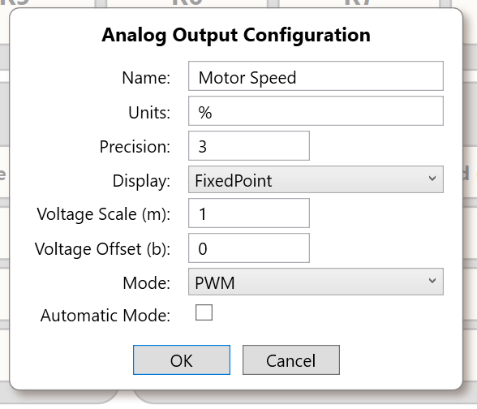

# Analog Outputs

> **Engineering source draft, not approved for customer distribution.** Four 0–5 V / PWM output channels are documented and implemented in the supplied Rev B source. There is a material discrepancy between the published Control Panel Reference and the Core's *engineering-unit scaling direction*. Until resolved, do not present arbitrary non-default scaling examples as verified operating instructions. The source code also resets a channel's commanded output to zero when its configuration is set.

## 1. Scope, channel names, and evidence classes

SigCore UC Rev B provides **four analog outputs**, `AO1`–`AO4`. The public Hardware Reference describes selectable **0–5 V voltage** and **PWM** modes. The output modes are independently selectable for each channel; the PWM carrier frequency is a **global** device setting.

The external channel names are one-based. The public .NET methods, Core payloads, and internal HTTP endpoints identify physical `AO1` as **channel `0`**, through `AO4` as **channel `3`**.

Terminology in this chapter:

- **Published**: specified in the supplied public product website's Hardware and Control Panel Reference pages.
- **Implemented**: observed in the supplied C# Core, hardware-driver, Control Panel, and WebBridge source snapshot.
- **Schematic**: defined by Rev B electrical drawing sheet 2, *Analog Out*. An intended schematic feature is not by itself proof of the populated assembly or a measured specification.
- **Calculated**: a mathematical consequence of code constants or ideal assumptions, not an electrical measurement.
- **Unverified**: requires release mapping, implementation reconciliation, or a limited actual-unit check.

## 2. Operator configuration image



*Figure 1. The supplied public Control Panel Reference's Analog Output Configuration screenshot. This illustrates the configuration fields, not confirmation that the published scaling explanation matches the deployed Core.*

When answering a question about the dialog or its settings, **include Figure 1 inline**, rather than mentioning only its filename.

## 3. Hardware signal path (Rev B schematic and implementation)

The supplied schematic (sheet 2, *Analog Out*) identifies the following intended arrangement:

```text
                 MCP4728 DAC (I2C 0x60) -- voltage signal ----+
                                                             | 
                                                           [per-channel
                                                            2:1 switch]
                                                             |
 PCA9685 PWM (I2C 0x40) ------- PWM signal ------------------+
                         + separate per-channel select signal
                                                             |
                                     output buffering / jumper selection
                                                             |
                                     series resistor and ESD protection
                                                             |
                                       AO field connector and reference
```

The actual implementation uses:

| Function | Source-backed detail | Important interpretation |
|---|---|---|
| Voltage generation | MCP4728 four-channel DAC on I²C bus `1`, address `0x60` | A 12-bit command value, not an independently confirmed 12-bit effective output accuracy |
| PWM generation | PCA9685 on I²C bus `1`, address `0x40` | PWM is a pulse train, not a continuous control voltage |
| Path selection | Each field channel's PWM-versus-voltage signal is selected by an SN74LVC1G3157 analog switch using a PCA9685 selection output | Selected **per channel** in `A_OUT.SetMode` |
| Buffer/output network | Schematic depicts OPA333 unity-gain stages, jumper/bypass provisions, series output components and ESD diodes | Do not state an output-current capability or guaranteed drive strength from these component names alone |

The schematic notes identify `LED0/2/4/6` as PWM sources and `LED1/3/5/7` as mode selectors. The driver maps logical output `n` to the PCA9685's **even channel `2n`** for duty cycle and **odd channel `2n+1`** for selection. The Core writes selector `false` for voltage mode and `true` for PWM mode. The drawing shows DAC paths from MCP4728 `VOUTD/C/B/A` routed to output channels `1/2/3/4` respectively, so do not assume physical output order equals the DAC's alphabetic channel order; the driver explicitly remaps DAC register commands.

**Physical limitations not confirmed here:** Pin-by-pin external wiring, as-built jumper population, maximum sourcing/sinking current, output loading, capacitive drive, short-circuit behavior, electrical isolation, and calibrated output-voltage accuracy. The public references provide mode and nominal voltage range, not those specifications.

## 4. Output modes and command conversion (implementation)

The Core implements the modes as `A_OUT.OutputMode.Voltage = 0` and `PWM = 1`.

| Mode | Engineering value to hardware command in supplied `A_OUT.cs` | Clipping applied |
|---|---|---|
| `Voltage` | `v = engineeringValue × voltM + voltB`; DAC command `round((v / 5.0) × 4095)` | `v` clipped to **0.0–5.0 V** before DAC conversion |
| `PWM` | `duty = engineeringValue × voltM + voltB`; set PWM duty in percent | `duty` clipped to **0–100%** |

The Core's readback method performs the inverse of its own command transform: `engineeringValue = (storedHardwareValue − voltB) / voltM` for either mode. `storedHardwareValue` is a **software-stored commanded hardware value**, not a physical ADC measurement of the actual terminal. The Core may skip a hardware write when the newly calculated hardware command equals the last stored command.

For the **default** scaling `voltM = 1` and `voltB = 0`, a command of `2.5` in voltage mode maps to a nominal `2.5 V` command. A command of `50` in PWM mode maps to `50%` duty. These are **code-derived examples**; they do not certify measured terminal output.

**Resolution:** The DAC sends integer codes `0` to `4095` and uses `5.0` V for its software normalization. The ideal code step is approximately `5 / 4095 = 1.221 mV` **if** the end-to-end transfer really spans 0–5 V. That is arithmetic, not output accuracy, linearity, or noise performance. DAC configuration and rail voltage also matter.

### PWM frequency

The global `PWMFrequency` property defaults to **250 Hz** in the supplied `HardwareManager` configuration. `Pca9685Driver.SetPwmFreq` clips its requested frequency to **40–1000 Hz** and programs a clock-divider value from a nominal 25 MHz oscillator. The actual PWM frequency depends on the device clock; no system frequency-tolerance measurement is supplied. Changing the system frequency affects PWM operation globally, not just one AO channel.

### What happens on mode or configuration changes

`A_OUT.SetConfig` reads the provided channel configuration and calls `SetMode`. `SetMode` switches the selected path and resets the active signal to **0 V** for voltage mode or **0% duty** for PWM mode. This happens on a configuration save even if the mode did not change. The separate `FromPayload` path explicitly zeros both DAC and PWM first, pauses briefly, loads the configuration, then calls `SetMode`.

Therefore, **treat a configuration update as a potentially disruptive output transition**, especially if an output is controlling operating equipment. Read back the configuration and command the intended value deliberately afterward; do not assume the pre-save output is preserved.

## 5. Engineering-unit scaling discrepancy: NOT RESOLVED

There is a direct conflict in the supplied material:

| Source | Written relationship |
|---|---|
| Product website **Control Panel Reference**, Analog Outputs / Bidirectional output scaling | `Displayed = m × physical_voltage + b`, and `physical_voltage = (Displayed − b) / m` |
| Core `A_OUT.SetAnalogValue` / `GetAnalogValue` | `physical_voltage = m × requested_engineering_value + b`, and `returned_engineering_value = (stored_voltage − b) / m` |
| Control Panel `AnalogOutChannel.ShowConfig` | `MinValue = b`; voltage `MaxValue = m × 5 + b`; PWM `MaxValue = m × 100 + b` |

The first and second rows use **opposite meanings for `m` and `b`**. They agree only under certain special cases, such as default `m=1, b=0`.

**Illustration of why this matters (not customer setup instructions):** The published reference claims `m=20`, `b=0` makes `0–5 V` appear as `0–100%`, so entering `50%` should produce `2.5 V`. In the supplied Core, entering `50` with `m=20` instead computes `1000 V` and clips the DAC command to `5 V`. This is a source-grounded discrepancy, not a hypothetical rounding issue.

A separate software hazard is visible in `GetAnalogValue`: it divides by `voltM` without an explicit nonzero check. The reviewed WebBridge config endpoint checks field presence and non-finite JSON values but does not show a **`voltM != 0`** numerical guard. Do not advise using zero as the scaling coefficient.

**Publication gate:** The product owner must decide the intended user-facing scaling convention, align the Core and the UI/reference accordingly, and verify representative non-default settings in voltage and PWM modes. Until then, explain the conflict rather than presenting either relationship as approved behavior.

## 6. Configuration payload and defaults

The Core's AO payload keys and defaults are:

| JSON key | Meaning | Source default |
|---|---|---|
| `channel` | Hardware AO index, `0`–`3` | Specified for target channel |
| `name` | User label | AO1–AO4 on new `A_OUT` construction; factory reset uses blank names |
| `units` | Display units | `V` in initialized/factory-reset config |
| `auto` | Automatic-mode flag | `false` |
| `precision` | Number formatting precision | `3` |
| `mode` | `0=Voltage`, `1=PWM` | `0` |
| `display` | `0=FixedPoint`, `1=Scientific` | `0` |
| `voltM` | Scaling coefficient | `1.0` |
| `voltB` | Scaling offset | `0.0` |

`precision` and `display` control presentation and must not be confused with output DAC resolution or hardware accuracy. `name` and `units` are descriptive metadata; they do not by themselves change the electrical range. Do not change scaling, mode or automatic state without understanding the connected load and control loop.

The WebBridge configuration API uses **`GET /api/config/ao/{channel}`** and **`PUT /api/config/ao/{channel}`**. The PUT implementation requires a nonempty `config` object with **all eight editable keys** (`name`, `units`, `auto`, `precision`, `mode`, `display`, `voltM`, `voltB`); `channel` comes from the URL and is not edited through the config object. The response `accepted: true, confirmed: false` indicates a command was accepted for transmission, **not proof that it was applied**. Follow with a GET readback. These paths are **private WebBridge endpoint paths**, not necessarily the externally available URLs. The supplied device website's PHP proxy uses `/api/config.php?kind=ao&channel=N` and forwards into the bridge.

## 7. Manual, automatic, and PID interaction

The `auto` configuration flag participates in PID output control. `A_OUT.SetFromPID` writes a channel only if `IsAuto` is true. The Windows Control Panel disables a channel's manual value control when it receives an AO state notification indicating automatic mode. A change to the output's automatic state is propagated by `HardwareManager.SetAOutAuto`.

**Do not overstate a safety interlock:** `HardwareManager.SetAOutValue` itself does **not** reject a direct manual/API set merely because the channel is in automatic mode. Such a command may be written while a controller is also attempting to set the same output. The visible Control Panel behavior and the Core command gate are different. This must not be described as guaranteed exclusive manual/automatic ownership.

Before testing an output that operates a motor, heater, valve, or other actuator, determine which subsystem owns the output, check the configured limits and external failsafe provisions, and select a safe test value. No general-purpose interlock or safe load-driving rating is established by the output mode alone.

## 8. Interface and programmatic access

### Windows Control Panel and device website

- **Windows Control Panel:** Open the AO's channel menu and configure its name, units, precision, display format, scale/offset, voltage/PWM mode and automatic setting. The main view displays and can command an output in manual mode.
- **Device website:** The **Control** view shows AO values and allows a numeric set command; the **Properties** view exposes the corresponding AO configuration fields. The supplied website sends commands through a PHP proxy to WebBridge.

### Public .NET API

The supplied `SigCoreSystem` exposes `GetAOutValueAsync(uint channel)`, `SetAOutValueAsync(uint channel, double value)`, `GetAOutConfigAsync(uint channel)` and `SetAOutConfigAsync(AOutConfigPayload config)`.

```csharp
// Illustrative calls against an already-connected SigCoreSystem instance.
// AO1 is index 0. Read-only until you deliberately enable the write.
var config = await device.GetAOutConfigAsync(0);
double reportedValue = await device.GetAOutValueAsync(0);

// To command a value in an appropriately configured, safe test setup:
// await device.SetAOutValueAsync(0, 2.5);
```

The `SetAOutValueAsync` and `SetAOutConfigAsync` methods transmit commands; the latter explicitly documents that it does not automatically read back the new configuration. Ensure the caller is connected and authorized for writes. Do not treat a returned reported output value as a measured terminal voltage.

### WebBridge HTTP control

The internal endpoint is **`POST /api/control/analog-output`** with JSON fields `channel` and `value`. The endpoint's response contains `requestedValue`, `accepted: true`, `confirmed: false`. The public-facing on-device PHP proxy accepts **`POST /api/control.php?operation=analog-output`** and forwards the body. The internal WebBridge listener and external exposure depend on deployment configuration; an HTTP endpoint's existence in code does not mean customers can reach it directly from their LAN.

## 9. Diagnostics and appropriate use

| Symptom or question | Evidence-based check | Avoid assuming |
|---|---|---|
| Requested voltage differs from terminal measurement | Verify supply rail, mode, common reference, load, configured scaling and whether the DAC command clipped | A nominal 0–5 V code conversion guarantees output accuracy |
| PWM signal appears as an unexpected average voltage | Confirm receiving instrument expects PWM and measure actual duty/frequency | PWM has the same meaning as a steady 0–5 V analog signal |
| Output falls to zero after changing settings | `SetConfig` and `SetMode` reset the selected output to a zero baseline | Saving properties preserves the previous hardware command |
| A manual change does not persist | Inspect automatic mode, PID output mapping and subsequent controller updates | Automatic mode reliably blocks every manual/API write |
| Scale is inverted or saturates | Test with defaults, review `voltM`/`voltB`, inspect the documented scaling conflict | Published scaling example and supplied Core always agree |
| Output reading looks correct but physical terminal does not | Remember the reported AO value is software-derived, not closed-loop terminal feedback | Readback alone verifies the real-world electrical level |

A voltage/PWM output is a **control signal**; it is not a general high-current power output for direct connection to heaters, motors, solenoids, or other substantial loads. Use a compatible external driver and determine its electrical interface before connecting it. This is engineering guidance, not a measured current rating for SigCore's AO terminal.

## 10. Source map and release questions

Paths below are relative to `project/sources/` in this **development** archive. The authoritative customer reference snapshots reside in `documentation/`; the device website's obsolete local reference copies must not be treated as current.

| Subject | Source |
|---|---|
| Published modes and nominal range | `documentation/hardware-reference.html`, *Send an analog output* / *Quick reference* |
| Published inverse scaling and UI field descriptions | `documentation/control-panel-reference.html`, *Analog outputs* |
| Field circuit / DAC / PWM / analog switch / buffer | `hardware/SCH_Schematic1_2026-08-15.pdf`, sheet 2, *Analog Out* |
| DAC/PWM initialization, mode, scaling, clipping, reset-on-config | `SigCore-Software-Source/libs/SigCoreCommon/A_OUT.cs` |
| I²C, DAC command codes | `SigCore-Software-Source/libs/SigCoreCommon/Mcp4728Driver.cs` |
| PWM mapping, frequency and duty commands | `SigCore-Software-Source/libs/SigCoreCommon/PCA9685.cs` |
| Global frequency default, AO state, factory reset, PID calls | `SigCore-Software-Source/libs/SigCoreCommon/HardwareManager.cs` |
| AO payload serialization and JSON names | `SigCore-Software-Source/libs/SigCoreCommon/Payloads/AOutConfigPayload.cs` |
| Control Panel displayed range and manual mode | `SigCore-Software-Source/ControlPanel/IOChannelHandlers/AnalogOutChannel.cs`; `ControlPanel/MainWindowVM.cs` |
| Public .NET commands | `SigCore-Software-Source/libs/SigCoreCommon/SigCoreSystem.cs` |
| WebBridge command and configuration paths | `SigCore-Software-Source/WebBridge/Endpoints/AnalogOutputEndpoints.cs`; `ConfigurationEndpoints.cs` |
| Device-website PHP proxy | `SigCore-Software-Source/UpdaterFiles/www/api/control.php`; `config.php` |
| Screenshot | `Images/Control-Panel/analog-output-properties.png` (copied unchanged from supplied `documentation/images/analog-output-properties.png`) |

### Items requiring an engineering decision or verification

1. **Scaling direction and bounds (high):** Reconcile documentation, Core conversion and Control Panel min/max conventions. Verify `voltM=0` handling and meaningful non-default test cases.
2. **Configuration reset behavior (high):** Confirm that zeroing an active AO on property save is intended and adequately communicated to operators, particularly where a PID owns the channel.
3. **Auto/manual command ownership (medium):** Decide/document expected behavior when an API write arrives during automatic operation.
4. **Hardware specs (medium):** Verify as-built output buffering/jumper population, physical terminals, power reference, output current limits, and any usable accuracy or tolerance statement before publishing them.
5. **Provenance (medium):** Associate this source snapshot with an installed Core, Control Panel and WebBridge release.

**Review status: NOT APPROVED.** The chapter documents supported evidence and concrete discrepancies; no live device test was performed during drafting.

## Related chapters

- [System Architecture](../Architecture/System-Architecture.md)
- [Analog Inputs](Analog-Inputs.md)
- [Image Inventory](../Images/IMAGE-INVENTORY.md)
