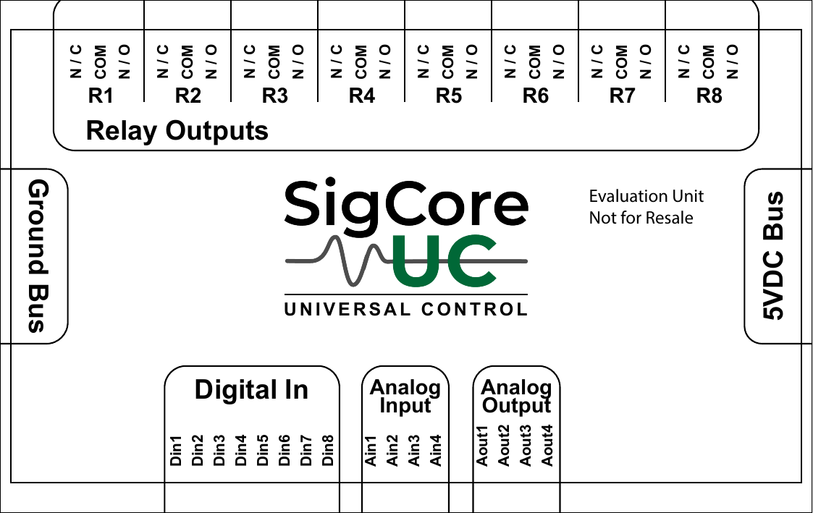
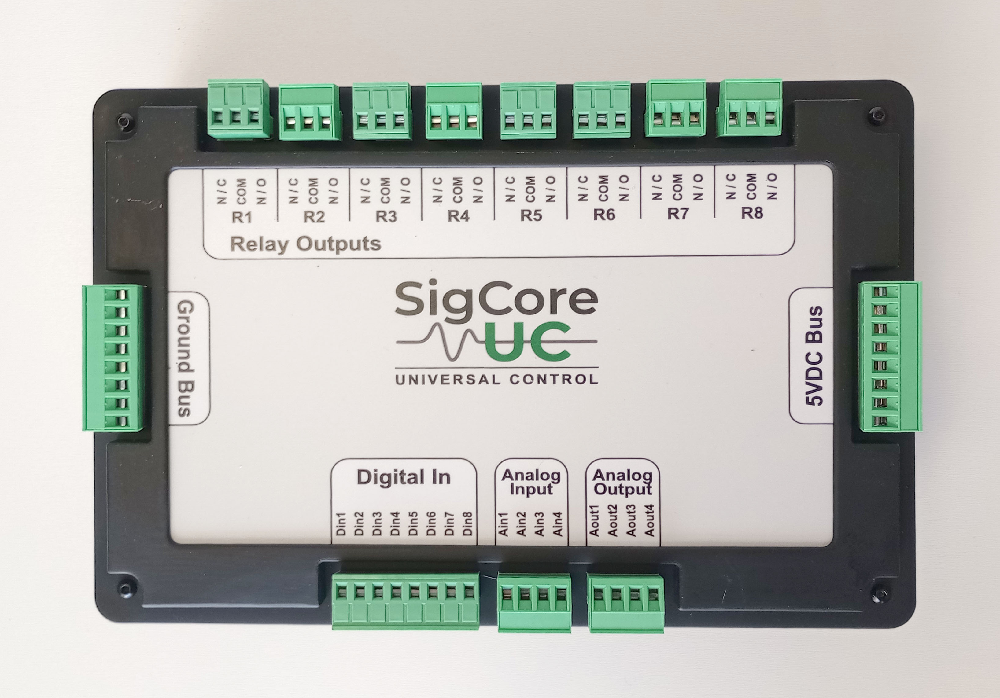
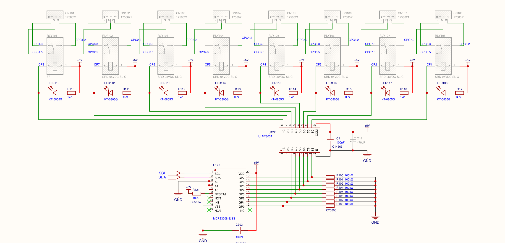

# Connectors and Pinouts

> **Engineering source draft. Not an approved live-wiring instruction.** This chapter differentiates connector *group labels* that are clearly supported by the supplied overlay and circuit drawing from **pin numbering, mating parts and permissible field wiring**, which have not been verified against the assembled product. Do not invent a pin-1 direction from a photograph.

## 1. Physical orientation and connector-group identification

*Figure 1. Exact rendering of supplied `top-overlay.pdf`. It includes “Evaluation Unit / Not for Resale”; it is a design artifact, not a stand-in for production connector inspection.*

*Figure 2. Actual device photograph. Use together with the device's physical silkscreen, not by itself as an installation pinout.*

On the supplied overlay, the relay terminal groups occupy the upper edge, with `R1` through `R8` each labeled **N/C, COM, N/O**. The opposite field side has `Din1`–`Din8`, `Ain1`–`Ain4`, and `Aout1`–`Aout4` in grouped rows. The overlay also labels a **Ground Bus** and a **5VDC Bus**. These words establish design-intended group identity; without the terminal drawing and tested assembly, they do **not** establish bus capacity, individual available pin count, safe load connections or which physical end of a detachable connector is pin 1.

**Terminology:** `R1`–`R8` are eight relay *channels*, each with a three-terminal contact set; `DI1`–`DI8` are eight independent sensed inputs; `AI1`–`AI4` and `AO1`–`AO4` are four channels each. Label case (`Din1` vs `DI1`) does not create distinct channels.

## 2. Connector-family evidence versus terminal assignments

| Board schematic reference | Reported connector type | Intended signal group | Verified assignment boundary |
|---|---|---|---|
| `CN109` (sheet 5) | `WJ2EDGV-5.08-8P` | Eight field digital-input signals (`CIN401`–`CIN408`) | Individual circuit nets are drawn; **physical orientation/pin-1 location not cross-checked on assembled board** |
| `CN111` (sheet 2) | `KF2EDGV-5.08-4P` | Four analog output signals (`CH1`–`CH4-PATCH-PANEL-OUT`) | Ground/reference strategy and the mating plug need direct assembly verification |
| `CN114` (sheet 3) | `KF2EDGV-5.08-4P` | Four analog input measurement signals (`CIN-ADC-501`, etc.) | Each channel's reference/return must be established from complete wiring, not assumed from a 4-pin signal connector |
| `CN112`, `CN113` (sheet 1) | `WJ2EDGV-5.08-8P` | Connector blocks appearing near shared power/board area | Not a verified field function or 5 V bus map solely from extracted PDF text |
| `CN1` and `CN2` (sheet 1) | JST VH series symbols `B2P-VH` and `B4P-VH` | Power/interface design region | Do not assign a production charging/input or 5 V accessory pinout without as-built inspection |
| Relay contact circuits (sheet 4) | Eight `COM`/`NO`/`NC` contact sets | Switched external power/load circuits | Overlay gives contact-label order, but exact terminal-number orientation and allowable harness details require sign-off |

**Source drawing caveat:** Component reference and schematic connector type are *design evidence*. A plug terminal's mating geometry, assembly orientation, wire-entry direction, pin pitch, terminal torque, wire gauge and polarity need an explicit engineering-approved connector drawing or physical continuity check. Do not claim the `WJ2EDGV` and `KF2EDGV` part labels alone certify a particular customer's installed connector.

## 3. Relay COM/NO/NC contacts

For each relay:

- **COM:** Moving/common contact.
- **NO (N/O):** Nominally open to COM when the *coil is de-energized*.
- **NC (N/C):** Nominally closed to COM when the *coil is de-energized*.
- **Coil versus load:** The internal coil driver uses board power. The contacts switch an **independently provided external circuit**; a `NO` pin is not a 5 V source and a relay status value is not contact-position sensing.
- **Inversion:** Software Inverted Logic changes the intended mapping between Core logical state and physical coil drive. Do not assume its current release always reapplies polarity on configuration edits; verify the patched build.

*Figure 3. Driver circuit, not terminal orientation.*

Refer to [Relay Outputs](Relay-Outputs.md) for ratings, external wiring concepts and safety boundaries. **Published contact figure:** 120 VAC / 10 A, without full load-category derating data. Do not generalize it to every DC/inductive load.

## 4. Digital input and analog signal connections

**Digital inputs:** Rev B DI circuits are referenced to the board's **common GND**. The published voltage thresholds are OFF ≤1 V and ON ≥2 V. A digital input is *not galvanically isolated* by its discrete NPN transistor conditioner. The published guide does not certify the maximum continuously safe input voltage, despite TVS component values shown in the schematic. A dry switch must be connected as part of a suitable signal-producing circuit; an open contact by itself does not necessarily drive the input high.

**Analog inputs:** Each channel senses a configured signal class (published 0–5 V, 0–500 mV, or 4–20 mA). The correct external voltage/current return path depends on the actual circuit and input-mode configuration. Do not wire a current-loop supply to a guessed return pin, treat the 5 V bus as a loop-power guarantee, or connect a 0–10 V signal directly to a 0–5 V input.

**Analog outputs:** Four DAC/PWM signal outputs provide **control signals**, not arbitrary load power. Commanded 0–5 V/PWM modes share external reference and load requirements that must be checked against the receiving equipment. PWM is a switched signal, not a guaranteed filtered analog voltage.

## 5. Connector handling and verification procedure

Before wiring a real machine:

1. Confirm the exact **board revision and printed terminal markings** on the unit, not only a reference PDF image.
2. Identify the physical connector family, mating plug and *pin-number orientation* from assembly drawings and a verified continuity map.
3. Determine the electrical return/reference and power source for each field device independently. Keep the controller's 5 V supply separate from relay contact load power.
4. Obtain approved wire gauge, stripping, torque, insulation, separation, current and voltage information for the actual connector/load. None are established in the supplied customer Hardware Reference.
5. Verify de-energized relay contact continuity and intended connection before energizing external loads. Test with an external meter or feedback rather than relying on software logical state.
6. Commission field signals one channel at a time with safe levels and the corresponding [installation checklist](../Operations/Installation-and-Commissioning.md).

**Do not use guessed pin-number maps as an AI-generated wiring diagram.** If a user requests a specific pin number, ground termination or wire-insertion direction that the KB does not certify, explain the missing datum and request the relevant as-built photograph/drawing rather than assigning one.

## 6. Evidence and limitations

- `project/sources/hardware/top-overlay.pdf`: printed group labels and relay contact identification for an evaluation unit.
- `project/sources/hardware/SCH_Schematic1_2026-08-15.pdf`: sheet 1 connector/power symbols; sheet 2 AO; sheet 3 AI; sheet 4 relays; sheet 5 DI.
- `project/sources/documentation/hardware-reference.html`: published field descriptions, threshold values and connector functions.
- [Power and Protection](Power-and-Protection.md), [Internal Interfaces](Internal-Interfaces.md), [Mechanical and Assembly](Mechanical-and-Assembly.md), [Electrical Specifications](../Reference/Electrical-Specifications.md).

**Outstanding sign-off:** complete table of *every* field connector physical pin number → tested schematic net → overlay marking, including common bus terminations and power polarity, plus mating part/gauge/torque and layout revision.
