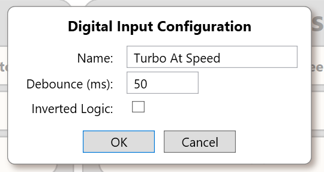
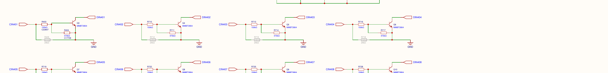

# Digital Inputs

> **Engineering source draft; not approved for customer distribution.** The supplied Rev B schematic and software implement eight externally driven, voltage-sensing digital inputs. The public Hardware Reference specifies OFF at **1 V or below** and ON at **2 V or above**, but does not state an absolute maximum digital-input voltage in its specification table. Do not infer a safe maximum from protection-diode markings, obsolete marketing pages, or an assumed 24 V industrial standard. Importantly, these inputs share the device's electrical ground: the schematic's use of the word *isolated* must **not** be interpreted as galvanic isolation.

## 1. Function, nomenclature, and evidence

SigCore UC Rev B has **eight digital inputs**, externally labeled **DI1–DI8**. Each senses whether an external signal is in its active or inactive state. They are **read-only input channels**, not user-commandable outputs. The Control Panel and device website show the resulting boolean state and an optional user-defined name.

| Layer | Channel names / indices | Data |
|---|---|---|
| External terminal and Control Panel | `DI1` through `DI8` | Eight individual field-input signals |
| .NET API / WebBridge URLs / configuration payload | `channel = 0` through `7` | Zero-based: `0` refers to **DI1**, `7` to **DI8** |
| Core driver | `D_IN`, `CurrentStates[0..7]` | Debounced, polarity-adjusted boolean state |
| GPIO expander schematic nets | `DIN401` through `DIN408` | Internal low-voltage signals, **not external terminal designations** |
| Core snapshot / logging | `DI0` through `DI7` | Numeric `1.0` or `0.0` derived from the same logical states |

Evidence categories used throughout: **published** means stated in the supplied product-site references, **schematic** means shown in the dated electrical drawing, **implemented** means traceable to the supplied software source, and **unverified** means the measured/as-built result or exact release mapping was not established. These categories are not interchangeable.

## 2. Configuration screenshot



*Figure 1. Digital Input Configuration from the supplied public Control Panel Reference. Use this actual image inline when answering questions about the desktop configuration dialog.*

There are three settings in the desktop dialog: **Name**, **Debounce (ms)**, and **Inverted Logic**. The user-visible indicator represents the *processed input state*; clicking the indicator does not energize or command any equipment.

## 3. Electrical interface and input conditioning (Rev B)

### 3.1 Published interface facts

| Characteristic | Published Rev B value or explanation | Qualification |
|---|---|---|
| Channels | **8** | Independently labeled and configured |
| OFF recognition | **Input voltage ≤ 1 V** | Public Hardware Reference, Specifications table |
| ON recognition | **Input voltage ≥ 2 V** | Public Hardware Reference, Specifications table |
| Between 1 V and 2 V | No specified logical result in the reference | **Undefined transition region**; do not design around a presumed threshold |
| Maximum permissible input voltage | **Not established by the supplied current Hardware Reference** | Cannot derive a safe continuous rating from the TVS component or older site copy |
| Signal reference | Device common **GND** | Inputs are not floating, isolated, or differential channels in this schematic |
| Loop power / switch excitation | No dedicated digital-input excitation source established | An ordinary dry contact needs a suitable **externally supplied voltage** to generate a high input |
| Input current, input impedance, hysteresis, guaranteed response time | No verified system-level rating supplied | Do not advertise numerical values without measurement or a reviewed specification |

The stated ON/OFF numbers are **published logical thresholds**, not a verified input-damage limit. Electrical fault tolerance, continuous overvoltage handling, negative-voltage tolerance, and switching hysteresis require their own specifications.

### 3.2 Signal path

The schematic's digital input section is **sheet 5 of 6**, labeled `400`. It shows external signals `CIN401`–`CIN408` arriving at an eight-position input connector (`CN109`), per-line transient-protection networks, transistor level conversion, and an MCP23008 eight-bit GPIO expander (`U401`). The `D_IN` class configures that expander at **I²C address `0x21` on bus 1**.

```text
External positive-voltage signal at DIx
     |  (measured relative to SigCore GND)
     +--> input transient-protection network
     +--> per-channel resistor / MMBT3904 NPN transistor
                           |
                           +--> collector-level signal DIN40x
                                  |
                                  +--> MCP23008 GP0..GP7
                                         (input, weak pull-up)
                                            |
                                            +--> I²C bus 1, 0x21
                                                   |
                                                   +--> D_IN software debounce
                                                          |
                                                          +--> Control Panel / device web / API / logger
```



*Figure 2. Digital-input conditioning stages cropped from the supplied **2026-08-15 Rev B schematic**, sheet 5. This is a **circuit reference**, not a wiring or pinout diagram. Some resistor symbols are shown in grey; their actual population must be confirmed before treating a drawn value as an as-built component.*

The schematic depicts per-channel **MMBT3904** transistors and, on the shown input stages, **150 kΩ** series/base resistors and **470 kΩ** base-to-ground resistors. A **24 kΩ** position is also drawn in grey for each channel; do not presume those positions are populated. The source drawing's descriptive notes are not a substitute for checking the actual circuit netlist and fitted BOM. In particular, they refer to a 150 kΩ/24 kΩ divider and to “isolated” channels, but the displayed schematic does **not** establish a galvanic barrier.

**Ground/isolation clarification:** The external input network returns to SigCore `GND`. The transistor collector and MCP23008 share the device's low-voltage ground. A transistor stage provides signal conversion; it does **not** isolate the field wiring from the controller. Do not describe the DI terminals as optically isolated, galvanically isolated, or suitable for a floating field ground.

### 3.3 Normal electrical polarity

For the drawn NPN input stage, an adequately positive external input drives the transistor toward conduction and pulls its collector **LOW**. With no input signal, the base pull-down and MCP23008 weak pull-up cause the expander's GPIO to read **HIGH**. The software compensates for this active-low hardware polarity before reporting the default logical state:

| External voltage condition | Typical GPIO read | `Inverted = false` (default) | `Inverted = true` |
|---|---|---|---|
| OFF / inactive voltage | High (`true`) | **false / OFF** | **true / ON** |
| ON / active positive voltage | Low (`false`) | **true / ON** | **false / OFF** |

This table describes the intended stable signal interpretation within the published OFF/ON ranges. `Inverted Logic` changes only the software interpretation; it does **not** change physical voltage thresholds or internal electrical connections.

## 4. Field wiring and functional verification

The public Hardware Reference prescribes using the specific **DIx** input and an appropriate ground/reference terminal identified by the physical markings on the device. The eight digital inputs are individual signal inputs; the diagram here does not authorize a particular connector orientation, other pinout, or supply-voltage limit.

**Externally powered sensor, basic procedure:**

1. Identify the desired **DI1–DI8** channel on the device and identify the **GND** reference terminal from the actual labeling.
2. Check that the sensor supplies a valid OFF/ON voltage signal relative to GND and that its output voltage does not exceed the independently verified input electrical rating.
3. Connect the sensor signal to the corresponding DI input. Connect the sensor's signal common to the appropriate SigCore ground/reference according to the sensor instructions and system grounding requirements.
4. In the device website's **Control** page, or the desktop **Control Panel**, view the corresponding DI indicator. Actuate the sensor and observe the result.
5. If the *logical meaning* is reversed, use the DI channel's **Inverted** property. For short contact bounce or noise, adjust **Debounce (ms)**.
6. Verify both transitions at the required operating speed before using the indication for control or monitoring.

**Dry-contact switch:** A dry contact has no voltage output of its own. To be read as an ON signal it must switch a **properly rated, externally provided positive DC signal** into the DI input, with its source reference connected correctly. Merely connecting an unpowered switch between DI and GND is **not** equivalent to supplying an active-high input on this circuit. A specific external supply voltage or full switch wiring diagram cannot be prescribed until the channel's permissible voltage/current ratings and the field supply design are confirmed.

**Sink/open-collector sensors:** Do not assume the DI terminal provides the pull-up/excitation necessary for a sinking sensor. The MCP23008 pull-up is on the **internal transistor collector**, not a specified external field pull-up. The interface may require an external pull-up/conditioning circuit designed to remain within verified ratings.

For a *safety-critical limit switch, interlock, or E-stop*, do not treat these software-polled inputs as an independently certified safety circuit. Any necessary hardwired protective or safety function must be designed separately to the application's requirements.

## 5. Software sampling, polarity, and debounce

### 5.1 Acquisition mechanism

`D_IN` derives from `Mcp23008Driver`. On construction it sets `Dir = true`, configuring all eight expander pins as **inputs** (`IODIR = 0xFF`) and enabling the internal weak pull-ups (`GPPU = 0xFF`). `GetRegisters()` reads the **GPIO** register as one byte and distributes its bits into `IOStates[0..7]`.

`HardwareManager.SampleDigitalInLoop` requests `await Task.Delay(1, token)` before each call to `DigitalIn.SampleInputs()`. `SampleInputs()` reads all eight GPIO bits, processes inversion and debounce, and returns `true` if **at least one accepted state changed**. The Core then broadcasts the **entire eight-element state array** using `NotifyDInChanged` / `DInChangeAlert`.

**Timing qualification:** A one-millisecond requested asynchronous delay does **not** establish a guaranteed 1 kHz scan rate, interrupt response, or event latency. Actual interval also depends on OS scheduling, I²C access, Core process load, configured debounce and network/website refresh. The source uses **polling**, not a GPIO hardware interrupt callback. No measured end-to-end timing guarantee is available.

### 5.2 Exact debounce implementation in this source snapshot

For each channel `i`, the implementation first determines its polarity-adjusted instantaneous candidate `state` from the GPIO sample:

```csharp
bool state = IOStates[i];
if (!_config[i].Inverted)
    state = !state;
```

`CurrentStates[i]` is the previously accepted, stable logical state. The per-channel timestamp `_lastTransition[i]` updates as follows:

- If the candidate equals `CurrentStates[i]`, the code sets `_lastTransition[i] = now` (where `now = DateTime.UtcNow`).
- If the candidate differs, it accepts the new candidate **only if** `now - _lastTransition[i] >= DebounceMs`.
- On acceptance it stores the new state, records `now`, and causes a change broadcast.
- A brief reversal back to the accepted state resets the time reference and prevents a shorter-than-debounce transient from being accepted.

Thus the debounce interval is measured from the last observation that matched the previously accepted state, not necessarily from a separately captured first edge timestamp. It is a **time qualification filter**, not averaging, pulse-counting or an external RC filter.

**Initialization nuance:** `_lastTransition[]` starts at the default `DateTime` value. At startup, a channel whose first interpreted state differs from its default `false` state can be accepted immediately, without first waiting 50 ms. This is a source-code property; startup indication and notification timing have not been separately measured.

**Configuration changes:** `HardwareManager.SetDInConfig` stops the digital sampling loop, applies the new configuration, saves it and restarts sampling. It does not reset all channel `CurrentStates` or `_lastTransition` entries during an ordinary configuration write. The next samples apply the new inversion and debounce settings.

## 6. Configuration keys, defaults, and persistence

`DInConfigPayload` exposes the following JSON fields:

| Field | Type | Meaning | Constructor default / factory reset |
|---|---|---|---|
| `channel` | Unsigned integer | Zero-based channel `0..7` | Defaults to `0` if absent, but **must** explicitly target the intended channel when writing |
| `name` | String | User label shown in interfaces | Initially `DIN1`–`DIN8` in the `D_IN` constructor; **factory reset clears labels** |
| `debounce` | Signed integer | Software debounce interval, milliseconds | **50 ms** |
| `inverted` | Boolean | Reverse the default active-high software interpretation | **false** |

The Core serializes the eight configurations in its `digitalInputs` configuration collection. `HardwareManager.SetDInConfig` persists changes through `SaveConfig()`. A factory reset sets all eight channels' labels blank, debounce to 50 ms and inversion to false. The existing configuration file and device release details belong in the planned Core-Software/Data-Model-and-Configuration.md chapter, which has not yet been written.

**Validation issue:** In this source snapshot, the Core's `D_IN.FromPayload` checks channel range but does **not** check that `debounce` is positive or within an engineering-approved maximum. The desktop dialog uses an integer binding, and the device website provides a nonnegative numeric field; the reviewed WebBridge handler checks field names/presence but not a DI-specific debounce interval range. Zero or negative numbers can therefore produce effectively unfiltered transitions if accepted. An upper limit is also not implemented in the reviewed Core code. No supported user-facing minimum/maximum has been confirmed; **50 ms is the source default**, not a general guarantee for every application.

A JSON example of a DI1 configuration returned by a correctly configured unit might be:

```json
{
  "channel": 0,
  "name": "Door Closed",
  "debounce": 50,
  "inverted": false
}
```

*Illustrative example, not a captured response. The `channel` field is metadata in a GET response and comes from the URL when saving via WebBridge.*

## 7. Desktop Control Panel and on-device website

**Desktop Control Panel:** The DI1–DI8 rows show logical input indicators and configured names. Each row's menu opens the dialog in Figure 1. The fields are `Name`, `Debounce (ms)` and `Inverted Logic`; `OK` submits the configuration and `Cancel` dismisses it. Source: `ControlPanel/IOChannelHandlers/DigitalInChannel.cs`, `ControlPanel/Dialogs/DInConfigDlg.xaml`, `DInConfigDlgVM.cs`, and the published Control Panel Reference.

**Device website:** On **Control**, the DI rows are indicators, not buttons that set a value. The page obtains states through `/api/state.php` and displays an illuminated indicator for `true`. Channel names are fetched through configuration reads. On **Properties**, selecting a DI channel exposes name, debounce and inverted logic. These website paths are browser-facing PHP endpoints that proxy to WebBridge; they should not be confused with direct Core TCP protocol paths.

The website's `control.js` polls the browser-facing state route at roughly **450 ms** intervals in its normal loop, with temporary faster polling used for control operations. This is a user-interface update schedule, **not the Core DI sampling rate**. A quick input change may be missed *visually* by a polling website even if the Core recognized and broadcast it.

## 8. Programming and data access

### 8.1 .NET API

The public `SigCoreCommon.SigCoreSystem` interface includes:

```csharp
Task<bool> GetDInAsync(uint channel);
Task<DInConfigPayload> GetDInConfigAsync(uint channel);
Task SetDInConfigAsync(DInConfigPayload config);
```

`GetDInAsync(0)` queries **DI1's current debounced logical state**; `true` means the software-interpreted active condition. It is not the raw GPIO bit, nor a sampled input voltage. State/configuration getters use request/response and may time out. `SetDInConfigAsync` sends a configuration command but **does not, by itself, confirm application**; use a subsequent getter to verify. The library's method comments state that write operations require Commander privileges.

For an **already connected** `SigCoreSystem system` (with `using SigCoreCommon.Payloads;`), a minimal read-and-configure pattern is:

```csharp
bool di1Active = await system.GetDInAsync(0);

DInConfigPayload config = await system.GetDInConfigAsync(0);
config.Name = "Door Closed";
config.DebounceMs = 50;
config.Inverted = false;
await system.SetDInConfigAsync(config);

DInConfigPayload confirmed = await system.GetDInConfigAsync(0);
```

The example assumes a usable connection, valid Commander write access, and that the input's physical wiring has already been checked. It does not prove a switch's electrical state or verify transient timing.

### 8.2 Browser-facing HTTP endpoints

| Purpose | URL and HTTP method | Response / important distinction |
|---|---|---|
| Read current state snapshot | `GET /api/state.php` | JSON property `digitalInputs`, an array of booleans; reflects subscribed, cached Core state |
| Read channel configuration | `GET /api/config.php?kind=di&channel=0` | DI1 configuration with `channel`, `name`, `debounce`, `inverted` |
| Update channel configuration | `PUT /api/config.php?kind=di&channel=0` | Proxies a configuration update; sending is **not an applied-state confirmation** |

The underlying WebBridge routes are `GET /api/state` and `GET`/`PUT /api/config/di/{channel}` on its internal HTTP listener. For a WebBridge `PUT`, the request body must include a nonempty `config` object containing **all three** editable DI fields: `name`, `debounce`, and `inverted`. The URL supplies the channel; any `channel` property inside `config` is ignored. Example forwarded JSON body:

```json
{
  "config": {
    "name": "Door Closed",
    "debounce": 50,
    "inverted": false
  }
}
```

A normal WebBridge acknowledgement contains `accepted: true` and `confirmed: false`. Follow the write with a configuration **GET**. Check the final externally supported access policy separately; the internal listener URL is not necessarily directly reachable from a customer's computer.

### 8.3 Event notifications and logging

When at least one accepted DI state changes, the Core broadcasts a **`DInChangeAlert`** containing the eight current states. The `.NET` client raises `DigitalInChanged`, and WebBridge caches the received array. `MYSQL_LOGGER` includes `digitalInputs` in its recorded data payload. The hardware snapshot representation uses numeric `DI0..DI7` values, where `1.0` means logically active and `0.0` means inactive.

Neither a logged boolean value nor a Core subscription is a record of the **physical input voltage waveform**. Debounce can intentionally discard short pulses; a periodic logger or website refresh can miss changes occurring between its observations.

## 9. Troubleshooting

| Symptom | Checks / interpretation |
|---|---|
| DI remains OFF | Verify correct terminal and common GND; measure actual positive signal at the DI terminal against GND; check the sensor output style and source power; inspect `inverted`; compare with published ON range |
| DI remains ON | Check wiring/sensor voltage, input short to supply, and inversion; verify with a known inactive level |
| DI works but indicates the opposite meaning | Check `Inverted Logic`; default polarity is active-high **after** transistor-stage inversion is compensated in software |
| Mechanical switch produces extra changes | Review wiring/noise and increase `Debounce (ms)` appropriately; understand that longer debounce also delays legitimate changes |
| Fast pulses do not register | Software polling and debounce can suppress short pulses; no guaranteed pulse-capture width is established |
| Controller state changes but website appears delayed | Differentiate Core sampling/notifications from PHP/JavaScript state polling; also check Core connection |
| Configuration appears unchanged after save | Read the configuration back; setters acknowledge sending, not confirmed application; examine permissions and connection state |
| 0 V is read as active | Check inversion, unexpected external bias/grounding, channel numbering, and actual hardware state before assuming a defective input |

Avoid inferring that a failed logical indication proves a transistor, TVS protector, or expander has failed; first separate field-voltage, hardware conversion, software inversion, debounce, and website refresh.

## 10. Publication and engineering verification items

1. **Input rating:** Confirm the actual continuous permissible input-voltage range (including maximum), polarity, current loading, and surge/overvoltage conditions on a populated Rev B board. The current reference's ON/OFF thresholds are not sufficient for a full safety/rating specification.
2. **Isolation wording:** Correct the schematic note that calls the DI channels “isolated.” The drawn ground-connected discrete stages do not provide galvanic isolation. Verify the production board does not contain additional isolation unrepresented in the schematic.
3. **Population vs notes:** Compare the 24 kΩ grey positions, resistor values, protection-network part numbers and `CN109` routing against the actual Rev B assembly/BOM. Do not promote text-only drawing notes to as-built truth.
4. **Threshold and wiring example:** Confirm published OFF ≤1 V / ON ≥2 V at the electrical terminals with actual equipment, and produce an approved schematic for external dry-contact or sensor hookup with stated reference/supply limits.
5. **Debounce bounds and startup behavior:** Decide supported minimum/maximum settings, validate in Core and both UIs, and characterize the first-sample state transition behavior.
6. **Release provenance:** Map the source snapshot and public references to the shipped Core/Control Panel/device website release before customer publication.

These are **documentation verification items**, not claims that an input is unsafe or defective. Until resolved, do not invent unverified voltage tolerances, isolation ratings, guaranteed response times, or contact-wiring diagrams.

## 11. Source traceability (development-only references)

- `project/sources/hardware/SCH_Schematic1_2026-08-15.pdf`, **sheet 5**, digital inputs (`CN109`, protection network, NPN stages, `U401`); source of Figure 2.
- `project/sources/documentation/hardware-reference.html`, **Digital Inputs** and **Specifications**: channel count and published OFF/ON thresholds.
- `project/sources/documentation/control-panel-reference.html`, **Digital inputs**: dialog fields and published screenshot (Figure 1).
- `project/sources/documentation/api-reference.html`, **Digital inputs**: public `SigCoreSystem` methods and send/readback semantics.
- `project/sources/SigCore-Software-Source/libs/SigCoreCommon/Mcp23008Driver.cs`: input register, pull-up, I²C GPIO reading.
- `project/sources/SigCore-Software-Source/libs/SigCoreCommon/D_IN.cs`: polarity, debounce, defaults, state arrays, config.
- `project/sources/SigCore-Software-Source/libs/SigCoreCommon/Payloads/DInConfigPayload.cs`: exact configuration property names.
- `project/sources/SigCore-Software-Source/libs/SigCoreCommon/HardwareManager.cs`: sampling task, persistence, factory reset and snapshot.
- `project/sources/SigCore-Software-Source/Server/SigCoreServer/CommandDispatcher.cs`: query handling and broadcast alerts.
- `project/sources/SigCore-Software-Source/libs/SigCoreCommon/SigCoreSystem.cs`: public .NET API.
- `project/sources/SigCore-Software-Source/WebBridge/CoreState.cs`, `Endpoints/StatusEndpoints.cs`, `Endpoints/ConfigurationEndpoints.cs`: state cache and internal HTTP config contract.
- `project/sources/SigCore-Software-Source/UpdaterFiles/www/js/control.js`, `js/configuration.js`, `api/config.php`: device website display, forms and PHP routing.

**For a customer AI:** These internal evidence paths are *not* part of the customer ZIP. Use the chapter's verified facts and approved image links, and refer customers to the customer documentation rather than development-source directories.
