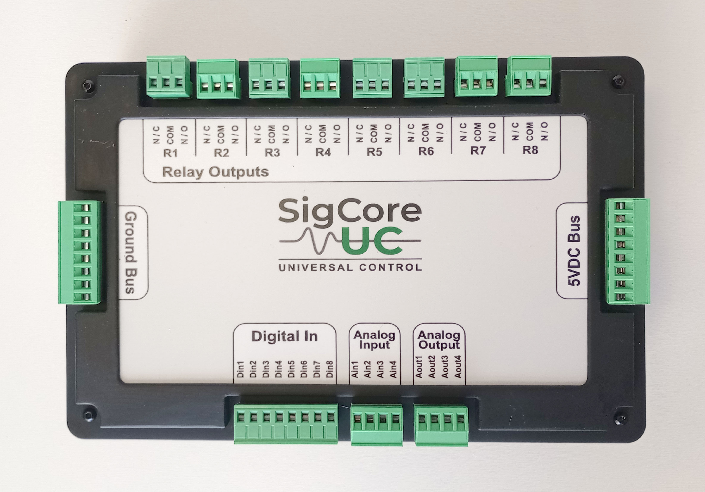
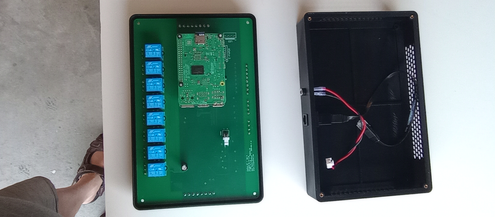
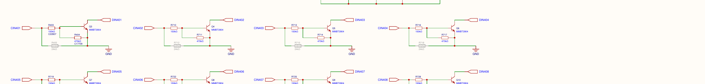
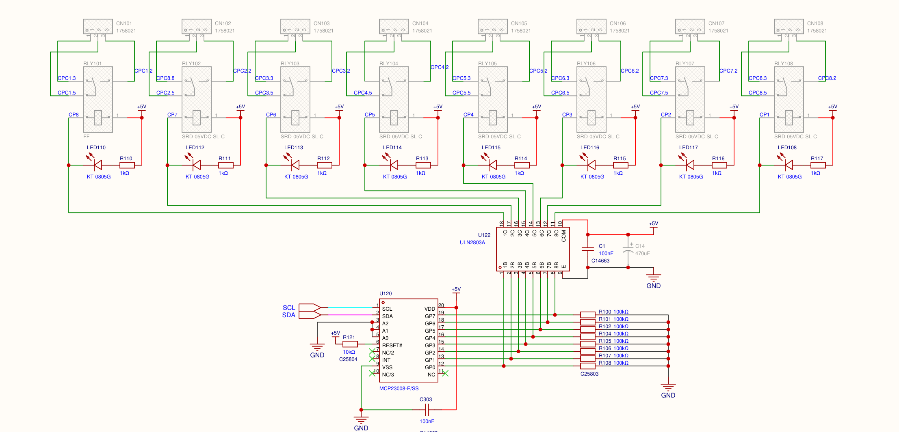

# Hardware Overview

> **Source-grounded engineering draft; not approved for customer release.** This chapter is a system-level map of SigCore UC Rev B hardware, not a substitute for connector pinouts, installation ratings, or individual subsystem specifications. Published customer information, schematic implementation, and manufacturing evidence are identified separately. A component drawn on the schematic does not by itself prove its final board population, power connection, or behavior in a shipped unit.

## 1. Controller composition and hardware boundary

SigCore UC Rev B combines a **Raspberry Pi 4 Model B** running the controller software with a purpose-built I/O board, power and signal-conditioning components, pluggable external I/O connectors, and an enclosure. The published Hardware Reference specifies **5 V DC device power**. Physical input/output signals are managed by Core through on-board peripheral devices, mostly over the Raspberry Pi's I²C interface.

A **channel** is one independently identified external signal or switched circuit. A **physical I/O channel** is distinct from an internal chip, a software control loop, a network connection, and a relay's individual contact terminals.

| External hardware group | Quantity and labels | Function | Detailed specification |
|---|---|---|---|
| Relay outputs | **8**, `R1`–`R8` | Change the continuity of separately powered field circuits through each relay's `COM`, `NO`, `NC` contacts | [Relay Outputs](Relay-Outputs.md) |
| Digital inputs | **8**, `DI1`–`DI8` | Sense digital levels from appropriately wired switches, sensors, or external circuits | [Digital Inputs](Digital-Inputs.md) |
| Analog inputs | **4**, `AI1`–`AI4` | Measure configured low-voltage or current-loop signals | [Analog Inputs](Analog-Inputs.md) |
| Analog outputs | **4**, `AO1`–`AO4` | Generate a selected 0–5 V analog or PWM control signal | [Analog Outputs](Analog-Outputs.md) |

This is **24 field I/O channels in total** (8 + 8 + 4 + 4), not 24 I²C devices or 24 directly connected Raspberry Pi GPIO pins. The four software PID loops are controller functions; they are **not four additional physical terminals**.

**Network and operator access:** The Pi hosts the on-device website and Core services and connects via its network interfaces. The separate Windows Control Panel or a customer application communicates over the network, not through a special field-I/O connector. Refer to [System Architecture](../Architecture/System-Architecture.md) for the software processes, interfaces, and connection paths.

## 2. Physical appearance and field connector groups



*Figure 1. Supplied `top-view.jpg`. Use the unit's own printed markings and the reviewed connector drawing to select terminals. This image shows connector **groups and relative placement**, not a verified pin-1 orientation, mating-connector part number, or installation wiring diagram.*



*Figure 2. Supplied `rev-b-enclosure-open.jpg`. Assembly photograph; it does not establish every populated option or the final electrical ratings of the production assembly.*

The accessible groups serve different electrical purposes:

- **R1–R8:** Each relay presents three mechanical contacts, `COM`, `NO` and `NC`. Its contact circuit is distinct from the device's 5 V control-power circuit. Do not confuse a relay *contact* with a separately powered voltage output.
- **DI1–DI8:** Eight logic-level inputs referenced to the circuit's common ground. The Rev B transistor input conditioning is **not galvanically isolated**, despite misleading wording on the source schematic.
- **AI1–AI4:** Four analog signal connections. Signal range and current/voltage selection are configured separately for each channel.
- **AO1–AO4:** Four output signal connections. Each channel can select DAC-derived voltage or PWM operation.
- **Controller power and communications:** Device power and Raspberry Pi networking are separate from the above signal types. An Ethernet port is not an I/O terminal; USB and Pi connectors should not be treated as field inputs without documented support.

**Do not derive pin order from a photograph.** Pin numbering, terminal polarity, exact ground positions, terminal wire size and mating connectors must be established in `Hardware/Connectors-and-Pinouts.md` (planned chapter) after direct drawing/assembly verification. An enclosure photograph alone is insufficient to define wiring for an energized circuit.

## 3. Hardware signal paths

The main I/O board converts between external circuits and the internal devices addressed by software. The signal paths below distinguish **electrical input**, **conversion or switching**, and **software state**.

```text
                         Raspberry Pi 4 Model B
                       (Linux + SigCore Core)
                                  |
                     I2C bus 1 (SDA/SCL)
                                  |
                  Main Rev B I/O PCB peripherals
        +-----------------+--------------------------+
        |                 |                          |
  Inputs to Core     Outputs from Core         Power/ground
        |                 |                          |
 DI1..DI8 -> NPN         MCP23008 -> ULN2803A   External 5 V DC
 conditioning ->         -> relay coils         -> +5 V rails;
 MCP23008 input          -> R1..R8 COM/NO/NC    local decoupling,
        |                                         conditioning
 AI1..AI4 -> field       MCP4728 DAC --+             |
 protection/mode                       +->         3.3 V logic,
 conditioning ->         PCA9685 PWM --+  analog    2.500 V reference
 TMUX1209 per channel    switching -> AO1..AO4   circuitry
 -> ADS1115 ADC
```

This diagram is a **functional summary**, not the complete electrical netlist. In particular, field-side grounds, analog switching, chip power domains and rail voltages require the detailed schematic. See the relevant I/O chapters for actual signal flow, polarity, inversion, conversion and timing.

### 3.1 Digital inputs

The Rev B schematic shows eight NPN transistor-conditioning stages feeding an **MCP23008** I²C GPIO expander. Core applies software polarity and debounce to the sampled electrical state. A status indication in the UI is a software interpretation of the circuit, **not electrical isolation or a guaranteed change-detection latency**.



*Figure 3. Source schematic excerpt (sheet 5); see [Digital Inputs](Digital-Inputs.md) for thresholds, pull networks, protection, debounce, and the unresolved input-voltage maximum.*

### 3.2 Analog inputs

Four **TMUX1209** per-channel analog switches and a single **ADS1115** ADC support the input range selections and measurements. An **MCP23017** output expander selects the active measurement path and switch state. The channels share the ADC but retain separate software configurations. The schematic also contains a nominal **REF3025 2.500 V reference circuit**, which must not be mistaken for a guaranteed measurement accuracy rating.

The customer Hardware Reference advertises **0–5 V, 0–500 mV and 4–20 mA** input signal classes. A separate range setting cannot make an overvoltage safe; for example, a 0–10 V sensor requires appropriately rated external conditioning per the published reference. See [Analog Inputs](Analog-Inputs.md) for exact code behavior, range ambiguities, acquisition and calibration.

### 3.3 Analog outputs

An **MCP4728 four-channel DAC** generates analog voltages, and a **PCA9685 PWM generator** provides selectable pulse outputs. Four **SN74LVC1G3157** analog switches route the selected signal mode to the four output connectors. Software configuration and PID control determine the commanded signal, but the board does not establish a universal load-current rating for a field terminal.

Published output classes are **0–5 V voltage** and **PWM**. Do not equate PWM with a filtered analog voltage or infer that a load can be powered directly by the output pin. See [Analog Outputs](Analog-Outputs.md) for mode selection, scaling discrepancies and configuration-change behavior.

### 3.4 Relays

An **MCP23008 output expander** drives a **ULN2803A low-side transistor array**, which sinks current through the eight **5 V relay coils**. The electromechanical `COM/NO/NC` contacts switch the customer's separate load circuit. Software logical state, physical coil drive and actual contact position are different concepts; there is **no independent contact-position feedback** demonstrated in the reviewed implementation.



*Figure 4. Source schematic excerpt (sheet 4), not a field terminal orientation drawing. See [Relay Outputs](Relay-Outputs.md) for the published **120 VAC / 10 A** rating limitations, COM/NO/NC behavior, startup state, inversion and outstanding fail-safe verification.*

## 4. Internal bus and component map

The schematic connects Raspberry Pi 40-pin header **GPIO2/SDA (physical pin 3)** and **GPIO3/SCL (physical pin 5)** into the I²C wiring. The source includes a **PCA9306** level-translation device and separate bus labels. Source drivers use **Linux I²C bus 1**; no customer application should assume a peripheral's internal bus address is an externally supported interface.

| Function | Device in Rev B schematic/source | I²C 7-bit address used by provided Core driver | Evidence and qualification |
|---|---|---|---|
| Relay coil controls | MCP23008 | `0x20` | `RELAY_OUT.cs`; drives ULN2803A, not the contact terminals directly |
| Digital input readback | MCP23008 | `0x21` | `D_IN.cs`; transistor-conditioned logic inputs |
| Analog input switch selection | MCP23017 | `0x22` | `A-DOUT.cs`; mux mode/address/enable output bits |
| PWM and analog-output selection | PCA9685 | `0x40` | `PCA9685.cs`, `A_OUT.cs`, `PWM_OUT.cs` |
| Analog-to-digital conversion | ADS1115 | `0x48` | `A_IN.cs` |
| Four-channel voltage DAC | MCP4728 | `0x60` | `Mcp4728Driver.cs`, `A_OUT.cs` |

All addresses are **internal implementation details from the supplied source snapshot**, not a public I²C accessory feature. Bus arbitration, initialization and ownership belong to the controller's hardware software. Code changes or a later PCB revision may change the topology.

## 5. Power, reference and protection domains

### 5.1 Documented supply and internal rails

- **Documented device supply:** **5 V DC**, as published in the Hardware Reference. The reviewed customer documentation does **not** establish an approved input-current range, allowable supply-tolerance band, peak start-up current, supply ripple limit or total system power budget.
- **Schematic main rail:** `+5V`, decoupled with local capacitors and shared ground. The main sheet depicts Pi power and board power connections and an input/transient protection component. The exact installed power-feed route and protection effectiveness require assembly review.
- **Logic interface:** The Pi-side I²C signals use the **3.3 V** domain; other peripheral circuits use board supplies and level translation as drawn. Do **not** apply a field voltage to Pi GPIO pins.
- **Analog reference:** The schematic shows **REF3025** at nominal **2.500 V**, used in analog measurement/reference routing. The reference is distinct from the 5 V supply, the ADC's programmable full-scale conversion setting, and the DAC's supply-referenced output. Its presence does not establish calibrated end-to-end accuracy.
- **Additional designed conditioning:** Schematic sheet 3 shows **LMR62421** boost-converter circuitry and **MIC5205** regulator circuitry. Whether every drawn power component is populated or active in the as-built Rev B unit is **unverified**. Do not represent its designed intermediate rail as a guaranteed external supply or promise its voltage/current at a field connector.

An external sensor or actuator may need **its own supply**. The relay contacts do not source 5 V, a 4–20 mA transmitter must not be assumed to receive loop power from SigCore, and the analog output is a **control signal**, not a general-purpose load-power source.

### 5.2 Protection and safety boundaries

The schematic includes signal protection elements such as TVS/ESD devices, local bypass capacitors, transistor interfaces, and relay drivers. Those components are **design features**, not proof of surge immunity, industrial safety certification, reverse-polarity tolerance, permissible field overvoltage, or any particular IEC/UL rating.

The **digital inputs are not galvanically isolated** on the reviewed design: their conditioning shares board ground. The **relay mechanical contacts** separate the controlled external circuit from the coil-drive logic; that fact alone does not establish a certified isolation or installation safety rating. Relay contact selection must consider the actual voltage, load type, current, inrush, PCB/terminal ratings and external protection.

**No verified system-level** environmental range, ingress-protection class, vibration rating, EMC performance, insulation withstand or hazardous-location approval was found in the supplied sources. These must not be inferred from component markings or photographs.

## 6. Physical board and assembly information

The supplied **`Gerber_BoardOutlineLayer.GKO`**, dated 2026-08-15, defines an outline extending from approximately `X=0` to `230 mm` and `Y=0` to `150 mm` (including rounded corners). Thus the **provided fabrication outline is nominally 230 × 150 mm**. This is **PCB outline evidence**, not verified enclosure external dimensions or a full installation clearance. An earlier project figure of **250 × 150 mm** needs reconciliation with the fabrication file; do not use either to machine an enclosure or prepare a mounting panel without checking the intended revision.

The photos show an enclosure, internal board and Pi assembly, surface-mounted circuitry, through-hole relays and removable field connectors. They do **not** independently establish mounting-hole coordinates, field terminal torque, wire gauges, service clearances, heat management or any regulatory installation rating. Use the eventual `Hardware/Mechanical-and-Assembly.md` (planned chapter) and `Hardware/Connectors-and-Pinouts.md` (planned chapter) chapters for verified mechanical and terminal dimensions.

The design source contains LEDs labelled **POWER** and **READY**. Their exact as-built wiring, indication criteria and startup behavior should be validated before describing them as fault/status guarantees.

## 7. Practical hardware identification and commissioning

1. Identify the **unit's actual hardware revision** and read the printed connector-group and channel markings before applying power or attaching field wiring.
2. Provide the documented **5 V DC controller supply** from a suitable external source. Obtain the approved supply-current and tolerance specification before selecting a production supply; do not infer it from the Pi model or nominal rail alone.
3. Connect the controller to the intended network and verify its identity/status through the on-device website or Control Panel. This confirms software connectivity, not the correctness of all connected electrical loads.
4. Match each sensor or actuator to the **right type** of physical interface. Record each channel, external circuit/reference and configured range/polarity/mode.
5. Verify inputs using known applied signals within the published interface limits. Check actual relay contact continuity/load response and actual analog-output signal with appropriate test instruments when needed.
6. Before unattended control, review startup/power-loss behavior and any external interlocks. Do **not** rely on the UI's relay logical state as contact feedback or on an unverified software fail-safe promise.

This is an identification checklist, **not** authorization to energize hazardous circuits without a verified wiring diagram and applicable safety practices.

## 8. What is confirmed, and what remains open

| Topic | Supported statement | Limitation |
|---|---|---|
| I/O inventory | 8 relays, 8 DI, 4 AI, 4 AO | Confirm hardware/overlay revision for the particular unit |
| Host | Raspberry Pi 4 Model B | Pi's general datasheet is not a SigCore environmental/power rating |
| Device supply | Published as 5 V DC | Current budget, tolerance and input protection not published in reviewed reference |
| I²C peripherals | Source identifies devices and addresses in §4 | Implementation evidence; not a customer-accessible bus specification |
| Board outline | Provided Aug 2026 Gerber gives nominal 230 × 150 mm | Earlier 250 × 150 mm project figure conflicts; enclosure/mounting dimensions not verified |
| Analog reference/power conditioning | REF3025 and regulator/boost circuitry appear on schematic | As-built population/routing and performance not fully verified |
| Digital input isolation | Reviewed schematic shares ground | Do not describe DI channels as galvanically isolated |
| Relay safety/fault behavior | Software exposes inversion/default/fail-safe settings | Applied fail-safe behavior and immediate inversion reapplication remain unverified until software fix is tested |

For deeper interpretation, use the specific I/O chapters linked above; the [Verification Register](../project/Verification-Register.md) is **internal development material** and is not part of the intended customer distribution.

## 9. Evidence and traceability (development-only)

- `project/sources/documentation/hardware-reference.html`: published I/O count, 5 V DC supply, interface classes, relay rating, web/Control Panel access and wiring cautions.
- `project/sources/hardware/SCH_Schematic1_2026-08-15.pdf`: **sheet 1** (Pi header, 5 V/3.3 V domains, I²C and protection); **sheet 2** (AO DAC/PWM/switching); **sheet 3** (analog input ADC/multiplexers/reference/regulator design); **sheet 4** (relay expander and drivers); **sheet 5** (DI stages/expander).
- `project/sources/hardware/Gerber_PCB17_2026-08-15/Gerber_BoardOutlineLayer.GKO`: nominal PCB fabrication bounds from mm coordinates, rounded outline.
- `project/sources/hardware/top-overlay.pdf`: channel labels and grouping; not an as-built wiring/test record.
- `project/sources/images/top-view.jpg` and `project/sources/images/rev-b-enclosure-open.jpg`: source for figures 1 and 2.
- `project/sources/SigCore-Software-Source/libs/SigCoreCommon/` source files: `HardwareManager.cs`, `D_IN.cs`, `RELAY_OUT.cs`, `A_IN.cs`, `A-DOUT.cs`, `A_OUT.cs`, `PWM_OUT.cs`, `Ads1115Driver.cs`, `Mcp23008Driver.cs`, `Mcp23017Driver.cs`, `Mcp4728Driver.cs`, `PCA9685.cs`.
- [System Architecture](../Architecture/System-Architecture.md), [Analog Inputs](Analog-Inputs.md), [Analog Outputs](Analog-Outputs.md), [Digital Inputs](Digital-Inputs.md), [Relay Outputs](Relay-Outputs.md): source-traced deeper treatments; current software source commit is not pinned.
