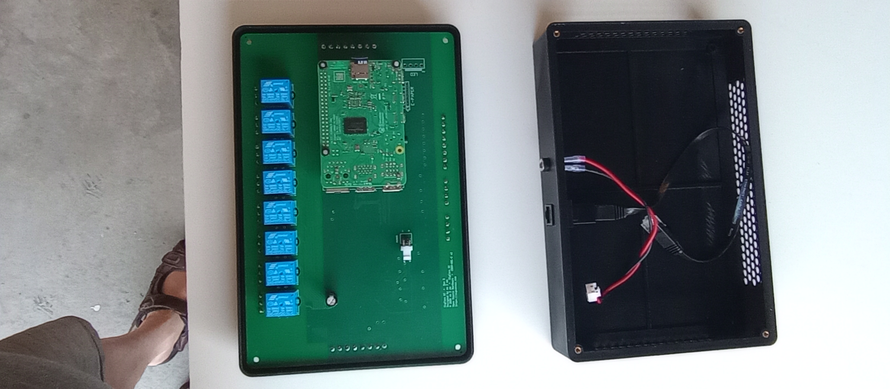
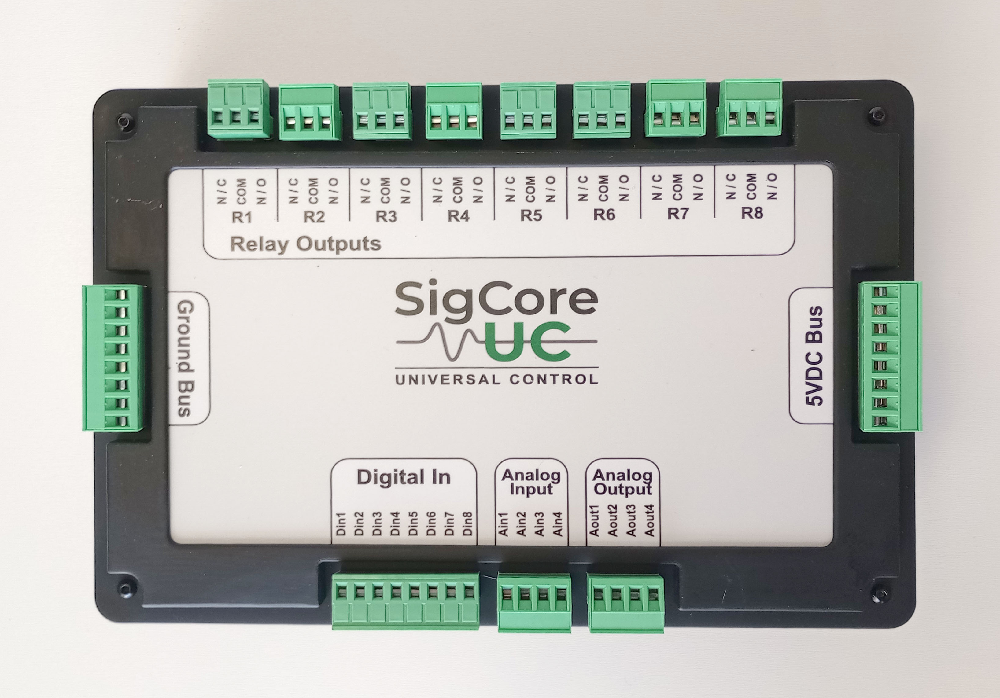
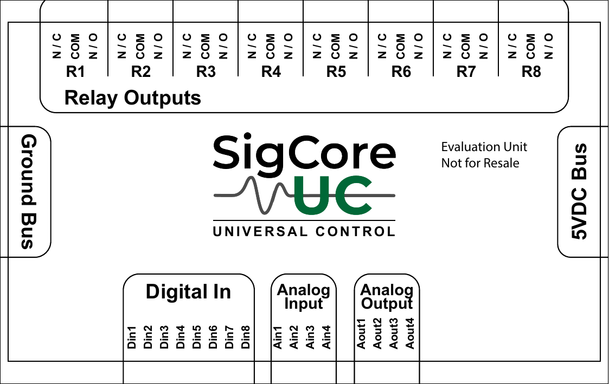

# Mechanical and Assembly

> **Engineering source draft; dimensional sign-off incomplete.** Distinguish the **fabrication board outline**, **enclosure outside dimensions**, **overlay artwork dimensions**, **mounting pattern**, and **installed clearance**. These are different measurements and must not be substituted for one another. The supplied manufacturing Gerber provides a more direct PCB-outline measurement than early planning notes.

## 1. Physical construction

SigCore UC Rev B uses a Raspberry Pi 4 Model B combined with a custom, nominally four-layer main PCB, discrete I/O and analog interface circuits, eight electromechanical relays, removable signal/contact connector groups, an enclosure and a printed top overlay.

*Figure 1. Actual evaluation/assembly photograph; design evidence for component placement only, not a mechanical clearance or production population certificate.*

*Figure 2. External view. The overlay labels relay and signal-channel groups; photographs must not be scaled to infer mounting dimensions.*

*Figure 3. Overlay artwork, **evaluation unit / not for resale**. Not an approved dimensioned drawing or evidence of production overlay material.*

## 2. PCB fabrication outline

**Direct manufacturing evidence:** `Gerber_PCB17_2026-08-15/Gerber_BoardOutlineLayer.GKO`. The Gerber declares millimeters (`%MOMM*%`) and traces an approximately **230.0 × 150.0 mm** outer rectangular extent with rounded corners. In the file the boundary is near X 0–229.997 mm and Y 0–149.987 mm, with outline arc geometry.

**Conflicting planning figure:** An earlier project summary referred to **250 × 150 mm** main-board size. Those values do not match the supplied August fabrication outline. **For this draft, use approximately 230 × 150 mm as the fabrication-outline evidence**, while leaving the final shipping-board specification pending assembly/production confirmation. Do not silently propagate the earlier 250 mm value.

| Dimension / attribute | Evidence status | Current draft statement |
|---|---|---|
| Fabrication outer PCB outline | **Direct Gerber coordinate evidence** | ~230 × 150 mm, not a measured assembled product |
| PCB layer stack | Gerber set contains `GTL`, `GBL`, `G1`, `G2` | Four copper layers in provided fabrication set; stack thickness/material and impedances not independently signed off |
| PCB corner style | Gerber boundary arcs | Rounded; manufacturing radius/board tolerance not yet approved |
| Enclosure external dimensions | No verified drawing/physical measurement in reviewed package | **Unknown**; do not substitute PCB size |
| Overlay artwork dimensions | Artwork PDF provided | Do not use for enclosure dimensions without drawing unit/scale verification |
| Mounting-hole pattern, boss dimensions | Drill/Gerber sources exist but no reviewed assembly drawing | **Not approved** as installation coordinates |
| Weight and mounting load | No verified record | **Unknown** |
| Operating temperature/IP/UL/CE | No approval evidence in snapshot | **No rating claimed** |

## 3. Connectivity and operator access

In the supplied physical layout the top/rear edge carries the eight relay terminal groups. Another edge carries the digital inputs, analog inputs and analog outputs. The overlay identifies a ground bus and 5 V DC bus, but those labels do not establish usable current, precise mating connector type or certified pin-by-pin field wiring.

The Raspberry Pi network interfaces remain separate from the field signal terminals. Use the physical assembly's Ethernet and power locations and the actual unit markings when arranging cable strain relief, service access and wire separation. Avoid routing higher-energy relay-contact wiring alongside low-level analog measurement wiring where installation guidelines or interference concerns require physical separation.

See [Connectors and Pinouts](Connectors-and-Pinouts.md). A 230 × 150 mm PCB outline alone is insufficient to specify enclosure panel cutouts, DIN mounting, terminal insertion space or installation on a machine.

## 4. Assembly sequence and service considerations

The available materials do **not** provide a production-approved assembly work instruction, torque schedule or acceptance checklist with signed dimensions. An illustrative build/check sequence for engineering review is:

1. Verify the **PCB fabrication revision**, solder-mask legend and populated component list against the intended manufacturing BOM; do not assume every drawn option is populated.
2. Inspect mechanical interfaces between main PCB, Raspberry Pi 4, relays, connectors, mounting bosses and enclosure, including solder joints and separation from the enclosure walls.
3. Verify the Raspberry Pi attachment and signal interconnect without bending or side-loading headers.
4. Inspect top overlay alignment and terminal access, ensuring printed labels correspond to the actual assembled board.
5. Verify the mating plugs seat correctly, with permitted wire size and retention. Electrical pinouts and torque need a separately approved connector/assembly record.
6. Perform non-energized continuity checks, then controlled power-up and electrical acceptance per [Installation and Commissioning](../Operations/Installation-and-Commissioning.md).

This is **an engineering review framework**, not a certified manufacturing traveler. An assembled unit should be positively identified by serial number/hardware revision and acceptance result; appearance alone cannot establish installed software version or finished state.

## 5. Field repair and modification boundaries

- Disconnect all independent supply sources, including relay-contact load circuits, before opening the enclosure or touching terminals. Unplugging the controller's 5 V supply does not de-energize separately powered contacts.
- Avoid replacing a relay, modifying a PCB trace, adjusting regulator population or tapping Pi GPIO without an approved service procedure and electrical revalidation.
- SD-card replacement, image restoration and serial-number assignment are operational manufacturing/service processes, distinct from enclosure geometry; use release-matched service documentation.
- Do not promise DIN-rail clips, display cutouts, feet, enlarged bosses or captured RJ45 tabs as current Rev B hardware merely because they occur on a Rev C improvement list.

## 6. Mechanical verification still required

Obtain/review: final as-built enclosure CAD, external dimensions, mounting hole coordinates and tolerances, structural interface to Pi, cable-entry and bending clearances, applicable plastic material and flammability, allowable orientation/environment, finished mass, mating connector drawings and mechanical fastener/wire-terminal torque. Verify board outline against a production PCB rather than assuming a particular Gerber was shipped.

**Source files:** `project/sources/hardware/Gerber_PCB17_2026-08-15/Gerber_BoardOutlineLayer.GKO` and other August Gerbers; `top-overlay.pdf`; supplied `rev-b-enclosure-open.jpg` and `top-view.jpg`. Related: [Hardware Overview](Hardware-Overview.md), [Power and Protection](Power-and-Protection.md), [Revisions and Feature Availability](../Architecture/Revisions-and-Feature-Availability.md).
