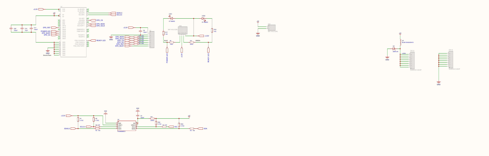
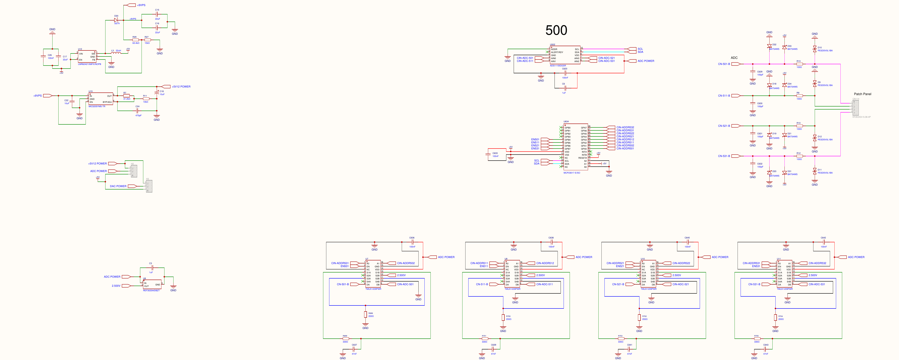

# Power and Protection

> **Engineering source draft, not an approved power-installation specification.** The public Rev B guide specifies **5 V DC device power**. It does not specify an approved current range, input-voltage tolerance, connector contact rating, supply transient requirements, external grounding scheme or protective earth installation. Do not invent those values or substitute component absolute maximum ratings for product ratings.

## 1. Power domains and loads

| Domain | Role | Source evidence / limitation |
|---|---|---|
| External **5 V DC** | Device/controller power | Published Rev B Hardware Reference and schematic sheet 1. Current demand depends on Pi, attached interface electronics, relay coils, service/USB state and transients; no signed-off 5 V/A requirement in supplied guide. |
| Pi **3.3 V** logic | Raspberry Pi 40-pin header and I²C-side logic | Sheet 1; GPIO2/SDA and GPIO3/SCL are Pi 3.3 V interface signals. |
| Board peripheral **5 V** | Relay coils, ADC/DAC/I²C/peripheral stages as designed | Schematic labels `+5V`; actual per-part rail should be taken from its pins rather than guessed from interface type. |
| Nominal **2.500 V** reference | Precision reference in analog subsystem | Sheet 3 `REF3025AIDBZT` (`U8`), named `2.500V`; do not conflate with the common +5 V supply. |
| `+9VPS`, `+5V12 POWER`, regulator/boost paths | Designed intermediate circuitry | Sheet 3 includes `LMR62421XMFX/NOPB` (`U12`) and `MIC5205YM5-TR` (`U15`); **as-built final population and routing unverified**. |
| Relay contact circuits | Externally powered switched circuits, galvanically distinct at the contacts | Relay `COM/NO/NC` is not an output of the device 5 V power distribution. See [Relay Outputs](Relay-Outputs.md). |

*Figure 1. Rev B design sheet 1 excerpt. This is circuit-design evidence, not an approved product installation drawing.*

## 2. Entry circuit and input conditioning

**Power input:** The published guide calls for a 5 V DC supply. Schematic sheet 1 draws external `+5VIN`/`+5V` distribution, Pi-related power paths, and connector/header symbols. Notes mention USB-C and an externally accessible 5 V net; those notes are not a verified instruction to connect multiple power supplies simultaneously or back-feed the Raspberry Pi.

The drawing includes:

- **`SMF6.0A` transient suppressor (`U2`)** and **`BLM21SN300SN1D` ferrite bead (`U3`)** in a drawn entry/distribution area. Their presence is evidence of intended suppression/filtering, **not** an approved maximum surge level, overcurrent trip, reverse-polarity protection, or external ESD classification.
- Local ceramic/electrolytic decoupling (`100 nF`, `10 µF`, `100 µF` classes) across documented power rails, for local transient current and noise control. Capacitors do not replace supply current capacity.
- Power/Ready LEDs on the PCB. Indicator illumination alone is not proof that all internal rails, services and I/O peripheral devices are healthy.
- I²C level translation using **PCA9306** and pull-ups; this is signal-level adaptation, not power isolation from external field wiring.

**Never infer from the presence of a TVS diode that an input is safe at every voltage below its breakdown voltage.** For example, the DI channel protection drawing does not supply a final product continuous DC voltage maximum or galvanic isolation certificate.

## 3. Analog reference and output supply sensitivity

*Figure 2. Rev B analog-system schematic sheet 3. Exact as-built boost regulator routing and final component population still require confirmation.*

The **REF3025** nominal 2.500 V reference is relevant to precision analog measurement/ranging and should be described separately from the Pi 3.3 V logic domain and the 5 V DAC supply. The **MCP4728** output rail matters to its achievable voltage range; a commanded voltage is not a guarantee of an independently measured terminal voltage. See [Analog Inputs](Analog-Inputs.md) and [Analog Outputs](Analog-Outputs.md).

The schematic includes boost and regulator circuitry and named intermediate rails. Project notes indicate a boost path may have been bypassed on later boards; the supplied files do not establish its physical configuration on every assembled device. **Treat `+9VPS` and `+5V12 POWER` as schematic net labels, not customer-accessible power specifications.**

The source evidence also does not establish continuous output-driver current capacity, noise spectral density, DAC full-scale compliance under load, or measurement accuracy over supply and ambient variation. Bench observations on a particular unit are useful but must not be generalized into a guaranteed product specification without test data and release linkage.

## 4. Power-up, loss of power and recovery

1. The Raspberry Pi boots Linux and the installed SigCore services. Core loads configuration and initializes hardware before accepting controller protocol clients in the reviewed source.
2. Relay coils are driven via the controller's 5 V domain and a ULN2803A array. When the device loses coil power, contacts return toward their **de-energized mechanical state**; actual system response depends on external wiring and power to the load circuit.
3. **Relay `NO` and `NC`** describe contact continuity relative to `COM` when the coil is de-energized; software logical ON/OFF and inversion are different. The external load may remain powered even when controller power is lost if it was wired through NC or powered independently.
4. Restoration is not equivalent to an application-level safety guarantee. The reviewed source exposes configuration properties such as startup/default/fail-safe state, but does not prove fail-safe application for every failure class. Refer to [Operating Modes and Safety](../Core-Software/Operating-Modes-and-Safety.md).
5. Forced process termination and uncontrolled power loss have different effects on Core state, output drive and persistent files. Refer to [Processes and Lifecycle](../Core-Software/Processes-and-Lifecycle.md).

## 5. Engineering deployment guidance, not a rating

Before energized operation, verify a supply's stable delivery of the **required 5 V at the controller's actual input** under worst-case documented load. Confirm the specific physical connector and polarity from the reviewed assembly drawing, including any upstream protection and mains isolation in the external power system. For inductive loads, suppress the *external* load appropriately. Keep relay contact/load power distinct from the controller power input and signal references.

Missing product-approved values that must not be guessed: 5 V supply current, input tolerance, inrush, reverse polarity, ground/shield/earth installation, expected voltage dip during relay switching, connector mating cycles and torque, power-up electrical sequencing, output default under rapid power interruption, ambient thermal rating. These belong in [Electrical Specifications](../Reference/Electrical-Specifications.md) after verification.

## 6. Source references and related chapters

- **Electrical evidence:** `project/sources/hardware/SCH_Schematic1_2026-08-15.pdf`, sheets 1 and 3; `top-overlay.pdf`; as-built status of regulator/boost is not proven.
- **Customer guide:** `project/sources/documentation/hardware-reference.html`, "Power input 5 V DC".
- **Core:** `project/sources/SigCore-Software-Source/libs/SigCoreCommon/{HardwareManager.cs,RELAY_OUT.cs,A_IN.cs,A_OUT.cs}`.
- **See also:** [Hardware Overview](Hardware-Overview.md), [Internal Interfaces](Internal-Interfaces.md), [Electrical Specifications](../Reference/Electrical-Specifications.md).
