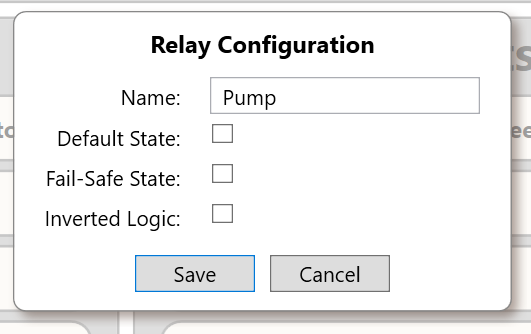
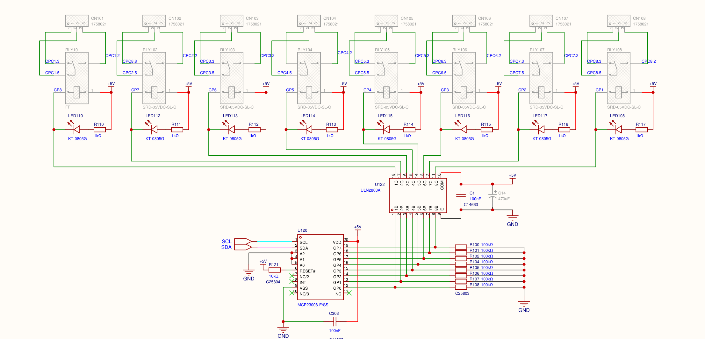

# Relay Outputs

> **Engineering source draft, not approved for customer distribution.** SigCore UC Rev B provides eight software-controlled, single-pole changeover relay outputs. The published Hardware Reference specifies a **120 VAC / 10 A** contact rating, without separate DC, inductive, or motor-load ratings. More importantly, the supplied Core stores a **Fail-Safe State** setting but does not contain a verified path that applies it during a fault. An inverted relay's API state is a **logical software state**, not an independent measurement of contact position or even a guaranteed indication of present coil energization. Do not use the software setting as a substitute for independently engineered fail-safe behavior.

## 1. Functions, naming, and sources of truth

The product has **eight relay outputs**, physically labeled **R1–R8**. Each output controls one electromechanical **single-pole, double-throw (SPDT)** contact arrangement: **COM**, **NO** (normally open), and **NC** (normally closed). These are **dry, voltage-free contacts**: they switch a customer's independently supplied circuit and do not generate an output voltage. The coil drive is internal to SigCore UC.

| Layer | Identification | What is represented |
|---|---|---|
| Device terminal / Control Panel / website | `R1`–`R8` | Eight field relay circuits |
| Public .NET API and WebBridge | `channel = 0..7` | `0` = R1; `7` = R8 |
| Core driver | `RELAY_OUT`, `_states[0..7]` | Last accepted **logical command states** |
| GPIO expander | MCP23008 at **I²C bus 1, address `0x20`** | Eight physical digital drive signals |
| Snapshot/logging | `RELAY0`–`RELAY7` | `1.0` or `0.0` from logical state, **not contact feedback** |

Evidence terminology: **published** refers to the public reference pages in the supplied documentation snapshot; **schematic** to the Rev B dated electrical drawing; **implemented** to code in the supplied source snapshot; **unverified** to claims not demonstrated for a particular shipped software/hardware combination.

## 2. Control Panel configuration screenshot



*Figure 1. Relay Configuration screenshot from the supplied public Control Panel Reference. Include this actual image inline when explaining relay properties.*

**Name** is a channel label. **Default State** configures the logical state applied on Core hardware initialization. **Fail-Safe State** is a stored configuration setting; **fault application is not found in the reviewed source**. **Inverted Logic** changes the mapping between software state and coil drive. Saving a configuration does **not**, in this implementation, immediately reconcile the currently driven coil with a newly selected inversion or default state.

## 3. Contact behavior and wiring meaning

The contact abbreviations refer to the **de-energized coil** position, independent of software labels:

| Actual coil condition | COM ↔ NO | COM ↔ NC |
|---|---|---|
| **De-energized** (including loss of relay-coil supply) | Open | **Closed** |
| **Energized** | **Closed** | Open |

**Physical contact behavior is determined by coil energization, not by the word ON in a user interface.** With software inversion enabled, logical ON can intentionally mean **coil de-energized**.

### Basic field connection

1. Identify the desired R1–R8 relay and its actual **COM/NO/NC** labels on the controller. Do not derive physical left-to-right terminal order from a conceptual contact symbol or a cropped schematic.
2. Determine whether the external circuit must **close on coil energization** (use **COM–NO**) or **open on coil energization** (use **COM–NC**). Decide separately what the external equipment must do on **controller power loss**, when the coil cannot remain energized.
3. Wire only the external circuit through those contacts. Provide its power from a separately designed source; the contact terminals are not a 5 V supply. Use appropriate circuit protection and installation practices for the voltage, current, inrush and load type.
4. Configure the logical default and inversion deliberately. Test both commands and inspect the **actual** contact/load response. For a critical installation also verify startup, restart, power removal, and the applicable fault scenarios.

**Published contact rating:** `120 VAC / 10 A` in the supplied Hardware Reference. This does **not** establish a blanket 10 A DC rating, inductive/motor-switching allowance, minimum signal current, inrush endurance, electrical lifetime, high-voltage compliance, or the application-specific derating. The PCB, terminal block, wiring, enclosure, protection and relay's load class must also be considered. Do not infer a 250 VAC or 30 V DC rating simply because such markings appear in generic Songle relay literature.

A *single* relay contact pair can signal a dry-contact input on another device. For an AC or DC load, the field supply and load must be placed in the intended switched loop. These contacts do not automatically provide safe isolation of the entire external installation; conformity and any safety-rated circuit must be established at the **system** level.

## 4. Rev B schematic: control and driver circuit



*Figure 2. Actual circuit excerpt from `SCH_Schematic1_2026-08-15.pdf`, **sheet 4 of 6**. It is a circuit reference, **not** an approved field-wiring or terminal-orientation diagram. Grey symbols/parts and the RLY101 value `FF` require an as-built BOM check.*

The intended control chain shown in the drawing is:

```text
Core logical relay state
       │
       └── apply InvertedLogic XOR mapping
                         │
                    MCP23008 GPIO (U120, I²C 0x20)
                         │   HIGH = driver channel active
                    ULN2803A (U122)
                         │   output sinks current to GND
          +5 V ── relay coil RLY10x ── driver output
                         │
                      mechanical SPDT contacts COM / NO / NC
                         │
                 independent field circuit
```

- **Eight relays**, `RLY101`–`RLY108`, route to **three-pin terminal blocks** `CN101`–`CN108`.
- **MCP23008 `U120`**, operated over I²C at `0x20`, drives the eight ULN2803A channels. `Mcp23008Driver` configures all GPIO pins as **outputs** with `IODIR = 0x00` and writes one eight-bit value to the **GPIO** register.
- **ULN2803A `U122`** provides the low-side coil-current sinks and internal suppression paths. For the drawn circuit, MCP GPIO HIGH makes the relay **energize**; LOW allows it to **release**.
- The relay coils are supplied by the board's **+5 V** rail; each drawn channel also has a green indicator LED and a nominal **1 kΩ** series resistor. The indicator circuit is wired with the coil and describes coil-drive intent, **not a measured contact state**.
- The drawing shows **100 kΩ pull-downs** on the ULN inputs to discourage accidental energization while the GPIO expander is high-impedance before software configuration. This is a hardware design provision, not a guarantee of the entire application's safe power-up state.
- The drawing includes **100 nF** local supply decoupling and a grey **470 µF** position. The actual stuffed component list has not been reconciled.
- The notes identify the intended relay type as **SRD-05VDC-SL-C**, a 5 V coil SPDT device. The first symbol, **RLY101**, is unusually marked **`FF`** rather than that type in the PDF. Confirm the actual fitted BOM before treating all relay part markings as proved.

**Critical electrical distinction:** the relay's mechanical contacts are physically distinct from its coil drive; the externally switched circuit is not directly connected to the I²C or GPIO driver nets. This does **not** establish a certified isolation voltage, creepage/clearance rating, safety-system classification, or authorization to switch every kind of hazardous voltage.

## 5. Logical state, inversion, and actual coil state

The Core stores one boolean logical state per relay in `RELAY_OUT._states`. Its conversion before writing the GPIO expander is:

```csharp
bool gpioHigh = invertedLogic ? !logicalState : logicalState;
```

On the drawn Rev B driver, GPIO HIGH energizes the coil. Consequently:

| `InvertedLogic` | Logical value commanded / reported | GPIO output | Intended coil condition | COM–NO |
|---|---|---|---|---|
| `false` (default) | `false` | LOW | Released | Open |
| `false` (default) | `true` | HIGH | Energized | Closed |
| `true` | `false` | HIGH | **Energized** | **Closed** |
| `true` | `true` | LOW | **Released** | Open |

The table assumes the output write has actually been applied and the driver, power supply, relay coil and contacts are functioning. It does **not** describe electrical feedback. **Do not equate API `true` with an energized relay when `InvertedLogic = true`.** Published .NET API text says `GetRelayAsync` returns energized state; the reviewed Core instead returns the software's **logical** state without applying the inverse transformation or reading hardware feedback.

**Inversion-change hazard:** `HardwareManager.SetRelayConfig` calls `RELAY_OUT.FromPayload` and saves the configuration. `FromPayload` updates the stored values, but neither recomputes `_states`/`IOStates` nor calls `SendOutputs()`. Therefore a configuration save changing `invertedLogic` can immediately change what the UI *implies* about the contact position **without changing the actual output drive**. A subsequent `ChangeState` recomputes and writes hardware **only when the requested logical state differs** from `_states[channel]`; repeating the unchanged logical state is a no-op. Initialization reapplies the then-current default/inversion combination. Verify actual contacts after an inversion change.

## 6. Startup, default, fail-safe, and shutdown behavior

### 6.1 Startup/default state: implemented

`HardwareManager.Initialize` loads saved `relays` configurations, then calls `RelayOut.Initialize`. Its `ApplyDefaultStates` iterates channels 0–7:

1. Take the stored `defaultState` as each channel's **logical** starting value.
2. Apply `invertedLogic` to determine the required hardware GPIO value.
3. Write the entire output byte to the MCP23008.

In a new `RELAY_OUT` object, each relay's default is `false` and inversion is `false`. Thus the nominal factory-default intention is **coils de-energized when Core initializes**. But `defaultState=false` combined with `invertedLogic=true` intentionally **energizes** the coil during the default application. Before Core has initialized the expander, separate hardware start-up behavior applies (see section 4). No guaranteed startup latency or glitch-free full-system startup test is supplied.

### 6.2 Fail-Safe State: **configured but not demonstrated as operational**

The published Control Panel Reference describes **Fail-Safe State** as a state for fault conditions. `RelayConfigPayload` and `RELAY_OUT.RelayConfig` store and serialize `failSafeState`, and both UIs expose it. However, a review of the supplied Core/server source found **no reference to the property that drives relays to that state**, and no fault handler in this source that applies all saved `FailSafeState` values. The only runtime references in the reviewed C# source read/write the configuration or verify its factory-reset value.

**Consequences:** Do **not** tell a customer that a loss of network connection, WebBridge crash, Core exception, software fault, or other event will automatically apply the configured `Fail-Safe State` unless that behavior has been explicitly implemented and verified in the deployed release. An external client's loss of connection is not equivalent to removing power from the relay coils.

**Electrical power loss:** When coil power disappears, an ordinary electromechanical relay physically returns to its unenergized contact arrangement (**COM–NC closed, COM–NO open**), subject to actual device condition. No stored software preference can override that mechanical consequence while the coil is unpowered. Choose the field wiring and any external interlocks/safety controls accordingly.

### 6.3 Commanding and factory reset

`HardwareManager.SetRelay` calls `ChangeState`; if the logical state changes, it writes the output byte and broadcasts `RelayChangeAlert`. `ChangeState` rejects channels outside `0..7`. Repeating the same logical state returns without a hardware write and without a state-change alert. The Core does not read the relay contact positions.

`FactoryResetRelays` constructs blank names and `defaultState=false`, `failSafeState=false` with `invertedLogic=false` (its class default), then commands logical false. Because a command equal to the stored logical state is skipped, **if an inversion change previously left the driven output inconsistent with the stored logical state**, that code path may not independently ensure the coil is returned to a known physical condition. This interaction requires an actual-device verification before claiming unconditional physical de-energization on factory reset.

## 7. Configuration data, defaults, and persistence

The configuration JSON exposed by the .NET `RelayConfigPayload` and WebBridge is:

| Field | Type | Meaning | New-object/default value |
|---|---|---|---|
| `channel` | Unsigned integer | Zero-based relay index `0..7` | `0` if absent; specify explicitly when writing through an API |
| `name` | String | User-visible label | `Relay1`…`Relay8` initially in the Core constructor; **factory reset clears it** |
| `defaultState` | Boolean | Logical state applied on Core initialization | `false` |
| `failSafeState` | Boolean | Stored desired fault state; **not found applied during faults in this source** | `false` |
| `invertedLogic` | Boolean | Invert logical state-to-hardware mapping | `false` |

Example payload for **R1** (illustration only):

```json
{
  "channel": 0,
  "name": "Vent Valve",
  "defaultState": false,
  "failSafeState": false,
  "invertedLogic": false
}
```

Core `HardwareManager.SetRelayConfig` saves changes through `SaveConfig` into the device configuration model's `relays` array. The reviewed device website's configuration endpoint requires **all four editable fields** (`name`, `defaultState`, `failSafeState`, `invertedLogic`) in a full configuration update, validates the requested URL channel, and does not allow changing `channel` in the submitted object. The .NET `SetRelayConfigAsync(channel, payload)` sets `payload.Channel` to the separately supplied channel index before sending.

A saved **default state** is not the same as an immediate relay command. Saving the configuration changes no coil output in the examined Core code; the default is next applied on initialization. An updated **fail-safe state** is likewise only stored unless another verified implementation actively uses it.

## 8. Operator interfaces and API

### 8.1 Desktop Control Panel

The desktop application displays a tile for each of **R1–R8**, a logical ON/OFF control, configured name, and NO/NC indications. The per-channel menu opens the configuration dialog (Figure 1). An operator click invokes `SetRelayAsync(Index, newValue)`; a change alert updates the corresponding displayed state. The `RelayControl` computes NO/NC indicators from `IsRelayOn XOR InvertedLogic`, **not from measured contact feedback**. Its **Reset All** function sends logical `false` to all eight relays. Inverted channels may therefore become **physically energized** when reset logically false; it is not a physical all-coils-off guarantee.

### 8.2 Device website

On the device website, **Control** shows eight relay toggles and NO/NC indicators. **Properties** exposes the same configuration fields. The website reads a cached live state via the PHP bridge and sends commands via:

```http
POST /api/control.php?operation=relay
Content-Type: application/json

{"channel":0,"state":true}
```

The corresponding internal WebBridge endpoint is **`POST /api/control/relay`**, with the same JSON body. In the supplied source, a successful WebBridge response includes:

```json
{"channel":0,"requestedState":true,"accepted":true,"confirmed":false}
```

Here `accepted:true` means the command was submitted over the Core connection; `confirmed:false` explicitly means this result is **not physical-state confirmation**. The website uses Core subscription/cached-state updates rather than optimistically changing the displayed command state on a click. It computes NO/NC indicators using the returned logical state plus the configured inversion, without contact sensors.

The website also proxies `GET` and `PUT` on `/api/config.php?kind=relay&channel=0` to the internal WebBridge `GET` and `PUT /api/config/relay/0` endpoints. The direct `/api/...` WebBridge paths are **internal endpoints** in the supplied architecture; browser clients use the device website's PHP routes.

For device website **readback**, `GET /api/state.php` proxies internal `GET /api/state`; the `relays` array contains eight booleans from the WebBridge's latest subscribed **logical** relay-state cache. Treat cache freshness and connection state separately. An observed state in this array does not prove a successful physical relay contact transition.

### 8.3 .NET API

Relevant methods of `SigCoreSystem` (all use zero-based `uint channel`):

```csharp
Task<bool> GetRelayAsync(uint channel);
Task SetRelayAsync(uint channel, bool state);
Task<RelayConfigPayload> GetRelayConfigAsync(uint channel);
Task SetRelayConfigAsync(uint channel, RelayConfigPayload config);

// Event (Action<uint, bool>):
RelayChanged;
```

`GetRelayAsync` and `GetRelayConfigAsync` are Core request/response reads and can time out. `SetRelayAsync` and `SetRelayConfigAsync` send commands; task completion does not independently prove that hardware operated. `RelayChanged(channel, logicalState)` reports a Core software state transition, **not a verified relay-contact sensor reading**.

Example, with an already connected `SigCoreSystem device`:

```csharp
await device.SetRelayAsync(0, true);  // Logical ON for R1, not necessarily coil ON.
bool logicalState = await device.GetRelayAsync(0);
RelayConfigPayload config = await device.GetRelayConfigAsync(0);
Console.WriteLine($"R1 logical={logicalState}, inverted={config.InvertedLogic}");
```

Before interpreting the field contact, reconcile **inversion** and confirm the actual equipment response. Do not use this API readback as a safety-rated feedback mechanism.

## 9. Practical diagnostics

| Symptom | First checks / meaning |
|---|---|
| Logical ON shown, but connected device remains off | Check **COM/NO/NC wiring**, external supply, load path, inversion, coil power, and terminal ratings. The UI does not sense actual contact closure. |
| NO/NC indicators seem reversed | Compare **Inverted Logic** setting to actual coil behavior; the visual indicators are calculated from logical state and configuration. |
| Inversion changed but hardware did not switch | In this source, saving config does not write the new GPIO value; an unchanged logical command is also skipped. Do not assume the new displayed contact position is physical. |
| Relay changes state after a Core restart | `defaultState` is reapplied during initialization, using the current inversion setting. Review the configuration and startup sequence. |
| Configured Fail-Safe State not applied on disconnect | The reviewed source does **not** implement fault-time application of that field. A disconnected UI does not imply a powered relay will drop out. |
| All relays drop out when device loses power | Expected mechanical response when coil power disappears; choose NO/NC accordingly. It is independent of software fail-safe settings. |
| Command returns but relay/load does not respond | A successful send, Core alert, or `accepted:true` response is insufficient to prove contact actuation; inspect the electrical circuit and actual output. |

**Never validate a mains-connected relay by touching terminals or probing an energized load without appropriate procedures, instrumentation and qualifications.** For significant loads, consider external interposing contactors, properly selected protection, and independently wired safety functions instead of relying solely on a software relay command.

## 10. Unresolved engineering and publication checks

1. **Fail-safe semantics:** Decide which faults, if any, are supposed to trigger the stored `failSafeState`; implement or explicitly remove/deprecate the claim, and verify each declared scenario. Do not equate browser/client disconnect with Core/device loss.
2. **Logical versus physical state:** Correct the public API wording that equates `GetRelayAsync(true)` with energization when inversion is enabled. Distinguish software command readback, coil drive and actual contact feedback.
3. **Immediate inversion reapplication:** Define whether saving a changed inversion should immediately recompute/drive the current relay; confirm transition safety and UI indicators. Reconcile the no-op on same logical command.
4. **Factory reset physical state:** Confirm that reverting inversion and asking for logical false always leaves physical coils de-energized, including state/config mismatch scenarios.
5. **Contact ratings:** Verify Rev B as-built relay model, contact load categories, maximum DC and AC limits, inrush limits, terminal/PCB path capacity and required load-specific derating. Reconcile `RLY101`'s `FF` schematic label with actual assembly/BOM.
6. **Version applicability:** Establish exact deployed software release/commit and Rev B assembly identity. The source snapshot is evidence for implementation, not proof that every customer unit runs that code.

These are specific evidence/accuracy questions. Until they are settled, preserve the distinctions in this chapter instead of inventing fault-response guarantees, contact measurements, or universal load ratings.

## 11. Source traceability (development-only)

- `project/sources/hardware/SCH_Schematic1_2026-08-15.pdf`, **sheet 4**, relay driver section, `RLY101`–`RLY108`, `CN101`–`CN108`, `U120` MCP23008, `U122` ULN2803A; source of Figure 2.
- `project/sources/documentation/hardware-reference.html`, **Switch a device with a relay** and **Specifications**: COM/NO/NC explanations, published contact rating.
- `project/sources/documentation/control-panel-reference.html`, **Relay outputs**, **Startup and fault behavior**: user-visible configuration fields and screenshot (Figure 1).
- `project/sources/documentation/api-reference.html`, **Relay outputs**: public method names and published (partly inconsistent) returned-state descriptions.
- `project/sources/SigCore-Software-Source/libs/SigCoreCommon/RELAY_OUT.cs`: logical states, inversion mapping, startup defaults, ChangeState and configuration setters.
- `project/sources/SigCore-Software-Source/libs/SigCoreCommon/Mcp23008Driver.cs`: bus access, IODIR/GPIO output writes.
- `project/sources/SigCore-Software-Source/libs/SigCoreCommon/Payloads/RelayConfigPayload.cs`: exact JSON configuration keys.
- `project/sources/SigCore-Software-Source/libs/SigCoreCommon/HardwareManager.cs`: initialization, persistence, factory reset, commands, snapshot.
- `project/sources/SigCore-Software-Source/Server/SigCoreServer/CommandDispatcher.cs`: Core relay read/write protocol handlers and change alerts.
- `project/sources/SigCore-Software-Source/libs/SigCoreCommon/SigCoreSystem.cs`: public .NET API and event dispatch.
- `project/sources/SigCore-Software-Source/ControlPanel/IOChannelHandlers/RelayChannel.cs`, `Controls/RelayControl.cs`, `MainWindowVM.cs`: desktop configuration, logical contact display, Reset All.
- `project/sources/SigCore-Software-Source/WebBridge/Endpoints/RelayEndpoints.cs`, `Endpoints/ConfigurationEndpoints.cs`, `Endpoints/StatusEndpoints.cs`, `CoreState.cs`: internal WebBridge state, config, and relay command endpoints.
- `project/sources/SigCore-Software-Source/UpdaterFiles/www/js/control.js`, `js/configuration.js`, `api/control.php`, `api/config.php`, `api/state.php`: current website distribution source, control rendering, and PHP routes.

**For a customer AI:** The development-only source archive is not distributed. Cite this KB chapter, render the two linked images when relevant, and direct customers to approved customer-facing documentation rather than unavailable internal files.
