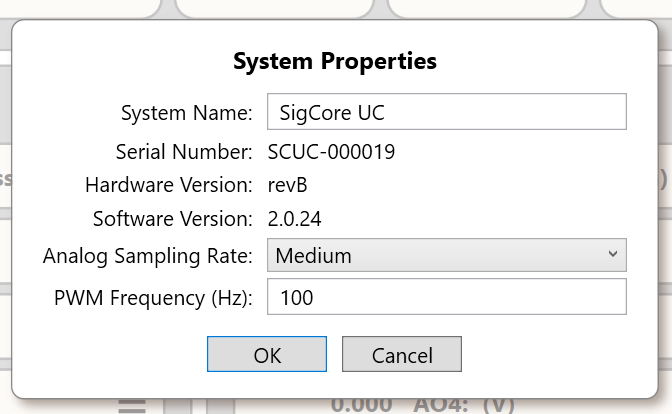

# Configuration and Restore

> **Engineering draft.** Configuration changes and restoration may immediately affect output signals or trigger process restarts. This document describes the provided application configuration paths; it does not imply that a JSON export is a complete image, a credentials-free document, or an independently verified rollback mechanism. Use [Data Model and Configuration](../Core-Software/Data-Model-and-Configuration.md) as the detailed schema authority.

## 1. Configuration versus runtime state

The supplied Rev B Core persists application settings to **`/opt/sigcore/properties.json`**. A setting such as `relay.invertedLogic` or an AO scaling factor is not itself a physical measurement. Live values (sampled AI, DI state, relay logical state, commanded AO, PID values) are process-managed state, not a full substitute for a saved configuration. The WebBridge additionally holds live-state caches and an in-memory Chart Recorder buffer; the recorder's **display configuration** persists separately in **`/opt/sigcore/webbridge-chart.json`** on Linux. Recorder history is lost when WebBridge restarts. Do not label a restored configuration as a restoration of historical data.

### 1.1 Core JSON sections

| Section | Purpose | Included in website configuration backup? |
|---|---|---|
| `global` | System name, acquisition and PWM settings; persistence varies by field | **No** |
| `network` | Hostname; Ethernet/Wi-Fi intended settings, potentially secrets | **No** |
| `relays` | Eight channels, names, default/fail-safe flags, polarity | Yes |
| `digitalInputs` | Eight channels, names, debounce, polarity | Yes |
| `analogInputs` | Four channels, signal ranges, units, calibration and averaging | Yes |
| `analogOutputs` | Four channels, signal mode, scaling, auto flag and display properties | Yes |
| `pids` | Four loop configurations, gains, limits and routing | Yes |
| `logger` | Logger configuration, host/database/user/possible credential | **Yes: sensitive** |

WebBridge's backup excludes `global` and `network`, but **includes the logger**. Therefore the backup can carry passwords or database access details. Protect exported JSON as configuration material, not as public documentation. Never include private values when showing a support example or uploading to an AI unless the customer deliberately authorizes disclosure.

## 2. Editing configuration through the interfaces

**Control Panel:** Settings dialogs edit selected channel fields and submit configuration payloads to Core. A displayed value may be stale if disconnected; verify connection and inspect channel status before/after an edit. The observed implementation can stop/restart certain acquisition/control loops during configuration updates. Saving AO configuration resets the physical AO channel to zero in the reviewed code, even for a display-only change. Relay inversion changes are the subject of a separately tracked immediate-apply bug; newer releases must be tested before the behavior is considered fixed.

**Device website:** Properties pages and administrative settings use PHP routes that forward to WebBridge. `PUT /api/config/{kind}/{channel}` expects a complete permitted channel configuration record under `config`, whereas `PUT /api/device-settings/{kind}` accepts selected fields. Do not transfer a partial-update example from one route to another; see [HTTP API and WebBridge](../Programming/HTTP-API-and-WebBridge.md).

**Direct JSON edits:** The Core `Config.Save()` method writes a temporary JSON file and replaces the target. Its `Config.IsValid()` checks overall object/array shapes more strongly than every parameter value. A structurally valid but semantically unsafe setting can pass preliminary file validation; an invalid *present* properties file can lead to defaults rather than legacy FRAM fallback. Do not recommend editing the live file manually as a normal end-user procedure.

## 3. Creating a backup

The device website's **configuration backup** endpoint `GET /api/config-backup` reads `properties.json`, filters out `global`/`network`, then returns a JSON file. Its suggested filename may contain the serial number, but that identifier is a filename suggestion rather than a copied configuration section.

Recommended operator sequence:

1. Record device serial, active software version and hardware revision separately.
2. Capture the existing network settings and relevant device identity through approved tools, **separately** from this backup, because they are omitted.
3. Use the provided website maintenance/backup function on a network whose administrative access is controlled, and save the JSON securely.
4. Verify that the file is parseable JSON with the expected section names and channel counts; do not post its secret-bearing content in a public issue or support chat.
5. Keep a dated baseline and a current, tested backup. Label the source revision and any application-specific safety assumptions.

This is **not** a device SD-card image; it does not contain the OS, active release, launcher release manifest, browser settings, WebBridge chart history or SQL database records. It is also not necessarily a portable, semantically compatible profile across hardware or software revisions.

## 4. Restoring a backup

`POST /api/config-restore` accepts a JSON object of at most **1 MiB**. In the supplied handler it rejects `global`/`network`, requires the same set of remaining section names, matching object/array categories and matching array lengths, and enforces channel identity by array position. For object-valued sections it checks matching property names. It **does not validate every numerical value or guarantee compatibility with a later software schema**. An accepted restore atomically replaces the app file and queues a delayed `sigcorelauncher.service` restart after the HTTP response completes.

**Before restore:** preserve the current known-good backup; stop or isolate unsafe field loads; verify intended channel identities and wiring; evaluate changes to relay polarity, AO mode and PID output routes; determine whether the restored logger credentials should be used on this device. The restore may result in network/API interruption and changed startup outputs when processes return.

**After restore:** do **not** treat `{ "accepted": true, "restarting": true }` as completion. Wait for the actual restart, verify the active release and Core connection, read back each critical configuration section, then perform safe functional I/O checks. A failed restart or rejected configuration file may require local recovery. If restore fails, preserve the server error and log messages without exposing credentials.

### 4.1 Common non-equivalences

| Operator expectation | Actual boundary |
|---|---|
| “Backup includes everything” | No: global and network sections are excluded; history, OS, images, releases and SQL records are separate |
| “Backup is safe to share” | No: `logger` configuration can include credentials |
| “Restore success means hardware is right” | No: response precedes restart and says nothing about external field wiring/actual outputs |
| “Same section count means compatible” | No: basic schema/shape checks do not certify all calibration ranges, limits or intended process actions |
| “Factory reset equals backup restore” | No: factory defaults and a saved user-specific profile are different operations |

## 5. Factory reset, identity and rollback

The Core has **factory-default configuration generation** and a separate `HardwareManager.FactoryReset(...)` path, which restores several I/O and PID defaults and saves properties. Its reset method preserves/sets selected identity and network parameters from arguments and updates separate device configuration records; that operation is **not** equivalent to wiping every partition, deleting logged measurements or reflashing the SD card. The reviewed sources do not prove that every user-visible factory-reset control invokes the same scope. Do not supply a destructive “factory reset” sequence unless that particular release's command and identity-preservation behavior have been verified.

If restoring a baseline, track the backup's origin and test it against the actual running release. There is no source-backed guarantee of a one-click rollback if restore is accepted but the process restart fails. Prepare a local recovery path for remote installations.

## 6. Image and related documentation

*Figure 1. System settings illustration. The names and values belong to the captured unit, not a complete backup of all configuration sections.*

See [Maintenance and Service](Maintenance-and-Service.md) for operational backup cadence and [Troubleshooting](Troubleshooting.md) for symptoms after restore. For detailed per-channel properties, see [Analog Inputs](../Hardware/Analog-Inputs.md), [Analog Outputs](../Hardware/Analog-Outputs.md), [Digital Inputs](../Hardware/Digital-Inputs.md), [Relay Outputs](../Hardware/Relay-Outputs.md) and [PID Control](../Core-Software/PID-Control.md).

## 7. Source evidence and unresolved checks

`libs/SigCoreCommon/HardwareManager.cs` (Config/FactoryReset/Set*Config); `WebBridge/Endpoints/BackupRestoreEndpoints.cs`, `DeviceSettingsEndpoints.cs`, `ConfigurationEndpoints.cs`; `WebBridge/ChartRecorder.cs`; `UpdaterFiles/www/api/*.php`; source Control Panel. All from the supplied **unversioned snapshot**.

**Engineering review:** current production schema and supported migration; whether secrets are omitted/redacted on released administrative endpoints; version compatibility of backups; confirmation of restore restart privileges; consistency of factory reset identity and field I/O states.
