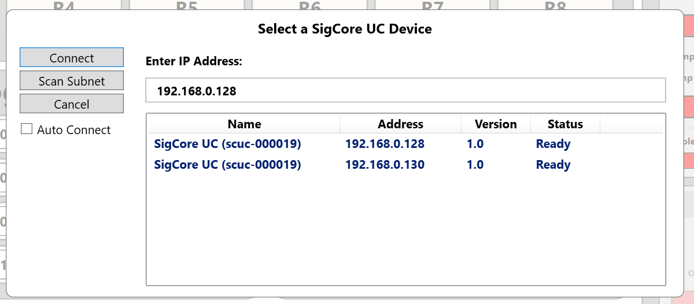

# Installation and Commissioning

> **Engineering draft, not a certified installation procedure.** This chapter combines the published first-use sequence with source-supported validation checks. It does not establish the permitted supply current, terminal ratings, enclosure environmental rating, wire torque, safety certification or final acceptance tolerances. Verify the as-shipped hardware reference before connecting field circuits. Treat examples and UI screenshots as illustrative, not universal defaults.

## 1. Pre-commissioning information

Record the device's **serial number, hardware revision, installed software version, intended host/network, intended channel assignments and responsible operator**. Keep those identifiers separate: the Raspberry Pi hardware serial, SigCore device serial number, friendly system name, network hostname and IP address are not interchangeable. The selected release's reported version is stronger evidence of active software than a version advertised during discovery. See [Hardware Overview](../Hardware/Hardware-Overview.md), [Data Model and Configuration](../Core-Software/Data-Model-and-Configuration.md) and [Discovery and Connections](../Programming/Discovery-and-Connections.md).

Before connecting actuators, establish an **externally safe test configuration**. Inputs should use signals within their published input class and separately confirmed absolute ratings; analog outputs must drive compatible signal inputs, not unverified power loads; relay contacts must switch loads only within approved *application-specific* electrical ratings. A software logical value is not proof of contact position or energized equipment state. For a first installation, test I/O with nonhazardous, independently instrumented loads or simulated field signals.

## 2. Initial setup sequence

1. **Inspect the unit and connectors.** Confirm case integrity, labels and intended power input. Do not infer terminal positions or wire sizes from photographs. Inspect for shipping damage before energizing.
2. **Connect the approved 5 V DC supply.** The published Hardware Reference identifies 5 V DC device power, but the reviewed source does not establish a complete current/tolerance/inrush specification; use a supply validated for the shipped unit. Do not apply 5 V to a field I/O terminal. Connect Ethernet as applicable.
3. **Apply power and allow startup.** The public Getting Started page says the unit boots automatically and becomes connectable after a few seconds. That statement is *not* a measured worst-case boot-time guarantee; allow longer for OS startup, network DHCP and release maintenance. A flashing or steady indicator alone is not proof Core and all peripherals are ready.
4. **Install the Windows Control Panel** from the current official SigCore UC Software download. The supplied Inno Setup installer places the executable under its selected program directory and offers to launch the application after installation. Do not use undocumented installation paths as a fixed requirement.
5. **Open the Control Panel and identify the intended device.** The UI supports discovery and, when the device-selection dialog is accessible, manual IP and subnet scan options. Match the serial/name/network address before connection. A reviewed-source defect can prevent the manual-IP dialog from appearing when mDNS finds zero devices; see the [Discovery and Connections](../Programming/Discovery-and-Connections.md) chapter rather than promising that fallback always works.
6. **Establish a Core protocol connection.** Discovery indicates a reachable candidate, not fully initialized I/O. Look for the managed client state `Connected`, then obtain fresh Core status to verify the serial, software version, hardware revision and operating health. The custom Core protocol uses **TCP 7020** in the supplied snapshot.
7. **Open the device website**, if deployed, by browsing to the device's known HTTP address. Verify that its dashboard reports a connected Core state, and use the Device/Status pages for current status. The website and Control Panel are distinct clients and can fail separately.
8. **Document the installed baseline** (identifiers, working address, selected release, configured channels and date). Save an approved configuration backup after the operating setup has been checked; the supplied website backup deliberately omits global and network identity, so do not treat it as a full-device image.

*Figure 1. Source Control Panel screenshot. The shown addresses, device names and operating state are examples.*

## 3. I/O validation sequence

| Subsystem | Initial check | Independent verification / caution |
|---|---|---|
| Digital input `DI1`–`DI8` | Inspect configured polarity and debounce, apply a known safe OFF then ON signal to **one channel at a time** | Compare actual electrical input and UI logical state; these transistor inputs are not galvanically isolated in the Rev B source drawing |
| Analog input `AI1`–`AI4` | Verify selected signal class, units, averaging and calibration; present a known source value | Compare indicated value with a calibrated source or meter; ADC rate is not per-channel update rate |
| Analog output `AO1`–`AO4` | With load isolated, select correct voltage/PWM mode, command a safe low level, then a test level | Measure output with appropriate meter/scope; configuration writes in reviewed source may reset AO output to zero |
| Relay `R1`–`R8` | Confirm COM/NO/NC wiring, nominal logical states and inversion in a de-energized field circuit | Check continuity/coil/contact response independently. Inversion changes are a separately tracked Core defect in the supplied snapshot; do not assume an applied fix until release verified |
| PID1–PID4 | Verify input/output routing, limits, auto/manual modes and setpoint before enabling | First test with a simulator or a process with independent shutdown protection; software PID is not a certified safety interlock |

Where the application is hazardous, keep its separate protective hardware active throughout checkout. Do not command a heating element, pump, valve or motor simply to demonstrate that an interface button works.

## 4. What to record as commissioning evidence

Suggested **operator test record**, not a claim that the product automatically generates a certification report:

| Field | Record |
|---|---|
| Product ID | SigCore serial; hardware Rev; active Core version; Control Panel version |
| Network | Connection method and observed hostname/IP; whether DHCP or fixed addressing |
| Setup | Supply identifier; firmware/update status; source of installer; test date |
| Channel check | Field wiring drawing reference; channel; configuration; commanded/expected value; independently observed result |
| Maintenance | Configuration backup filename and secure storage location; any changes requiring restart |
| Issues | Error messages, logs, unsupported assumptions and follow-up owner |

A green network indicator or a successful API acknowledgement is **not** a substitute for the channel-specific functional test.

## 5. First-use problems and boundaries

- **Nothing responds:** isolate unsafe loads first; verify correct 5 V power source, Ethernet or Wi-Fi connectivity, and then Core status. Do not repeatedly power-cycle a controller attached to critical equipment without an application-specific startup policy.
- **Device missing from discovery:** mDNS/DNS-SD can be filtered, addresses can change under DHCP, and the supplied Control Panel has a known zero-discovery dialog limitation. A missing advertisement is not proof of failed hardware.
- **Website opens but data are stale:** `/api/state` is a cached representation; check `connection.connected` and request fresh `/api/status` if Core is reachable. See [Status and Diagnostics](../User-Interfaces/Status-and-Diagnostics.md).
- **Outputs are unexpected:** stop unsafe field activity. Distinguish logical commands, physical drives, relay contacts and load feedback. Recheck scaling, inversion, auto-mode PID ownership and pending configuration changes.
- **A new release appears downloaded but not active:** `READY` is preparation, not proof of activation. Identify which version actually launched; see [Updates and Recovery](../Core-Software/Updates-and-Recovery.md).

## 6. Evidence and review status

Published source: `Web/public_html/getting-started.html` and `project/sources/documentation/hardware-reference.html`. Implementation: `Installer/ControlPanel/ControlPanelInstaller.iss`, `ControlPanel/MainWindowVM.cs`, `libs/SigCoreCommon/SigCoreDiscovery.cs`, `SigCoreSystem.cs`, `WebBridge/Endpoints/StatusEndpoints.cs`, `Core-Software` and `Hardware` chapters. Source paths are relative to `project/sources/SigCore-Software-Source/` except the archived reference documents.

**Requires engineering sign-off:** as-shipped power-supply limits, field-terminal pinout and ratings, revised relay polarity implementation, safety procedures, initial boot-time expectations, current Control Panel discovery behavior and release applicability.
