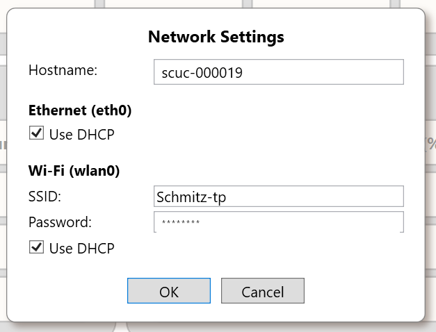

# Networking and Access

> **Engineering draft.** This chapter describes observed code paths, not an independently audited firewall, authentication or installed-network configuration. A listening port, an mDNS record or a saved networking setting does not by itself establish remote accessibility or safe exposure. See [Discovery and Connections](../Programming/Discovery-and-Connections.md) for the managed client API.

## 1. Access paths and trust boundaries

| Port/service | Device-side role | Intended caller | Verified behavior in supplied source |
|---|---|---|---|
| `_sigcore._tcp.local.` | DNS-SD/mDNS advertisement | Local-link discovery clients | Discovery code searches for SigCore records; actual advertisement/service registration must be checked on the running image |
| **7020/TCP** | SigCore Core native command/status protocol | Windows Control Panel and custom .NET clients | Server binds to `IPAddress.Any`; required handshake and subscriptions follow connection |
| **80/TCP** | Device website via Apache/PHP | LAN browser (or intentionally published demo) | Website routes and PHP bridge are supplied; deployed Apache listener/site enablement not independently verified |
| **127.0.0.1:8080** | WebBridge private HTTP API | PHP proxy on the **same device** | `WebBridge/Program.cs` binds only to loopback; do not instruct remote users to connect directly to `:8080` |
| Configured SQL server/port | Optional MySQL logging destination | Device logger / log-viewing feature | Not the control protocol or browser API; host and credentials are separately configured |

The browser-facing path is **browser → Apache/PHP on device → `http://127.0.0.1:8080` WebBridge → managed TCP client → Core on 7020 → hardware**. A failure in one stage does not prove another stage is down. An external user or program requiring the native protocol uses a **separate** connection to Core; the public PHP endpoints are not simply aliases for its wire protocol.

## 2. Device identity and addressing

Keep five fields distinct: SigCore device serial, Raspberry Pi hardware serial, system display name, OS hostname, and current interface IP. The source `NetworkSettingsPayload` contains `hostname`, `ethernet` and `wifi`; each interface config has `dhcpEnabled`, `ipAddress`, `subnetMask`, `gateway` and `dns`. Wi-Fi adds `ssid` and `psk`. A configured address is not necessarily the OS's current address: the live network can also reflect DHCP, routing, connection profile state and adapter availability.

**DHCP** is the configured factory Ethernet default in the reviewed `NetworkManager.FactoryReset`. It leaves address/mask/gateway/DNS fields empty until the network assigns values. A reservation managed at the router can preserve a stable IP without making a permanent, hard-coded controller-side address. **Static addressing** must use an IP, subnet/prefix, gateway and DNS consistent with the deployed network. Incorrect edits can make remote recovery difficult; arrange an alternate local access method before changing the interface that carries the control session.

### 2.1 Changing settings

- **Control Panel:** network settings are available through its device settings interfaces. Treat a saved configuration and the OS applying that configuration as separate events.
- **Device website:** `GET/PUT /api/device-settings/network` reaches WebBridge through PHP, then the Core network setter. The reviewed PUT handler permits `hostname`, `ethernet` and `wifi`; it allows partial fields and treats a **blank** Wi-Fi PSK as *retain the stored PSK*, not clear it.
- **Core and OS:** `HardwareManager.SetNetworkConfig()` updates `NetworkManager` and saves JSON intent; separate server OS code uses `nmcli`/`hostnamectl` to apply operating-system settings. The supplied code does not prove that every saved UI change is immediately activated or returns a verified interface state.

**Do not assume successful `accepted:true, confirmed:false` means the device is reachable on a new address.** Reconnect to the observed address and independently verify network status. Credential-bearing settings must not be pasted into diagnostics or AI conversations.



*Figure 1. Control Panel network settings UI. Values shown are examples, not recommended fixed addresses.*

## 3. Discovery versus protocol connectivity

`SigCoreDiscovery.DiscoverAsync()` searches `_sigcore._tcp.local.` and selects a reachable **IPv4** address, testing port **7020** with a 1000 ms TCP timeout per candidate. Its `Ready=true` means that socket opened, **not** that the Core handshake succeeded or all hardware is ready. The managed .NET client subsequently progresses through `Connecting`, `Handshaking`, `Subscribing` and `Connected`. A recoverable loss normally enters `Reconnecting` and repeats setup. The Windows Control Panel's source-reviewed device picker may not appear if no discovered devices were returned, which can prevent its manual IP/Scan Subnet controls from being used. This defect is tracked independently and may already be fixed in a later build.

**Network troubleshooting sequence:** (1) identify device and selected interface, (2) check host and IP on the correct VLAN/subnet, (3) test required TCP port, (4) distinguish missing mDNS from failed TCP reachability, (5) complete protocol handshake/subscription, (6) request fresh Core status, (7) test browser HTTP and PHP routing independently. Do not rely on ICMP ping alone: hosts may drop ICMP even when TCP works.

## 4. Access control and security expectations

The supplied WebBridge route registrations have no demonstrated application authentication middleware, and browser-accessible PHP proxies include writes and administrative configuration routes. In particular, the reviewed `GET /api/device-settings/network` and `GET /api/device-settings/logger` return configuration objects that can contain Wi-Fi or database credentials. The status-only `/api/network` route explicitly omits the Wi-Fi PSK; **do not infer that all similarly named routes redact secrets**.

Consequently:

1. Keep operational Core and administrative web access on an appropriately controlled network unless an exposure design has been reviewed and accepted.
2. Do **not** publish Core's TCP 7020 directly to the Internet as a generic remote-control solution.
3. Treat a public interactive demonstration as its own isolated deployment, with intentionally safe loads, scoped firewall rules, and an explicit assessment of all read/write/credential routes. Marketing email registration is **not** authentication.
4. TLS termination, firewall policy, authorization, credential redaction and OS permissions must be established for the *deployed installation*, not assumed from the presence of a website.
5. The private WebBridge port is loopback-only in this snapshot; forwarding it externally or making it listen publicly would change the security architecture.

The public-demo address-publishing/redirection plan is not a standard production device feature demonstrated by the supplied source.

## 5. Connectivity examples (diagnostics only)

Use an address the operator is authorized to test; `192.0.2.10` below is a **documentation placeholder**, not a default SigCore address.

```powershell
# Windows PowerShell: TCP reachability, not a Core protocol handshake.
Test-NetConnection -ComputerName 192.0.2.10 -Port 7020
# Browser HTTP reachability can be tested separately.
Test-NetConnection -ComputerName 192.0.2.10 -Port 80
```

A successful TCP probe does not show that application requests are valid, that the reported values are fresh, or that a relay has physically switched. For actual protocol health, use the Control Panel or a managed client and read [Status and Diagnostics](../User-Interfaces/Status-and-Diagnostics.md).

## 6. Evidence / sign-off

`libs/SigCoreCommon/NetworkManager.cs`, `Payloads/NetworkSettingsPayload.cs`, `SigCoreDiscovery.cs`, `SigCoreSystem.cs`; `Server/SigCoreServer/OsManager.cs`; `WebBridge/Program.cs`, `Endpoints/StatusEndpoints.cs`, `Endpoints/DeviceSettingsEndpoints.cs`; `UpdaterFiles/www/api/_bridge.php`; Control Panel network settings screenshot; source website. Implementation snapshot is **unversioned**.

**Open checks:** actual on-unit service configuration and firewall policy, DNS-SD registration, whether network edits cause an immediate OS apply and connectivity loss, required access controls and credential redaction, latest discovery-picker fix and shipped version identity.
