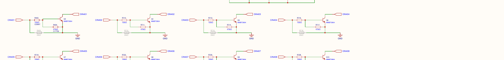

# Troubleshooting

> **Engineering draft, not a substitute for application-specific safety procedures.** Start by making the attached process safe. Do not use an unexpected heater, motor, valve, energized relay or missing input as an excuse to bypass a protective interlock. The checks below identify the **failed boundary** and the information to preserve; they do not imply every defect persists in the current released software.

## 1. First classify the symptom

Use the following order to avoid treating all communication, configuration and electrical faults as one problem:

1. **Safety boundary:** Is any external load in an unsafe state? Follow the equipment's independent shutdown/isolation procedure before diagnosis.
2. **Power and hardware:** Does the controller receive correct approved power? Is the specific channel's field signal within approved limits and wired to its intended terminal?
3. **Host and network:** Is the Raspberry Pi/network reachable? Distinguish a changing DHCP address, missing mDNS, blocked TCP port and an offline device.
4. **Core connectivity:** Has the native protocol reached managed `Connected` state, including handshake/subscriptions, or only a preliminary TCP discovery check?
5. **Interface:** Is the fault in the desktop Control Panel, browser/PHP, private WebBridge or Core?
6. **Command versus physical effect:** Does a change in logical state correspond to an independent voltage/contact/sensor measurement?
7. **Version and change history:** Did the symptom start after an update, reset, configuration change, power loss or network edit?

Write down **serial, hardware revision, active software version, client version, timestamp, channel, original settings and exact error**. Do not confuse product serial with Pi serial. Capture logs as evidence before restarting if they are transient. See [Status and Diagnostics](../User-Interfaces/Status-and-Diagnostics.md).

## 2. Symptom-to-check matrix

| Symptom | First distinctions / checks | Relevant details |
|---|---|---|
| **Controller appears dead** | Verify approved 5 V device power and supply condition at the *proper power connector*, then signs of OS/boot; do not probe unidentified field pins | [Hardware Overview](../Hardware/Hardware-Overview.md), [Installation](Installation-and-Commissioning.md) |
| **Not found automatically** | Check wired/Wi-Fi link, DHCP lease or known address, local mDNS filtering, TCP **7020**; a missing discovery entry is not a failed hardware verdict | [Networking](Networking-and-Access.md), [Discovery](../Programming/Discovery-and-Connections.md) |
| **Cannot type an IP because selection dialog never appears** | The supplied Control Panel returns early when mDNS returns zero devices; check whether running version includes the fix; do not assume Scan Subnet can be reached | [Control Panel](../User-Interfaces/Control-Panel.md) |
| **Listed as Ready but connect fails** | `Ready` can mean only that TCP 7020 opened; test protocol handshake, version compatibility and full connection state | [Discovery](../Programming/Discovery-and-Connections.md) |
| **Control Panel reconnecting/faulted** | Inspect state transition and whether server Core is actually running; `Reconnecting` differs from protocol `Faulted` | [Processes and Lifecycle](../Core-Software/Processes-and-Lifecycle.md) |
| **Device website does not open** | Test its address and expected HTTP **80**; distinguish Apache/PHP availability from Core TCP 7020; private WebBridge **8080** is loopback only | [Device Website](../User-Interfaces/Device-Website.md) |
| **Website loads but values freeze** | Inspect `/api/state` connection flag; cached values may remain from last Core notification; request fresh `/api/status` when connected | [Status and Diagnostics](../User-Interfaces/Status-and-Diagnostics.md) |
| **Configuration Save says accepted but result differs** | Check `confirmed:false`, read back the actual property and observe physical effect; writes can have hidden restarts/output resets | [Configuration and Restore](Configuration-and-Restore.md) |
| **Relay software ON/OFF differs from contacts** | Check inversion and COM/NO/NC; software state is not coil/contact feedback; polarity-change immediate-reapply bug was found in old source and is tracked as separate fix | [Relay Outputs](../Hardware/Relay-Outputs.md) |
| **Digital input inverted or unstable** | Check field common, actual voltage, configured inverted polarity and debounce; transistor stage is *not* galvanically isolated; do not assume guaranteed pulse-width capture | [Digital Inputs](../Hardware/Digital-Inputs.md) |
| **Analog input wrong or pegged** | Confirm selected range, current/voltage wiring, external transmitter, averaging and calibration; verify ADC reference and conditioning with a known signal | [Analog Inputs](../Hardware/Analog-Inputs.md), [Calibration](../Core-Software/Calibration-and-Scaling.md) |
| **All analog readings stop after setting an invalid averaging count** | A previously observed failure used zero samples and blocked scanning; later fixes introduced a validated **1–100** range and per-channel moving buffers, but source snapshot and shipping build must be reconciled | [Analog Inputs](../Hardware/Analog-Inputs.md), [Measurement Timing](../Core-Software/Measurement-and-Control-Timing.md) |
| **Analog output unexpectedly goes to zero** | Check whether an AO config write/reinitialization occurred, voltage-vs-PWM selection, scaling, PID automatic mode and load compatibility | [Analog Outputs](../Hardware/Analog-Outputs.md) |
| **PID output unexpectedly changes / wrong channel** | Verify feedback input, output routing, auto flags, limits, setpoint/ramp and concurrent writers; do not mistake controller action for a safety limit | [PID Control](../Core-Software/PID-Control.md) |
| **Chart is empty or jumps** | Check WebBridge connection and RAM process lifetime, recording interval, requested time range, gaps returned as null and resampling rules | [Logging and History](../Core-Software/Logging-and-History.md), [Device Website](../User-Interfaces/Device-Website.md) |
| **SQL logging stopped** | Check logger enabled/status, configured database host/port/schema/user, connectivity and DB-side error; chart recorder and text logs are separate systems | [Logging and History](../Core-Software/Logging-and-History.md) |
| **Restore accepted but device missing** | Restore queues Launcher restart; check new Core process/active release, then network independently (backup omitted network). Read back channel configs once reachable | [Configuration and Restore](Configuration-and-Restore.md) |
| **Updater downloaded but version unchanged** | Distinguish package downloaded, verified/installed `READY`, candidate activation on Launcher startup, probation and fallback | [Updates and Recovery](../Core-Software/Updates-and-Recovery.md) |
| **Log viewer gives 404** | Reviewed `/api/logs` serves `/tmp/sigcore-log/log.txt`; nonexistent text log returns 404. This is not a SQL database error by itself | [Status and Diagnostics](../User-Interfaces/Status-and-Diagnostics.md) |

The above is a **diagnostic index**, not a statement that all listed conditions have been reproduced in a deployed release. Confirm currently installed version before diagnosing a historical code issue.

## 3. Electrical troubleshooting boundaries

### 3.1 Digital inputs

A logical DI reading travels through external wiring, transistor protection/conditioning, the I²C expander, Core polling/debounce/inversion and the UI. Test each stage. In particular, a sensor that toggles a supply voltage is not guaranteed compatible with the chosen terminal arrangement. Do not increase input voltage to “see if it registers,” bypass the common/reference or infer input isolation from a schematic label. A multimeter may miss short transients; use appropriately rated measurement equipment when timing is the question.

*Figure 1. Circuit excerpt, not a connector pinout. See the detailed Digital Inputs chapter for transistor/polarity interpretation and unresolved voltage maximum.*

### 3.2 Analog channels

For AI: compare a known input at the terminal to the displayed value, then isolate selected current/voltage range, active mux, ADC scan, software averaging, calibration table and display format. The ADC programmed conversion rate is **not** the measured rate of each input channel. Reject values beyond an approved signal-class limit rather than assuming calibration can compensate for unsafe input voltage.

For AO: verify command mode (voltage or PWM), displayed/physical scaling direction, channel selection and an independent output measurement. The DAC output depends on its supply/reference path; a software command alone does not prove the intended voltage arrived at the connected load. Do not connect power-actuated loads directly to signal outputs without a validated driver.

### 3.3 Relays and outputs

A relay has logical state, GPIO/coil drive, and contact position; only the first is directly reported by the reviewed API. Use a properly isolated continuity/voltage check at the **contact circuit** with field power safely removed or appropriately controlled. Contact `NO`/`NC` is defined relative to de-energized state, not relative to the UI's logical ON label under inverted logic. Default/fail-safe flags in the snapshot are not independent protective shutdown proof.

## 4. Diagnostics without changing equipment state

**Preferred first actions:** get a fresh `/api/status` response where available; read `/api/connection` and `/api/state` to separate cache from Core availability; inspect the Control Panel Status dialog; save a suitable excerpt of the logs; check DHCP/router state; read back channel and PID configuration without writing anything. These are observational checks. If using a browser or API, verify the requested path and whether it is a read-only or administrative route.

The reviewed `GET /api/logs` returns at most the final **2 MiB** of the text log. A 404 means the expected file/path was not found; a 500 means the handler encountered another failure. `/api/status` returns **503** if Core is not connected and may return **502** on an upstream Core-status error. Treat the meaning of these statuses as route-specific; do not conclude a Pi power fault simply from one HTTP error.

**Sensitive material:** Database, Wi-Fi and other credentials can appear in stored configuration or administrative settings responses. Redact before copying logs, backing up for support, or uploading information to an AI.

## 5. Restart/recovery decision tree

| Observed state | Preferred next step | What not to assume |
|---|---|---|
| Desktop UI broken, Core connected elsewhere | Reopen/reconnect desktop client and inspect version | Device reboot is automatically necessary |
| Website unavailable, Core 7020 reachable | Diagnose Apache/PHP/WebBridge separately | Hardware I/O has failed |
| Core crashed or unavailable, OS reachable | Collect service logs and current release state; use approved service recovery action | Launcher can prove hardware functional just because process survives probation |
| Restored config causes different process state | Read back configuration, verify restart and safe outputs; have local recovery path | `accepted:true` means successful I/O checkout |
| Update rejected or failed probation | Inspect version disposition and Launcher fallback rather than deleting release files | `READY` or download telemetry proves upgrade active |
| Controller/OS inaccessible | Inspect physical power, network and host recovery under application-specific safe shutdown | Repeated hard power cycling is risk-free for SD storage or field loads |

No generic recommendation to change OS service permissions, erase files or reimage an SD card is justified without identifying the exact deployed build and recovering serial/network identity.

## 6. Incident record and engineering handoff

For a reproducible issue, record **steps, expected result, actual result, hardware/software version, config changes, independent measurement, connection status, timestamps, minimal logs and impact on external loads**. For an intermittent issue, log the event window and whether it correlates with relay actuation, power changes, interface reconnect, database access or a timed update. Preserve the prior behavior and attempted actions rather than repeatedly overwriting the state under investigation.

## 7. Evidence and scope

Built from `WebBridge/Endpoints/{Status,Restart,BackupRestore,DeviceSettings}Endpoints.cs`, `libs/SigCoreCommon/{HardwareManager,SigCoreDiscovery,SigCoreSystem}.cs`, `Server/SigCoreServer/OsManager.cs`, `SigCoreUpdater`, `SigCoreLauncher`, `ControlPanel/MainWindowVM.cs` and the already drafted I/O and interface chapters. These are **development snapshot** observations. Engineering review is required to retire fixed defects, confirm release-specific paths, and approve customer-facing recovery actions.
