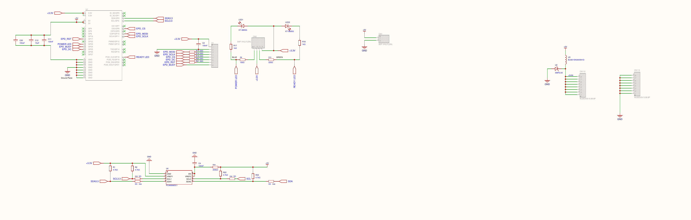
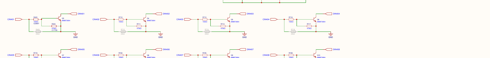
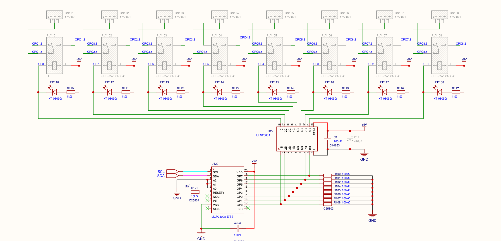
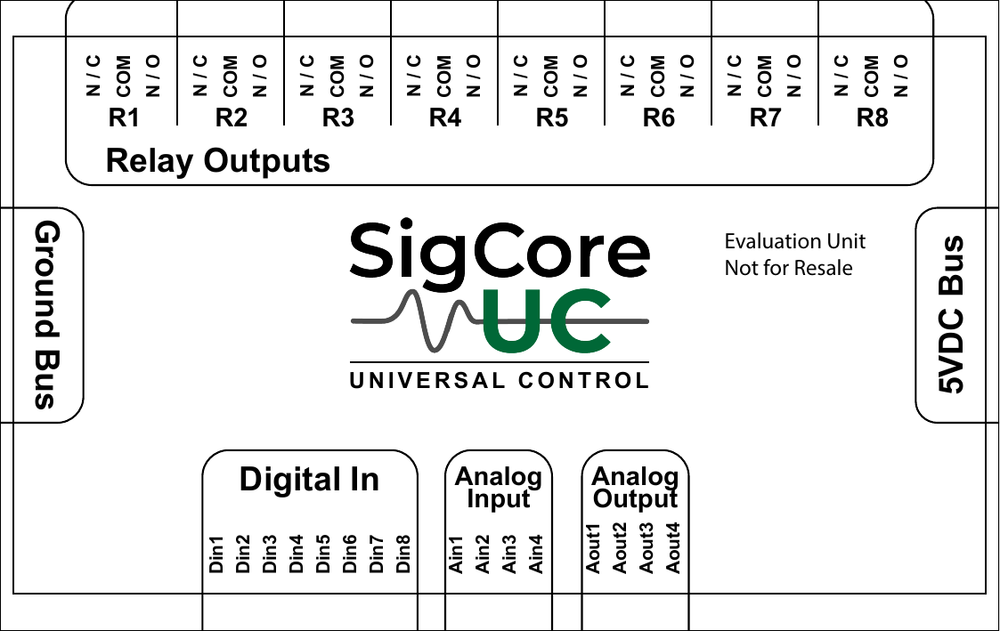

# Electrical Specifications

> **Consolidated engineering draft, not a certified rating sheet.** Distinguish (1) values expressly published for SigCore UC, (2) schematic/component design information, (3) computed examples and (4) limits not established for the assembled product. For field installation, a signed-off revision-specific specification takes precedence over this source draft. Do not infer a system rating from a component's data sheet. The hardware-reference snapshot is development evidence; the public product-site reference is the authority when the two are reconciled.

## 1. Channel and signal inventory

| Interface | Count | User labels | API channel indices | Confirmed signal function |
|---|---:|---|---|---|
| Digital inputs | 8 | `DI1`–`DI8` | 0–7 | Low/high sensing, software debounce and optional inversion |
| Relay outputs | 8 | `R1`–`R8` | 0–7 | Independent electromechanical SPDT `COM`, `NO`, `NC` contacts |
| Analog inputs | 4 | `AI1`–`AI4` | 0–3 | Selected voltage or current-path sensing, software calibration |
| Analog outputs | 4 | `AO1`–`AO4` | 0–3 | Per-channel DAC-voltage or PWM-path selection |
| PID loops (software) | 4 | `PID1`–`PID4` | 0–3 | Computed control loops, **not additional physical terminals** |

All channel names are one-based in hardware/UI labeling and **zero-based** in Core/.NET/HTTP API parameters. A data or configuration channel number does not identify a physical terminal pin. See [Connectors and Pinouts](../Hardware/Connectors-and-Pinouts.md).

## 2. Power and common reference

| Parameter | Value supported by supplied material | Evidence and restriction |
|---|---|---|
| Main controller input | **5 V DC**, nominal | Published Rev B Hardware Reference; **no system input-voltage tolerance or continuous/peak current approved** in reviewed reference |
| Internal Pi interface logic | **3.3 V** GPIO/I²C domain | Pi 4 and Rev B schematic, not an externally available customer 3.3 V auxiliary-power rating |
| Relay coil supply | Board **+5 V** domain in schematic | Coil/driver design, not a 5 V load-output specification at relay contacts |
| Precision analog reference | **2.500 V nominal**, REF3025 design | Design intent at reference device; no guaranteed complete-system accuracy, tolerance or temperature coefficient stated here |
| Other designed rails | `+9VPS`, `+5V12 POWER`, LMR62421 boost, MIC5205 | Intermediate circuit shown on schematic; final population and bypass routing **not confirmed** for shipped assemblies |
| Digital/analog input returns | Referenced to board GND as drawn | **Do not call digital inputs galvanically isolated** or assume isolated per-channel grounds |
| Relay contact power | **None internally provided** | Contacts switch an independently powered external circuit |

Required but **not established**: permitted supply-voltage range and ripple, minimum supply current/peak/inrush, permissible reverse polarity and surge, fuse behavior, auxiliary-current capacity, protective-earth scheme, regulatory/temperature/environmental ratings, and final as-built power-regulator configuration. For bench setup, size and verify the 5 V source against the actual device load and supplier-approved installation documentation, not a fabricated amperage figure.

*Design drawing, not a tested power-input rating or field pinout.* See [Power and Protection](../Hardware/Power-and-Protection.md).

## 3. Digital inputs

| Parameter | Published or verified value | Qualification |
|---|---|---|
| Channel count | **8** | DI1–DI8 |
| Input recognized OFF | **≤ 1 V** | Published threshold; do not equate with damage limit |
| Input recognized ON | **≥ 2 V** | Published threshold; do not equate with allowable maximum |
| Behavior between thresholds | **Not specified** | Do not assign a guaranteed state at e.g. 1.5 V |
| Maximum permissible steady input | **Unverified / not specified** | No justified 5 V, 12 V or 24 V terminal maximum from supplied product reference |
| Signal conditioning | NPN transistor stage per channel, MCP23008 at `0x21` | Schematic implementation; no galvanic barrier |
| Debounce | Configurable in software | No signed-off min/max input validation in snapshot |
| Input current, impedance, hysteresis, transition speed | **Unverified** | Do not derive a device specification from individual resistor values |

*Electrical input stage from the provided schematic; external signal common shares device GND.* See [Digital Inputs](../Hardware/Digital-Inputs.md).

## 4. Analog inputs

The public Rev B references describe the following **customer-facing signal classes**, which are not the same as every internal `Range` enum name.

| Published class | Published range | Implementation consideration |
|---|---|---|
| Voltage | **0–5 V** | Internally one ADC/PGA mapping uses ±6.144 V; that is **not** an extended terminal rating |
| Low-level voltage | **0–500 mV** | Source enum ranges include ±0.256 V and ±1.024 V; exact customer selection mapping requires release validation |
| Current loop | **4–20 mA** | Current path/shunt and raw-unit interpretation require final confirmation; loop power is not presumed to be supplied |
| Direct 0–10 V terminal input | **Not documented as supported** | Use verified external signal conditioning rather than select an internal enum named `Voltage10V` and assume safety |

- Multiplexed conversion: **ADS1115** at I²C `0x48`, four external AI channels selected in sequence through TMUX1209 and MCP23017 control lines at `0x22`. The 16-bit ADS1115 and programmable gain **do not establish 16-bit effective system resolution**.
- Configured ADS1115 data rates in the reviewed source: **Low 8 SPS**, **Medium 32 SPS**, **High 475 SPS**. These are converter settings, **not four-channel aggregate or per-channel sampling rates**. Driver waits of approximately 130 ms / 34 ms / 3 ms per relevant conversion stage also affect throughput.
- Nominal reference device: **REF3025, 2.500 V**; do not claim a particular achieved ADC noise, absolute precision or supply rejection from a plot alone.
- Software: piecewise/polynomial/linear calibration, units, numerical display precision, configured averaging. Actual current-version averaging logic and guardrails need checking against the installed release, because source and recent maintenance work differ.

See [Analog Inputs](../Hardware/Analog-Inputs.md), [Measurement and Control Timing](../Core-Software/Measurement-and-Control-Timing.md) and [Calibration and Scaling](../Core-Software/Calibration-and-Scaling.md).

## 5. Analog outputs

| Parameter | Supported description | Constraint |
|---|---|---|
| Channel count | **4** | AO1–AO4 |
| Voltage mode | **0–5 V nominal** | DAC command is not a measured terminal-voltage guarantee |
| DAC | **MCP4728**, 12-bit, four channels, I²C `0x60` | Do not substitute nominal code resolution for calibrated absolute accuracy |
| PWM mode | **PWM signal**, four PCA9685 channels, I²C `0x40` | Duty cycle/frequency are signal-control concepts, **not** direct heater/motor power |
| Driver/current/impedance/load capability | **Not verified at product terminals** | OPA333 buffer and analog switch symbols do not authorize an arbitrary load |
| Absolute accuracy, temperature drift, settling and ripple | **Not verified** | Board 5 V supply behavior can affect commanded analog voltage |
| Output behavior during configuration save | Source may reset AO to zero | Confirm after software fixes/version changes before using during an active process |

DAC code step by ideal arithmetic for an exactly 5.000 V full-scale span is approximately `5/4096 = 0.0012207 V` per code; this is an **illustration**, not an assertion of achieved output resolution, calibration or accuracy. The documented AO scaling formula and source differ; do not silently resolve that conflict. See [Analog Outputs](../Hardware/Analog-Outputs.md).

## 6. Relay contacts

| Parameter | Source-backed value | Caveat |
|---|---|---|
| Number/type | **8**, mechanical **SPDT** contacts | Each is one `COM`/`NO`/`NC` set |
| Published contact rating | **120 VAC, 10 A** | In supplied Hardware Reference; **not** a universal DC/inductive/inrush/motor rating |
| Coil nominal | **5 V** | Internal board-powered driver, not the contact-circuit voltage |
| Contact default on loss of coil power | `COM–NC` closed, `COM–NO` open | Actual contact mechanism; wiring must be matched to application |
| Contact feedback | **None established** | Software reports logical state, not measured continuity |
| Contact isolation/certification, derating, lifetime | **Not established for the complete assembly** | Schematic component listing is insufficient to certify a safety application |

*Circuit excerpt; not a certified field wiring map.* See [Relay Outputs](../Hardware/Relay-Outputs.md).

## 7. Mechanical and connection constraints

The supplied Aug 2026 Gerber fabrication outline is approximately **230 × 150 mm**. An earlier project planning figure gives **250 × 150 mm**; confirm a representative assembled board and enclosure before using dimensions for mounting. The provided evaluation-unit overlay identifies field groups but does **not** settle terminal-by-terminal pin-1 orientation, connector torque, wire size, clearances or enclosure installation limits.

*For channel identification, not an installation-certified connector pinout.* See [Mechanical and Assembly](../Hardware/Mechanical-and-Assembly.md).

## 8. Evidence priority and outstanding verification

For a rating question, first find an **approved public reference for the relevant hardware revision**, then check the supplied dated schematic, actual population/measurements and installed software release. If a limit is absent, explicitly answer **"not established by the available material"** rather than infer from a component or schematic label. Highest-priority sign-offs: digital-input maximum voltage; power-source amperage/tolerance; accurate connector pin map; AO load limits; relay DC/inductive ratings; as-built power routing; environmental limits. See [Known Limitations](Known-Limitations.md) and `project/Verification-Register.md` (development only).
