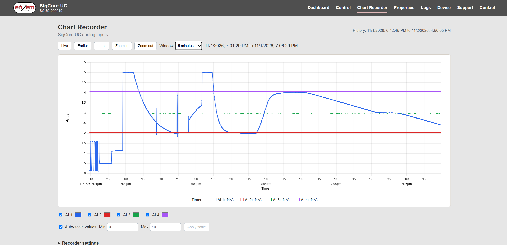

# Protocol and Data Reference

> **Implementation-derived reference, not a newly guaranteed public wire-protocol commitment.** The preferred programmatic entry points are the documented .NET client and the device website's HTTP/PHP API. The internal Core protocol is included to support troubleshooting and faithful interpretation of the supplied source. **Do not assume the same response/acknowledgment behavior for TCP and HTTP.** Confirm the installed software release before targeting exact numeric command IDs or using an undocumented field.

## 1. Transports and ownership

| Interface | Endpoint | Transport/framing | Authority and constraints |
|---|---|---|---|
| Core application protocol | Device **TCP 7020** | UTF-8 **newline-delimited JSON** objects | Owned by Core; managed .NET API is the intended client implementation |
| mDNS discovery | `_sigcore._tcp.local.` | DNS-SD/Zeroconf | Discovery metadata, not measurement or authenticated control |
| Device website | Device Apache typically **HTTP 80** | HTML and public `/api/*.php` | PHP forwards to local WebBridge; access/security are deployment-dependent |
| WebBridge internal API | `127.0.0.1:8080/api/*` | HTTP/JSON | Local/private service; not an externally supported Internet-facing API |
| Database logger | Configured MySQL server/port | SQL | Logging destination, **not** the Core API |

For architecture, see [Software Architecture](../Architecture/Software-Architecture.md), [Discovery and Connections](../Programming/Discovery-and-Connections.md) and [HTTP API and WebBridge](../Programming/HTTP-API-and-WebBridge.md).

## 2. Core TCP JSON envelope

`SigCoreProtocol.Encode` serializes a `SigCoreMessage` to JSON plus `\n`; `ClientSession` and `SigCoreClient` read a line at a time. The message object exposes these fields:

| Field | Type in source | Meaning |
|---|---|---|
| `MsgId` | unsigned 64-bit integer | Correlation identifier; matched by a reply when an operation has one |
| `Command` | `MsgType` enum (integer by default JSON serialization) | Operation or notification type |
| `Payload` | JSON object (`JObject`) | Command-specific keys and values |
| `Status` | string | Nonempty for certain error/reply conditions; not a universal success boolean |
| `Message` | string | Diagnostic text, notably on protocol error responses |

**Illustrative serialization (not a captured packet):**

```json
{"MsgId":123,"Command":5,"Payload":{"channel":0},"Status":"","Message":""}
```

`Command=5` is `GetRelay`; the corresponding `Relay` response uses command 6 and typically contains `channel` and boolean `state` with the original `MsgId`. The format is JSON, not binary Modbus frames; a separate Modbus implementation file in the source tree does **not** establish a supported customer Modbus TCP interface. Framing and version compatibility remain bound to the reviewed source.

The source declares `ProtocolVersion = 12`. Its `Connect` payload carries `version` (the server-created session announcement serializes this field as a **string**, while the client-created version is numeric), and the server evaluates compatibility with `ConnectResult.accepted`. Do not read the version field as the product software release. `Connect`/`ConnectResult` also carry session or connection details; consult the client library rather than assume raw opening-handshake order from the enum alone.

## 3. Core command/notification IDs

The values below come from `SigCoreProtocol.cs` in the supplied snapshot. They are **version-scoped**, not an invitation to change the Rev B wire protocol. Not every enum is legal from either endpoint, and many setter calls are *send-only*; see the dispatcher and managed client before constructing raw traffic.

| Value | `MsgType` | Operation class |
|---:|---|---|
| 0–8 | `None` 0, `Connect` 1, `Ping` 2, `Pong` 3, `SetRelay` 4, `GetRelay` 5, `Relay` 6, `Status` 7, `Error` 8 | Basic session/relay/status |
| 9–15 | `GetAnalogIn` 9, `AnalogInValue` 10, `AInConfig` 11, `GetAInConfig` 12, `SetAInConfig` 13, `GetDIn` 14, `DIn` 15 | Analog and digital input |
| 16–24 | `GetAOut` 16, `SetAOut` 17, `AOut` 18, `GetAOutConfig` 19, `SetAOutConfig` 20, `AOutConfig` 21, `GlobalConfig` 22, `GetGlobalConfig` 23, `SetGlobalConfig` 24 | AO and global configuration |
| 25–30 | `GetRelayConfig` 25, `SetRelayConfig` 26, `RelayConfig` 27, `GetDInConfig` 28, `SetDInConfig` 29, `DInConfig` 30 | Relay/DI configuration |
| 31–36 | `SetPIDCurVal` 31, `GetPIDCurVal` 32, `PIDCurVal` 33, `SetPIDConfig` 34, `GetPIDConfig` 35, `PIDConfig` 36 | PID state and configuration |
| 37–42 | `Subscribe` 37, `DInChangeAlert` 38, `AInChangeAlert` 39, `RelayChangeAlert` 40, `AOutChangeAlert` 41, `PIDCurValChangeAlert` 42 | Notifications |
| 43–48 | `GetFRAM` 43, `FRAM` 44, `ResetPID` 45, `GetLoggingConfig` 46, `SetLoggingConfig` 47; **48 is not assigned in reviewed enum** | Historical/legacy storage, PID reset, logger configuration |
| 49–56 | **49 not assigned**; `LoggingConfig` 50, `GetLoggingStatus` 51, `LoggingStatus` 52, `Restart` 53, `Shutdown` 54, `GetStatus` 55, `FactoryReset` 56 | Logger/device operations |
| 57–61 | `NetworkConfig` 57, `SetNetworkConfig` 58, `GetNetworkConfig` 59, `ConnectResult` 60, `FactoryResetResult` 61 | Network/session/factory reset |

**Name/number validation:** these are numeric enum values, not text-based HTTP operation strings. `Status` (7) is not `GetStatus` (55). `ConnectResult` (60) is a handshake outcome; `FactoryResetResult` (61) relates to a destructive configuration operation. `GetFRAM` exists as a legacy enum identifier even though the current architecture uses persistent JSON configuration; an enum name is **not proof** of deployed FRAM support.

## 4. Field and result semantics

| Example operation | Request `Payload` | Result / caveat |
|---|---|---|
| `GetRelay` | `{"channel":0}` | `Relay` returns `{"channel":0,"state":true/false}`; logical Core state, **not measured contacts** |
| `SetRelay` | `{"channel":0,"state":true}` | Source handler performs state change then **returns null**; do not expect a correlated success response |
| `GetAnalogIn` | `{"channel":0}` | `AnalogInValue` returns `channel` and numeric `value`, after configured processing |
| `GetDIn` | `{"channel":0}` | `DIn` returns logical processed input state |
| `GetAOut` | `{"channel":0}` | `AOut` returns configured `value` and `auto` flag; no independent terminal-voltage feedback |
| `SetAOut` | `{"channel":0,"value":2.5}` | Handler applies requested value and returns null; no hardware confirmation reply |
| `Get*Config` | Usually `{"channel":N}` | Corresponding typed config payload; use actual `.NET` payload types rather than assume one universal schema |
| `Set*Config` | Type-specific full JSON payload | May reset/reconfigure hardware; no uniform PATCH or success reply |
| `Subscribe` | Library-defined payload | Server pushes DI/AI/relay/AO/PID change alerts; not a lossless historical data transport |
| `Ping` | `{}` | `Pong` reply correlates with request `MsgId` |

Session `isCommander` is assigned for a connection in the reviewed `ClientSession`, but its actual enforcement for every command has **not** been established; do not present it as an access-control guarantee. Use `.NET` client request, timeout and reconnect handling, not a handmade simulator, for normal integrations.

## 5. Public HTTP/PHP API quick reference

**Public route names and loopback WebBridge paths are different.** Typical request flow: `client -> http://DEVICE/api/name.php -> Apache/PHP -> 127.0.0.1:8080/api/name -> Core TCP 7020`.

| Public route | HTTP verb | Main purpose / payload |
|---|---|---|
| `/api/connection.php` | GET | Managed connection status |
| `/api/state.php` | GET | Cached DI/AI/relay/AO/PID/logger state; check connected flag for freshness |
| `/api/status.php` | GET | Fresh Core status request; disconnected Core gives error |
| `/api/network.php` | GET | Sanitized network summary |
| `/api/config.php?kind=relay&channel=0` | GET / PUT | Full per-channel config; `kind=relay|di|ai|ao|pid` |
| `/api/control.php?operation=relay` | POST | `{"channel":0,"state":true}` |
| `/api/control.php?operation=analog-output` | POST | `{"channel":0,"value":2.5}` |
| `/api/control.php?operation=pid&channel=0&action=setpoint` | POST | `{"value":10.0}`; other PID action names in detailed chapter |
| `/api/device-settings.php?kind=system|network|logger` | GET / PUT | Sensitive administrative settings; **may return passwords** in snapshot |
| `/api/chart-history.php?start=S&length=L&samples=N` | GET | Resampled four-channel history, **S and L in Unix milliseconds** |
| `/api/chart-config.php` | GET / PUT | Recorder settings, including `recordIntervalSec` |
| `/api/config-backup.php` | GET | Backup download, possibly containing logger secrets |
| `/api/config-restore.php` | POST | Restore upload; `accepted`/`restarting` does not prove recovery |
| `/api/restart.php` | POST | Request OS restart, not completion proof |

The reviewed output-control HTTP endpoints return a body with `accepted:true` and `confirmed:false` following a send-only Core operation. This explicitly **does not mean physical actuation was verified**. HTTP request errors may be **400** invalid arguments, **502** Core command failure, **503** Core disconnected, or endpoint-dependent **404/500**; clients must inspect status and returned `error`. Do not assume every route uses identical JSON formatting.

## 6. Chart Recorder history wire data

`/api/chart-history.php?start=...&length=...&samples=...` uses **Unix milliseconds** for `start` and `length`, with `samples` from **1 through 10,000** in reviewed code. The response includes `start`, `length`, `samples`, `intervalMs`, `firstRecordedMs`, `lastRecordedMs`, and `data`. `data` is a matrix of five parallel arrays: `[time[], AI1[], AI2[], AI3[], AI4[]]`. **Time values inside `data[0]` are Unix seconds**, despite millisecond request arguments. Data missing one/both neighbors or nonfinite measurements become JSON `null` rather than literal `NaN`. Buckets use the most recent raw sample in that bucket or interpolate if a bucket has no direct measurement and two valid bounding points. The resulting array **is not a raw lossless measurement export**.



## 7. Response, freshness, limits and compatibility

- `200 OK` or command transmission is not physical confirmation; verify critical outputs with a separate sensor/measurement.
- Live values from WebBridge `/api/state` may survive disconnect in cache. Distinguish `connection.connected` and request freshness from measured I/O.
- The installed public website uses **HTTP** in the supplied deployment concept. Do **not** infer TLS, access-control policy or safe Internet exposure from a working URL.
- Common WebBridge JSON write bodies have a **16 KiB** limit in the reviewed helper; restore has a separate **1 MiB** limit. These are software input limits, not electrical ratings.
- PID command/config and Core protocol details should be implemented using documented client methods. The **Rev B no-protocol-change policy** is a project plan, not proof that every older client is compatible with every device image.

## 8. Evidence

Code: `libs/SigCoreCommon/SigCoreProtocol.cs`, `SigCoreClient.cs`, `SigCoreSystem.cs`, `Payloads/*.cs`; `Server/SigCoreServer/ClientSession.cs`, `CommandDispatcher.cs`; `WebBridge/Endpoints/*.cs`; `UpdaterFiles/www/api/*.php`. Customer-oriented explanations: [DotNet API](../Programming/DotNet-API.md), [HTTP API and WebBridge](../Programming/HTTP-API-and-WebBridge.md), [Python Integration](../Programming/Python-Integration.md). All implementation claims require reconciliation with the deployed release before publication.
