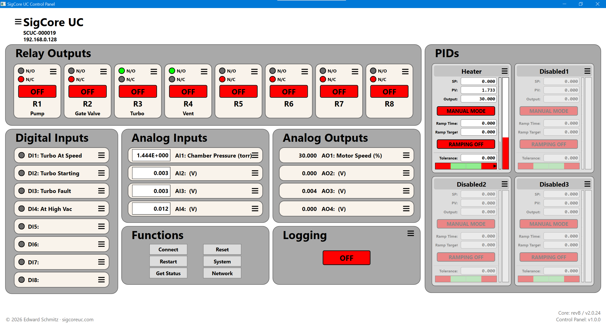
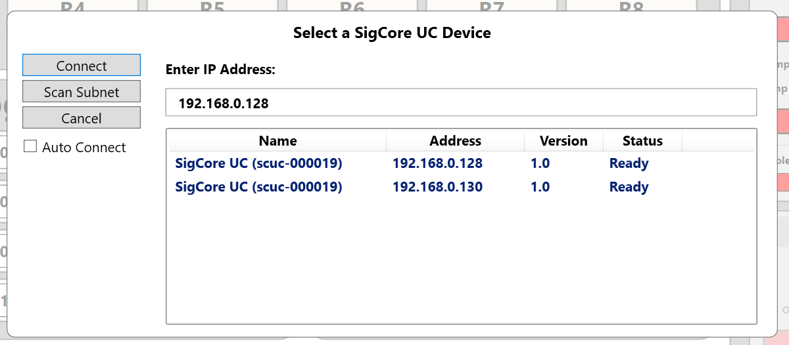
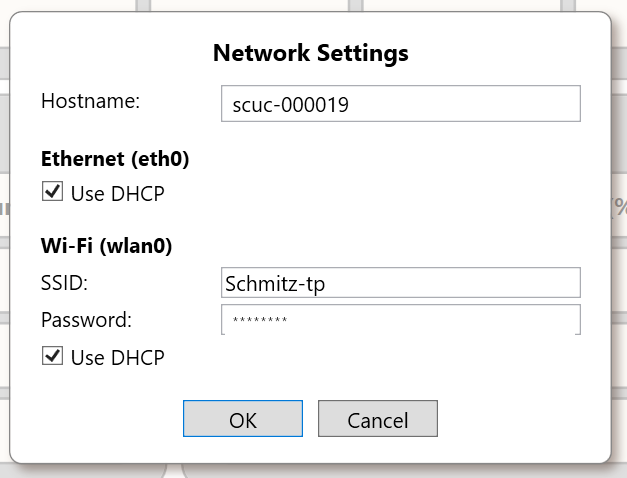

# Control Panel

> **Source-grounded first draft requiring engineering review.** The Windows desktop Control Panel operates a SigCore UC over Core's TCP protocol. It is **not** the device's internal website and does not run the real-time hardware loops. Screenshots document one captured software version; addresses, names, readings and values shown are illustrative. For the human-oriented current UI instructions, the public **Control Panel Reference** on the SigCore UC product website remains the primary reference.

## 1. Main window

The main view groups eight **relay outputs**, eight **digital inputs**, four **analog inputs**, four **analog outputs**, four **PID controllers**, and a Functions/Logging area. Device identity includes system name, serial and connected address; the footer/view model presents Core revision/version and the Control Panel version after connection. The numeric channel number determines the hardware endpoint; a custom label is descriptive and may be changed independently.

| Region | Read/actuate behavior | Configuration entry |
|---|---|---|
| Relay Outputs R1–R8 | Shows reported logical state; operator can issue ON/OFF commands | Relay Configuration: name, default state, fail-safe state, inverted logic |
| Digital Inputs DI1–DI8 | Read-only reported states | Name, debounce and inversion |
| Analog Inputs AI1–AI4 | Read-only live scaled values with units/precision | Input range, averaging, scaling/calibration, formatting |
| Analog Outputs AO1–AO4 | View output and set requested value when manual control is allowed | Output mode, display, units, scaling and automatic control settings |
| PID1–PID4 | View PV, setpoint, output and automatic/ramp controls | Tuning, source, destination, limits and related properties |
| Functions / Logger | Connection, status, restart, reset, global, network and logger settings; logger state | System/Network/Logger dialogs |

The actual controls are implemented in `ControlPanel/Controls/`, channel handlers in `IOChannelHandlers/`, and application actions in `MainWindowVM.cs`. Do **not** equate a UI state indicator with independent physical contact or sensor verification. See [Relay Outputs](../Hardware/Relay-Outputs.md).

## 2. Connecting

1. Select **Connect** in the Functions area. The application attempts mDNS/Zeroconf discovery of `_sigcore._tcp.local.` and checks whether each discovered IPv4 address accepts TCP port **7020**.
2. Select the intended controller and verify its name, IP and, where available, version. The dialog also has a manual address field and an **ARP-based** Scan Subnet facility.
3. Start the managed connection. The client's stages include `Connecting`, `Handshaking`, `Subscribing`, `Connected`, `Reconnecting`, `Faulted`, and `Disconnected`.
4. Confirm the main window shows the correct device serial and connected status **before issuing output commands**.

The `UserPrefs` model stores the last IP and auto-reconnect preference. The view model may automatically connect using the saved IP on startup, and the managed SigCoreSystem client reconnects after transient loss. **Important version-specific limitation:** In the reviewed `MainWindowVM.DiscoverSigCore_ClickAsync()`, zero mDNS results cause the dialog **not to open**, so its manual IP field and subnet scan are not reachable through that path when discovery finds no eligible device. The dialog can accept a typed address when it is open, but an absent discovery list does not guarantee the operator can reach it. This needs correction/verification before publishing manual-IP recovery as universally available.

For discovery API behavior and diagnosis, see [Discovery and Connections](../Programming/Discovery-and-Connections.md).

## 3. Live operation and output commands

The Control Panel subscribes to Core events and updates displayed values through `OnAnalogInChanged`, `OnDigitalInChanged`, `OnRelayChanged`, and `OnAnalogOutChanged` (in `MainWindowVM.cs`). Command methods send requests to Core and do not themselves create physical sensor feedback. When Core marks an analog output as automatic, the Control Panel disables its manual value control.

**Reset All** as implemented in the snapshot attempts to command all eight relay logical states `false`, all four analog outputs `0`, and all four PID automatic flags `false`. These are asynchronously dispatched commands; this is **not** a hardware emergency-stop guarantee or a safe de-energization sequence for arbitrary connected equipment. Relay polarity and contact wiring can make a logical `false` command energize a coil or external load. Review the physical plant before using this function.

The **Restart** action presents a confirmation, sends Core's restart request and expects the managed client to reconnect. It is not the same as restarting only the Windows UI. Confirm whether the Core restart request reboots the device OS for the deployed release before describing its scope to customers.

## 4. Configuration dialogs

Individual tile menus launch type-specific dialogs. A normal workflow is to select the correct numbered channel, inspect existing settings, edit intended properties, and choose **Save**, which submits configuration via the SigCoreSystem client. **Cancel** abandons unsaved dialog changes. Changes to configuration can immediately affect I/O processing; an operator should not assume that edits are display-only.

Relevant existing detail: [Analog Inputs](../Hardware/Analog-Inputs.md), [Analog Outputs](../Hardware/Analog-Outputs.md), [Digital Inputs](../Hardware/Digital-Inputs.md), [Relay Outputs](../Hardware/Relay-Outputs.md), [PID Control](../Core-Software/PID-Control.md) and [Calibration and Scaling](../Core-Software/Calibration-and-Scaling.md). Those chapters track unresolved implementation discrepancies, including AO scaling and relay inversion; do not override them with a screenshot's implied behavior.

### 4.1 Global and network settings

Global/System Properties identify the device and include configured analog sampling rate and PWM frequency. Network settings expose hostname plus Ethernet and Wi-Fi addressing (DHCP or static), Wi-Fi SSID, and credential entry. A network edit can disconnect the current client and may require rediscovery or use of a new address. Do not treat configured static IP fields as the active interface IP while DHCP is enabled. Use [Data Model and Configuration](../Core-Software/Data-Model-and-Configuration.md) for persistence semantics.

### 4.2 Logger configuration

The logging controls show runtime logger status and configuration for enabled, interval, database server/port, schema/table and credentials. In `MainWindowVM`, the `IsLogging` setter performs an asynchronous GetConfig followed by SetConfig; avoid assuming every failure is surfaced synchronously to the UI. The reviewed Core's MySQL logger source has unresolved hard-coded-credential behavior; a correctly filled-out dialog does **not** prove the deployed process honors all connection settings. See [Logging and History](../Core-Software/Logging-and-History.md) and project verification item KB-040.

## 5. Status and connection indicators

The **Status** command requests a Core status payload, copies the JSON string to the Windows clipboard and displays it in a modal Status dialog when nonempty (`MainWindowVM.GetStatusAsync`). This permits support to capture device/system diagnostics. Status values are reported facts from the device at the time of request; they are not an external health test of every field circuit or load. [Status and Diagnostics](Status-and-Diagnostics.md) details fields and failure interpretation.

The Control Panel connection label is an application state machine: `Connecting`, `Connected`, `Reconnecting`, `Connection Fault`, or `Not Connected`. `Connected` incorporates transport connection plus protocol handshake and subscription completion; a disconnected desktop client does not by itself mean the controller stopped controlling its outputs.

## 6. Troubleshooting

| Symptom | Recommended next check |
|---|---|
| Device not discovered | Confirm power/network, multicast reachability and mDNS advertisement; try a known address using an available manual connection path; source snapshot's zero-result dialog limitation applies |
| UI says `Reconnecting` | Check address, Core TCP 7020, network changes and controller restart; do not click output controls based on stale displayed states |
| Some values unchanged | Check subscribed connection state, Core acquisition, channel configuration and physical input; do not assume a stationary sensor value is a stalled connection |
| AO manual control disabled | Inspect AO automatic/PID ownership and mode; do not force a manual write without understanding active control |
| Output action did not affect load | Compare logical command, inversion, relay contacts, physical wiring or AO mode; verify on the device with appropriate procedures |
| Logger configured but no rows | Check actual deployed logger process, database reachability/rights and backend credentials defect noted in review |
| Status unavailable | Confirm Core connection, not merely that the Windows window is open |

## 7. Engineering review items

- Check the zero-discovery path so manual address entry remains reachable.
- Verify auto-connect preference and connection dialog behavior for the shipping installer, including resume from Windows sleep.
- Confirm action confirmation and error propagation for Reset All and asynchronous logger commands.
- Reconcile Control Panel labels and actual Core behavior after the immediate relay inversion fix and AO scaling review.
- Confirm safe operation and credential handling in the logger/network UI; retain screenshots without sensitive values.
- Pin the exact Control Panel build/installer version for these screenshots and behavior descriptions.

## Evidence inventory

`ControlPanel/MainWindow.xaml`; `ControlPanel/MainWindowVM.cs`; `ControlPanel/Dialogs/SelectSigCoreDlg.xaml.cs`; `ControlPanel/Dialogs/NetworkSettings.xaml`; `ControlPanel/UserPrefs.cs`; `ControlPanel/IOChannelHandlers/`; `ControlPanel/Controls/`; `libs/SigCoreCommon/SigCoreDiscovery.cs`; current public product-site `Web/public_html/reference/control-panel-reference.html` (human-oriented source); actual images copied from `project/sources/documentation/images/`. Paths are development-evidence paths, not external customer requirements.
